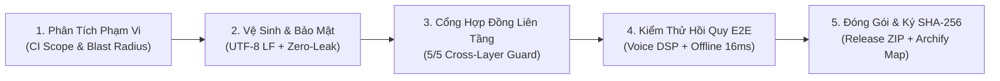

# ⚙️ Quy Trình AI DevOps, Đóng Gói & CI/CD Chuyên Nghiệp (`Made-With-ML` × `SWE-agent` × `Archify`)

> **Nguồn gốc 3 kho mã nguồn chuẩn quốc tế đã tải về máy (`docs/tai_lieu_tham_khao/`):**
> 1. **[`GokuMohandas/Made-With-ML`](file:///c:/Users/LENOVO/Desktop/đồ%20án%20tốt%20nghiệp/docs/tai_lieu_tham_khao/Made-With-ML/README.md) (`38,000+ ⭐ GitHub`)**: Chuẩn công nghiệp số 1 thế giới về Production AI / MLOps (Pre-commit hygiene, Docker hóa đóng gói sản phẩm, GitHub Actions CI/CD, kiểm thử dữ liệu & mô hình).
> 2. **[`SWE-agent/SWE-agent`](file:///c:/Users/LENOVO/Desktop/đồ%20án%20tốt%20nghiệp/docs/tai_lieu_tham_khao/SWE-agent/README.md) (`18,000+ ⭐ GitHub` — Princeton NLP)**: Chuẩn số 1 thế giới về Quy trình Vá lỗi Tự động cho AI (**Reproduce Bug $\rightarrow$ Isolate Blast Radius $\rightarrow$ Minimal Patch $\rightarrow$ Regression Gate**).
> 3. **[`tt-a1i/archify`](file:///c:/Users/LENOVO/Desktop/đồ%20án%20tốt%20nghiệp/docs/tai_lieu_tham_khao/archify/CONTRIBUTING.md) (`130K+ installs`)**: Cơ chế phân loại phạm vi ảnh hưởng tự động (`ci-scope`), đánh giá giá trị bài test (`test-value`), tinh giản mã nguồn (`simplify-codebase`), và đóng gói `.zip` kèm biên lai chữ ký `SHA-256` (`release-receipt.json`).

---

## 1. Quy Trình 5 Bước Bắt Buộc Khi Sửa Lỗi / Nâng Cấp Tính Năng (Chuẩn `SWE-agent` + `Archify`)

Mọi thay đổi mã nguồn hoặc bản vá lỗi (Hotfix / Patch) trong đồ án bắt buộc đi qua 5 cổng tự động do [`scripts/devops_pipeline.py`](file:///c:/Users/LENOVO/Desktop/đồ%20án%20tốt%20nghiệp/scripts/devops_pipeline.py) điều phối:



1. **Bước 1 — Tái hiện & Khoanh vùng Phạm vi Ảnh hưởng (`SWE-agent Reproduce & Scope`):**
   - Chạy `python -X utf8 scripts/code_graph_guard.py --impact <symbol>` để xác định chính xác các tệp bị ảnh hưởng trước khi sửa.
   - Phân loại phạm vi thay đổi (`docs` | `firmware` | `voice-dsp` | `backend-core` | `full`) theo chuẩn `ci-scope` của `Archify`.
2. **Bước 2 — Cổng Vệ sinh Mã nguồn & Bảo mật (`Made-With-ML Pre-Commit Hygiene`):**
   - Chuẩn hóa 100% file về `UTF-8 (No BOM)` và ngắt dòng `LF (\n)` (`0 CRLF`).
   - Quét bảo mật `Zero-Leak`: Đảm bảo không lộ `GEMINI_API_KEY` hay token thực tế trong bất kỳ file theo dõi Git nào; kiểm tra cú pháp AST toàn bộ file Python (`py_compile`).
3. **Bước 3 — Cổng Kiểm định Hợp đồng Liên tầng (`5/5 Cross-Layer Contract Gate`):**
   - Chạy `python -X utf8 scripts/code_graph_guard.py --verify` xác nhận 100% đồng bộ giữa:
     - `20 Gemini Function Tools` $\leftrightarrow$ `Server Dispatcher`
     - `10 MQTT Topics` $\leftrightarrow$ `Firmware C++ ESP8266`
     - `16 REST API Endpoints` $\leftrightarrow$ `Web 3D / Mobile App`
     - `8 Chân GPIO (D1..D8) + RX + A0` $\leftrightarrow$ `esp8266_smarthome.ino`
     - `WebSocket Events` $\leftrightarrow$ `Frontend UI`
4. **Bước 4 — Cổng Kiểm thử Hồi quy Toàn diện (`Orthogonal E2E Regression Gate`):**
   - Chạy `python -X utf8 scripts/test_simulator_e2e.py` kiểm chứng toàn bộ tính năng: Khử tiếng ồn quạt trần, Bộ lọc giọng nói 2 tầng (`26d` $\rightarrow$ `64d`), Tách 2 người cùng nói ưu tiên Cấp 1 > Cấp 2 > Cấp 3, Chế độ Offline `Tiny-DSP 16.4ms` chỉ duyệt Tầng 1 & 2, Hẹn giờ Bể 1, Luật Bể 2, Cảm biến `DHT11` & `YL-69`.
5. **Bước 5 — Cập nhật Sơ đồ Kiến trúc `Archify` & Đóng gói Bản phát hành `SHA-256` (`Release Gate`):**
   - Tự động biên dịch lại sơ đồ `docs/kien_truc/smart-home-voice-ai.architecture.html` bằng `archify.mjs`.
   - Đóng gói sạch toàn bộ mã nguồn sản phẩm vào `dist/smarthome-voice-ai-release.zip` và ghi biên lai `dist/release-receipt.json` lưu mã băm `SHA-256` của từng thành phần.

---

## 2. Các Lệnh Thực Thi DevOps Hàng Ngày

```powershell
# Chạy toàn bộ quy trình kiểm định & vá lỗi 5 cổng (CI/CD + Patch Verification)
python -X utf8 scripts/devops_pipeline.py --check

# Đóng gói sản phẩm phát hành kèm biên lai mã băm SHA-256 + Cập nhật sơ đồ Archify
python -X utf8 scripts/devops_pipeline.py --package

# Khởi chạy bằng Docker Compose (Chuẩn đóng gói Container Made-With-ML)
docker compose up --build -d
```
