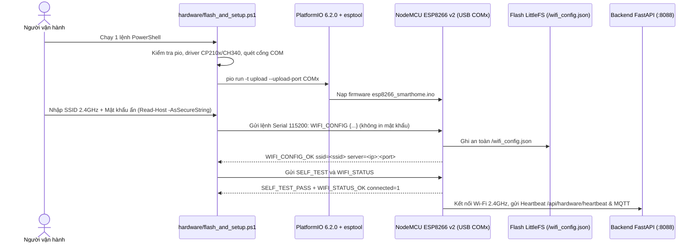

# Hướng Dẫn Thống Nhất: Nạp Firmware USB & Cài Đặt Wi-Fi Runtime Cho ESP8266

> **Tài liệu chuẩn duy nhất (Canonical Guide):** Toàn bộ phần mềm máy chủ (`backend/`), giao diện Web 3D (`web/`), ứng dụng Android (`app/`) và firmware ESP8266 (`firmware/`) đã hoàn thiện **100%**. Khi có bo mạch **NodeMCU ESP8266 v2 Amica** thật trên tay, bạn chỉ cần làm đúng **3 bước** trong tài liệu này: **Cắm cáp Micro-USB $\rightarrow$ Chạy 1 lệnh PowerShell nạp firmware & nhập Wi-Fi runtime $\rightarrow$ Cấp nguồn `5V 2A` là hệ thống hoạt động hoàn chỉnh.**

> **Nguyên tắc bảo mật bắt buộc:** Tuyệt đối **KHÔNG** ghi mật khẩu Wi-Fi, tên mạng bí mật hay `HARDWARE_API_KEY` vào mã nguồn `firmware/esp8266_smarthome/esp8266_smarthome.ino` hoặc đẩy lên Git. Mọi thông số Wi-Fi được nạp lúc chạy (runtime) qua cổng Serial USB và lưu cục bộ trong bộ nhớ Flash **LittleFS** (`/wifi_config.json`) của chip ESP8266.

---

## 1. Kiến Trúc Lưu Cấu Hình Wi-Fi Runtime (Không Hardcode Mật Khẩu)



### Tại sao dùng Wi-Fi Runtime qua USB thay vì hardcode hay Captive Portal?
- **An toàn tuyệt đối cho Git:** Mã nguồn `esp8266_smarthome.ino` không bao giờ chứa thông tin nhạy cảm; khi đổi router hoặc mang đi bảo vệ đồ án ở trường chỉ cần cắm USB và nhập lại Wi-Fi trong 10 giây (không cần sửa code hay biên dịch lại).
- **Tự kiểm tra tức thì (`SELF_TEST` + `WIFI_STATUS`):** Script tự xác nhận đủ 10 chân phần cứng, bộ nhớ heap, trạng thái kết nối Wi-Fi và địa chỉ IP ngay trong một lần chạy, in kết luận rõ ràng `RESULT: PASS` hoặc `RESULT: FAIL`.
- **Giữ nguyên dự phòng ngoại tuyến:** Firmware vẫn giữ chế độ SoftAP dự phòng **`SmartHome-Offline-AP`** (`192.168.4.1`) tự kích hoạt khi mất Wi-Fi quá `15 giây` để điều khiển khẩn cấp qua LAN theo Addendum A1–A4.

---

## 2. Chuẩn Bị Phần Cứng, Driver & Môi Trường Trước Khi Cắm Mạch

### 2.1. Công cụ biên dịch trên máy Windows
- **PlatformIO Core (`6.2.0`):** Cài sẵn tại `C:\Users\LENOVO\.local\bin\pio.exe` (tích hợp `tool-esptoolpy` và tự quản lý 4 thư viện trong [`firmware/esp8266_smarthome/platformio.ini`](../../firmware/esp8266_smarthome/platformio.ini): `PubSubClient`, `ArduinoJson`, `DHT sensor library`, `Adafruit Unified Sensor`).
- Script [`hardware/flash_and_setup.ps1`](../../hardware/flash_and_setup.ps1) tự tìm `pio` trên `PATH` hoặc các đường dẫn cài đặt mặc định — **không cần cài Arduino IDE hay `arduino-cli`**.

### 2.2. Kiểm tra phần cứng bắt buộc
1. **Cáp Micro-USB truyền dữ liệu (4 lõi):** Không dùng cáp sạc 2 lõi vì máy tính sẽ không hiện cổng `COM`.
2. **Đúng bo mạch:** **NodeMCU ESP8266 v2 Amica** (`48.26 × 25.40 mm`, khoảng cách hai hàng chân `0.9"` / `22.86 mm`, chip USB-UART **CP2102**).
3. **An toàn 3 chân Boot-Strap (`D3`, `D4`, `D8`):**
   - **`D3 (GPIO0)`** và **`D4 (GPIO2)`** phải ở mức **`HIGH`** lúc khởi động (trên PCB Hub DIY v3 đã hàn sẵn điện trở kéo lên `R4 10kΩ`, `R7 10kΩ` và tụ chặn DC `C4 10µF`).
   - **`D8 (GPIO15)`** phải ở mức **`LOW`** lúc khởi động (trên PCB Hub DIY v3 đã hàn sẵn điện trở kéo xuống `R9 10kΩ` và mạch lái NPN `Q1 S8050`).
   - *Khuyến nghị thực tế:* Lần đầu nạp firmware nên cắm riêng NodeMCU qua USB (trước khi gắn vào đế `U1/U2` trên PCB Hub) hoặc giữ nút `FLASH` nếu đang gắn tải ngoài gặp lỗi đồng bộ.
4. **Băng tần Wi-Fi 2.4 GHz:** Chip ESP8266 **chỉ hỗ trợ băng tần 2.4 GHz** (không kết nối được mạng chỉ phát 5 GHz). Laptop chạy Backend và ESP8266 cần ở cùng mạng LAN 2.4 GHz (hoặc phát Hotspot 2.4 GHz từ điện thoại/laptop khi đi bảo vệ).

### 2.3. Kiểm tra & cài Driver USB-Serial (`CP2102` / `CH340`)
Script `flash_and_setup.ps1` chỉ kiểm tra driver ở chế độ **chỉ đọc** (không tự ý sửa driver Windows):
- **NodeMCU v2 Amica (chip `CP2102` — Silicon Labs):** Tải *CP210x Universal Windows Driver* từ Silicon Labs, giải nén, bấm chuột phải tệp `silabser.inf` $\rightarrow$ **Install**.
- **Bản tương thích dùng chip `CH340 / CH341` (WCH):** Tải *CH341SER.EXE* từ WCH và cài đặt.
- Kiểm tra trong **Device Manager $\rightarrow$ Ports (COM & LPT)** thấy `Silicon Labs CP210x USB to UART Bridge (COMx)` (hoặc `USB-SERIAL CH340 (COMx)`) không có dấu chấm than vàng.

---

## 3. Quy Trình 3 Bước Cắm Là Chạy

### Bước 1 — Kiểm tra khô không cần cắm mạch (`-DryRun`)
Chạy tại thư mục gốc dự án để xác minh `pio`, trạng thái driver `CP210x`/`CH340`, liệt kê cổng `COM` và biên dịch thử firmware (tuyệt đối không nạp xuống mạch):

```powershell
powershell -NoProfile -ExecutionPolicy Bypass -File hardware\flash_and_setup.ps1 -DryRun
```

Kỳ vọng dòng cuối: `RESULT: PASS` (exit code `0`).

### Bước 2 — Cắm USB, nạp Firmware & nhập Wi-Fi Runtime (1 lệnh duy nhất)

#### Cách A — Nhập trực tiếp trên terminal (Khuyên dùng, ẩn mật khẩu)
```powershell
powershell -NoProfile -ExecutionPolicy Bypass -File hardware\flash_and_setup.ps1
```
Script sẽ lần lượt thực hiện:
1. Tự chọn cổng `COM` USB-Serial duy nhất (nếu có nhiều cổng, truyền thêm `-Port COM3`).
2. Biên dịch và nạp firmware bằng `pio run -d firmware\esp8266_smarthome -t upload --upload-port <COMx>`.
3. Yêu cầu nhập các thông số runtime (mọi mật khẩu/key đều dùng `Read-Host -AsSecureString`, **không hiển thị và không in ra log**):
   - **Wi-Fi SSID (2.4 GHz)**
   - **Mật khẩu Wi-Fi** *(ẩn ký tự)*
   - **IP máy chủ Laptop** *(script tự gợi ý IPv4 LAN hiện tại, nhấn `Enter` để dùng ngay)*
   - **Cổng máy chủ** *(mặc định `8088`)*
   - **Hardware API Key** *(tùy chọn, ẩn ký tự; nhấn `Enter` để bỏ qua nếu chưa đặt `SMARTHOME_HARDWARE_API_KEY`)*
4. Gửi lệnh `WIFI_CONFIG <json>` qua Serial `115200 baud` để ESP8266 lưu vào `/wifi_config.json` (LittleFS).
5. Tự động gửi `SELF_TEST` và `WIFI_STATUS` để xác nhận mạch sẵn sàng.

#### Cách B — Đọc từ tệp JSON cục bộ không commit Git (`hardware/wifi_local.json`)
Tạo tệp cục bộ `hardware/wifi_local.json` (đã nằm trong `.gitignore`, **tuyệt đối không commit**):

```json
{
  "ssid": "<TEN_WIFI_2_4GHZ>",
  "password": "<MAT_KHAU_WIFI>",
  "server_ip": "192.168.1.100",
  "server_port": 8088,
  "mqtt_server": "192.168.1.100",
  "mqtt_port": 1883,
  "hardware_api_key": ""
}
```

Sau đó chạy:
```powershell
powershell -NoProfile -ExecutionPolicy Bypass -File hardware\flash_and_setup.ps1 -ConfigFile hardware\wifi_local.json
```

#### Tổng hợp các tham số dòng lệnh của `hardware/flash_and_setup.ps1`

| Tham số | Tác dụng |
| :--- | :--- |
| `-DryRun` / `-CompileOnly` | Kiểm tra toolchain, driver, cổng `COM` và biên dịch firmware; **không** nạp xuống mạch. |
| `-Port COMx` | Chỉ định đích danh cổng `COM` khi máy tính có từ 2 cổng Serial trở lên. |
| `-ConfigFile <đường_dẫn>` | Đọc cấu hình Wi-Fi từ tệp JSON cục bộ (khuyên dùng `hardware\wifi_local.json` đã git-ignore). |
| `-Baud 115200` | Tốc độ Serial cấu hình & tự kiểm tra (mặc định `115200`). |
| `-SkipWifiSetup` | Nạp lại firmware và chạy `SELF_TEST` + `WIFI_STATUS`, giữ nguyên `/wifi_config.json` đã lưu trên Flash. |

### Bước 3 — Cắm NodeMCU lên PCB Hub DIY v3, cấp nguồn `5V 2A` & kiểm chứng
1. Rút cáp USB, cắm **NodeMCU ESP8266 v2 Amica** vào đúng chiều đế `U1/U2` trên mạch **PCB Hub DIY v3** (cổng USB hướng ra mặt trước khoang kỹ thuật).
2. Kiểm tra lại checklist an toàn nguồn (40 dây nối đúng màu/chân theo [`WIRING_TABLE.md`](../phan_cung/WIRING_TABLE.md), đặc biệt `LM393` & `KY-037` chỉ cấp `3.3V`, loa `PAM8403` không nối `GND`, jumper Relay 2 ở vị trí `H`).
3. Khởi động máy chủ Backend lắng nghe trên LAN (`--host 0.0.0.0 --port 8088`) nếu chưa chạy.
4. Cấp nguồn ngoài **`5V 2A`** vào cổng `J1` (`PWR_5V_IN`): đèn xanh nguồn `D3` trên PCB Hub sáng, ESP8266 tự kết nối Wi-Fi đã lưu, gửi nhịp tim `POST /api/hardware/heartbeat` mỗi `3 giây` và trạng thái trên Web Dashboard (`/`) + Android App tự động chuyển sang trực tuyến.

---

## 4. Đọc Phản Hồi Serial & Cơ Chế An Toàn Khi Mất Mạng

### 4.1. Phản hồi chuẩn từ ESP8266 sau khi nạp
- `WIFI_CONFIG_OK ssid=<ssid> server=<ip>:<port>` — Firmware đã xác thực JSON, lưu `/wifi_config.json` vào LittleFS và kích hoạt kết nối Wi-Fi/MQTT.
- `SELF_TEST_PASS node=esp8266_node_01 fw_pins=10 offline_http=80 heap=<bytes> wifi=<0|1> online=<0|1>` — Khởi tạo thành công đủ 10 chân khóa cứng (`D0–D8`, `A0`) và máy chủ HTTP ngoại tuyến cổng `80`.
- `WIFI_STATUS_OK connected=<0|1> ip=<ip> rssi=<dBm> ssid=<ssid> server=<ip>:<port> online=<0|1> heap=<bytes>` — Tình trạng kết nối Wi-Fi hiện thời.
- Kết luận cuối: **`RESULT: PASS`** (mã thoát `0`) hoặc **`RESULT: FAIL`** (mã thoát `1`).

### 4.2. Máy trạng thái an toàn ngoại tuyến (Offline Fail-Safe FSM — Addendum A1–A4)
Khi mất Wi-Fi hoặc mất kết nối tới máy chủ Backend, firmware tự động kích hoạt chế độ an toàn mà không treo Watchdog:
1. **Kết nối lại thông minh (Exponential Backoff):** Thử nối lại không chặn theo chu kỳ `1s → 2s → 4s → 8s → 16s → tối đa 30s`.
2. **Trạng thái mặc định an toàn:**
   - **Cửa chính (`main_door`, `D1`):** Tự động đóng về `0°` và **cấm mở tuyệt đối ở chế độ ngoại tuyến** (HTTP `403`, mã `DOOR_OPEN_FORBIDDEN_OFFLINE`).
   - **Máy bơm (`garden_pump`, `D6`):** Vẫn duy trì tự động độ ẩm đất (`< 40%` bật, `>= 70%` tắt) nhưng **tự ngắt bắt buộc sau tối đa `120 giây`** chạy liên tục.
   - **Còi báo động (`alarm_siren`, `D8`):** Tự động tắt sau tối đa **`30 giây`** ngoại tuyến.
   - **Loa phản hồi (`speaker_amp`, `D7`):** Tự ngắt nguồn khuếch đại sau `1,5 giây` nghỉ.
3. **Chỉ báo cục bộ:** Đèn phòng khách (`D0`) nháy kép `2 × 120 ms` mỗi `4 giây` rồi trả về trạng thái đang bật/tắt; còi (`D8`) kêu `2` tiếng bíp ngắn `80 ms` đúng `1` lần khi vừa mất kết nối.
4. **Điều khiển LAN khẩn cấp & Tự đồng bộ lại:** Mở HTTP cổng `80` (`POST /offline/cmd`, `GET /offline/status`) qua mDNS `smarthome-esp8266.local` hoặc SoftAP dự phòng `SmartHome-Offline-AP` (`192.168.4.1`). Ngay khi mạng khôi phục, mạch ưu tiên gửi `POST /api/hardware/resync` để đồng bộ ngược trạng thái vật lý thực tế về máy chủ.

---

## 5. Bảng Xử Lý Sự Cố Thường Gặp

| Sự cố | Nguyên nhân phổ biến | Cách khắc phục |
| :--- | :--- | :--- |
| **Không thấy cổng `COM`** | Cáp Micro-USB chỉ có 2 dây sạc; chưa cài driver `CP210x`/`CH340`; cổng USB lỏng. | Đổi sang cáp truyền dữ liệu 4 lõi; cài driver CP210x hoặc CH341SER; đổi cổng USB khác và chạy lại `-DryRun`. |
| **Lỗi `Access is denied` / `Port busy`** | Arduino Serial Monitor, PuTTY hoặc PlatformIO Monitor đang giữ cổng `COM`. | Đóng toàn bộ phần mềm Serial đang mở, rút cắm lại cáp USB rồi chạy lại script. |
| **Lỗi `Failed to connect to ESP8266` / treo boot** | Tải ngoài kéo sai mức chân boot-strap `D3 (GPIO0)`, `D4 (GPIO2)` hoặc `D8 (GPIO15)`. | Rút NodeMCU ra khỏi PCB Hub khi nạp, hoặc giữ nút **`FLASH`**, bấm nhả **`RST`**, rồi thả **`FLASH`** khi `esptool` bắt đầu kết nối. |
| **Nạp xong nhưng `connected=0`** | Router chỉ phát Wi-Fi **5 GHz**; gõ sai SSID/mật khẩu; tín hiệu yếu. | Dùng đúng SSID băng tần **2.4 GHz**, kiểm tra mật khẩu và chạy lại script `hardware\flash_and_setup.ps1`. |
| **`connected=1` nhưng `online=0`** | Backend laptop chưa chạy trên `0.0.0.0:8088`, sai `server_ip`, hoặc Windows Firewall chặn cổng `8088`/`1883`. | Khởi động Backend với `--host 0.0.0.0 --port 8088`, kiểm tra IPv4 bằng `ipconfig`, mở quy tắc tường lửa Private Network cho cổng `8088` và `1883`. |

---

## 6. Tài Liệu Liên Quan

- [Chi tiết Firmware ESP8266 & sơ đồ 10 chân (`firmware/README.md`)](../../firmware/README.md)
- [Bản tóm tắt phục vụ giao diện `/wokwi` (`docs/phan_cung/HUONG_DAN_NAP_FIRMWARE_USB.md`)](../phan_cung/HUONG_DAN_NAP_FIRMWARE_USB.md)
- [Tổng quan phần cứng, 14 module & in 3D (`TONG_QUAN_PHAN_CUNG_VA_IN_3D.md`)](../phan_cung/TONG_QUAN_PHAN_CUNG_VA_IN_3D.md)
- [Hướng dẫn vận hành & triển khai máy chủ (`VAN_HANH_VA_TRIEN_KHAI.md`)](VAN_HANH_VA_TRIEN_KHAI.md)
