# Sơ Đồ Thực Thể Kết Hợp (ERD) & Tài Liệu Schema SQLite — Smart Home Voice AI (25 Bảng, v4)

- **Engine**: SQLite 3 (`PRAGMA journal_mode = WAL`, `PRAGMA foreign_keys = ON`, `PRAGMA synchronous = NORMAL`)
- **Múi giờ nghiệp vụ**: `Asia/Saigon` (UTC+7)
- **Tổng số bảng**: 25 bảng (loại trừ bảng hệ thống `sqlite_*`)
- **Nâng cấp chính v4**:
  - `pending_confirmations`: Lưu trạng thái xác nhận 4 bước server-side theo `(owner_user_id, session_key)`, TTL 20 giây.
  - Bể riêng theo người (`owner_user_id` FK -> `users.user_id ON DELETE CASCADE`): `custom_commands` (`UNIQUE(owner_user_id, phrase_norm)`), `timers_pool`, `schedules`, `automation_rules`, `rules_pool`.
  - Khóa ngoại xác thực & bảo mật: `sessions.user_id -> users.user_id`, `sessions.invite_jti -> invites.jti`, `user_sessions.user_id -> users.user_id`, `invites` chỉ lưu `token_hash` (SHA-256, không lưu raw token), `users.can_create_links` kiểm soát quyền Cấp 2 tạo liên kết.

## Sơ Đồ ERD Mermaid (Đủ 25 Bảng)

```mermaid
erDiagram
    schema_migrations {
        INTEGER version PK
        TEXT name
        TEXT applied_at
    }
    roles {
        TEXT role_code PK
        INTEGER tier UK
        TEXT display_name_vi
        TEXT description
    }
    users {
        TEXT user_id PK
        TEXT full_name
        TEXT role
        INTEGER tier
        INTEGER offline_allowed
        TEXT email
        TEXT role_code FK
        INTEGER permission_active
        INTEGER is_allowlisted
        INTEGER is_active
        INTEGER can_create_links
        TEXT updated_at
    }
    voiceprints {
        TEXT voiceprint_id PK
        TEXT user_id FK
        REAL f0_hz
        REAL centroid_hz
        TEXT embedding_26d_json
        TEXT embedding_64d_json
        TEXT updated_at
    }
    devices {
        TEXT device_id PK
        TEXT device_name
        TEXT gpio_pin
        TEXT state
        INTEGER min_tier_required
        INTEGER offline_controllable
        TEXT min_role FK
        TEXT room
        TEXT device_type
    }
    device_state {
        TEXT device_id PK
        TEXT state
        INTEGER version
        REAL updated_at
        TEXT last_client_id
        INTEGER last_client_seq
        TEXT last_request_id
    }
    system_state_meta {
        INTEGER id PK
        INTEGER revision_seq
        INTEGER revision_ts_ns
        INTEGER server_connected
        INTEGER pump_manual_override_off
        REAL dht_temp_c
        REAL dht_hum_pct
        REAL soil_moisture_pct
    }
    invites {
        TEXT jti PK
        TEXT token_hash
        TEXT owner_user_id FK
        TEXT role_code FK
        INTEGER tier
        TEXT label
        REAL created_at
        REAL expires_at
        INTEGER revoked
        INTEGER redeem_count
    }
    sessions {
        TEXT session_id PK
        TEXT token_hash
        TEXT user_id FK
        TEXT role_code FK
        INTEGER tier
        TEXT source
        TEXT invite_jti FK
        REAL created_at
        REAL expires_at
        REAL revoked_at
    }
    user_sessions {
        TEXT session_id PK
        TEXT user_id FK
        INTEGER tier
        TEXT role
        REAL created_at
        REAL expires_at
        TEXT source
    }
    otp_challenges {
        TEXT challenge_id PK
        TEXT email
        TEXT purpose
        TEXT otp_salt
        TEXT otp_hash
        REAL issued_at
        REAL expires_at
        INTEGER used
        INTEGER failed_attempts
    }
    trusted_devices {
        TEXT device_token_hash PK
        TEXT account_id
        TEXT email
        TEXT user_agent_hash
        REAL created_at
        REAL expires_at
        INTEGER revoked
    }
    owner_pin_security {
        INTEGER id PK
        TEXT pin_salt
        TEXT pin_hash
        INTEGER failed_attempts
        INTEGER locked
        INTEGER revision
        REAL updated_at
    }
    login_rate_limits {
        TEXT scope_key PK
        TEXT attempts_json
        REAL locked_until
        REAL updated_at
    }
    aoede_audio_cache {
        TEXT cache_key PK
        TEXT phrase_norm
        TEXT voice_name
        INTEGER sample_rate
        BLOB pcm_bytes
        REAL created_at
    }
    system_kv_meta {
        TEXT meta_key PK
        TEXT meta_value_json
        REAL updated_at
    }
    timers_pool {
        TEXT timer_id PK
        TEXT owner_user_id FK
        TEXT device_id FK
        TEXT action
        TEXT schedule_mode
        TEXT target_time_vn
        TEXT repeat_rule
        REAL fire_at_epoch
        REAL delay_seconds
        TEXT status
        INTEGER owner_tier
    }
    schedules {
        TEXT schedule_id PK
        TEXT owner_user_id FK
        INTEGER owner_tier
        TEXT device_id FK
        TEXT action
        TEXT time_hhmm
        TEXT schedule_type
        TEXT run_date_vn
        TEXT timezone
        INTEGER enabled
        TEXT last_fired_date_vn
    }
    automation_rules {
        TEXT rule_id PK
        TEXT owner_user_id FK
        INTEGER owner_tier
        TEXT when_device_id FK
        TEXT when_state
        TEXT then_device_id FK
        TEXT then_action
        TEXT else_device_id FK
        TEXT else_action
        REAL delay_seconds
        INTEGER enabled
    }
    custom_commands {
        TEXT command_id PK
        TEXT phrase
        TEXT phrase_norm
        TEXT owner_user_id FK
        INTEGER owner_tier
        TEXT steps_json
        INTEGER enabled
    }
    pending_confirmations {
        TEXT pending_id PK
        TEXT session_key
        TEXT owner_user_id FK
        INTEGER owner_tier
        TEXT action_kind
        TEXT payload_json
        TEXT prompt_question
        REAL created_at
        REAL expires_at
        TEXT status
    }
    rules_pool {
        TEXT rule_id PK
        TEXT owner_user_id FK
        TEXT rule_category
        TEXT trigger_expr
        TEXT target_device_id FK
        TEXT target_action
        INTEGER bidirectional
    }
    ir_remote_codes {
        TEXT ir_code_id PK
        TEXT device_id FK
        TEXT appliance_name
        TEXT command_action
        TEXT protocol
        TEXT hex_code
        INTEGER freq_khz
    }
    knowledge_rag {
        TEXT doc_id PK
        TEXT category
        TEXT title
        TEXT content
        TEXT updated_by_user_id FK
        TEXT updated_at
    }
    audit_logs {
        INTEGER log_id PK
        TEXT ts_iso
        TEXT time_vn
        TEXT category
        TEXT event_type
        TEXT user_id FK
        TEXT user_name
        INTEGER tier
        TEXT summary
        TEXT details_json
    }

    roles ||--o{ users : "defines role"
    roles ||--o{ devices : "min_role"
    roles ||--o{ invites : "grants role"
    roles ||--o{ sessions : "session role"
    users ||--o{ voiceprints : "has legacy vp"
    users ||--o{ invites : "created by"
    users ||--o{ sessions : "owns session"
    users ||--o{ user_sessions : "owns legacy session"
    users ||--o{ timers_pool : "owns timers"
    users ||--o{ schedules : "owns schedules"
    users ||--o{ automation_rules : "owns links"
    users ||--o{ custom_commands : "owns custom cmds"
    users ||--o{ pending_confirmations : "pending confirm 20s"
    users ||--o{ rules_pool : "owns pool rules"
    users ||--o{ knowledge_rag : "updates kb"
    users ||--o{ audit_logs : "audited action"
    invites ||--o{ sessions : "issued via invite"
    devices ||--|| device_state : "realtime state"
    devices ||--o{ timers_pool : "targets device"
    devices ||--o{ schedules : "targets device"
    devices ||--o{ automation_rules : "when_device"
    devices ||--o{ automation_rules : "then_device"
    devices ||--o{ automation_rules : "else_device"
    devices ||--o{ rules_pool : "target_device"
    devices ||--o{ ir_remote_codes : "ir codes"
```

## Phân Nhóm 25 Bảng

| Nhóm | Bảng | Ghi chú chính |
|---|---|---|
| Hệ thống & Cấu hình | `schema_migrations`, `system_state_meta`, `system_kv_meta`, `aoede_audio_cache` | Theo dõi migration v1-v4, monotonic `revision_seq`, cache PCM 24kHz Aoede |
| Danh tính & Xác thực 3 lớp | `roles`, `users`, `sessions`, `user_sessions`, `invites`, `otp_challenges`, `trusted_devices`, `owner_pin_security`, `login_rate_limits`, `voiceprints` | `sessions`/`user_sessions` có FK `users(user_id)`; `invites` chỉ lưu `token_hash`; `users.can_create_links` quản quyền tạo liên kết |
| 3 Bể Tự Động Hóa Riêng Theo Người | `timers_pool`, `schedules`, `automation_rules`, `custom_commands`, `pending_confirmations`, `rules_pool` | Cách ly theo `owner_user_id`; `custom_commands` unique theo `(owner_user_id, phrase_norm)`; `pending_confirmations` TTL 20s |
| Phần Cứng IoT & Nhật Ký | `devices`, `device_state`, `ir_remote_codes`, `knowledge_rag`, `audit_logs` | 6 thiết bị ESP8266 khóa cứng (`main_door`, `living_room_light`, `bedroom_light`, `garden_pump`, `alarm_siren`, `speaker_amp`), tri thức RAG và `audit_logs` sạch 0 emoji *(bảng `ir_remote_codes` là bảng lịch sử giữ lại để tương thích migration, không dùng trong hợp đồng phần cứng hiện hành)* |
