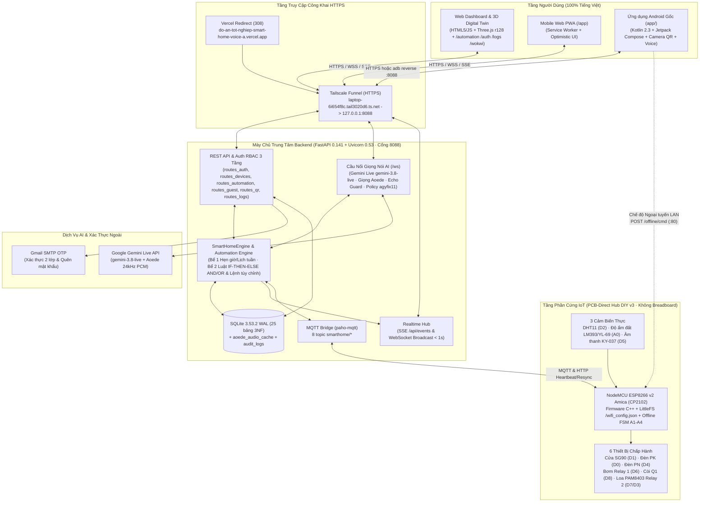
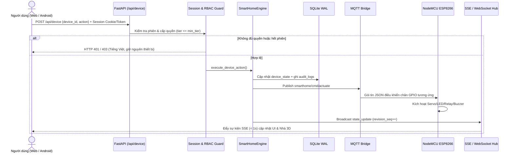
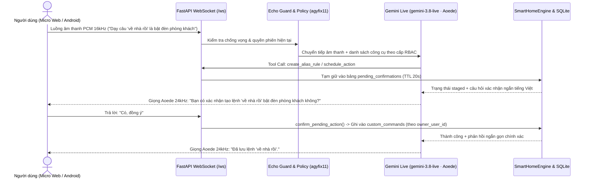
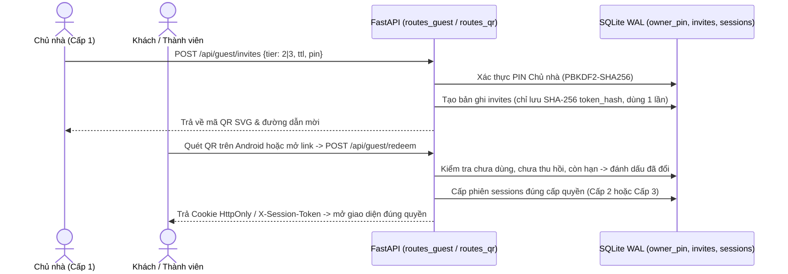
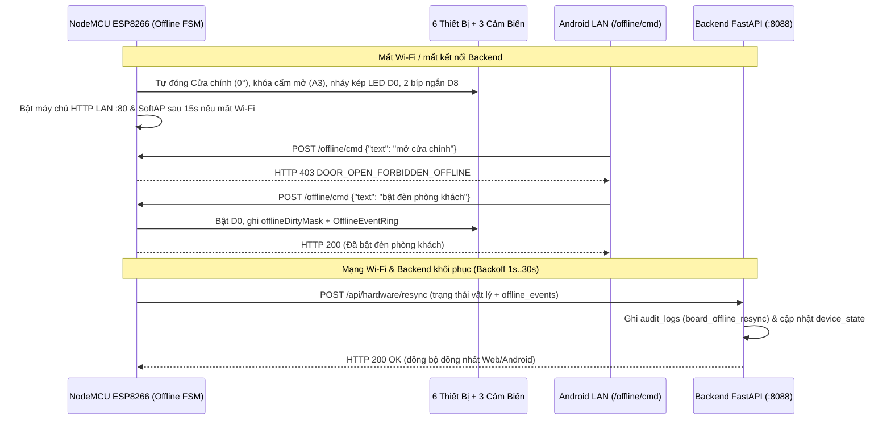

# Kiến Trúc Hệ Thống Chi Tiết — Smart Home Voice AI (`v3.8.0` / `v1.0`)

Tài liệu này mô tả chi tiết kiến trúc kỹ thuật của toàn bộ các phân hệ trong **Smart Home Voice AI**, giải thích cách từng thành phần vận hành độc lập và phối hợp với nhau từ trình duyệt Web / ứng dụng Android, máy chủ trung tâm FastAPI + SQLite WAL, trợ lý giọng nói AI tiếng Việt Gemini Live cho tới vi điều khiển phần cứng NodeMCU ESP8266 v2 Amica và mạch PCB Hub DIY v3.

---

## 1. Sơ Đồ Kiến Trúc Tổng Thể Hệ Thống

---

## 2. Phân Tích Chi Tiết Từng Phân Hệ

### 2.1. Máy chủ Backend FastAPI & Cơ sở dữ liệu SQLite WAL (`backend/`)
- **Điểm vào chính (`backend/server.py`, API phiên bản `3.8.0`):** Khởi chạy trên `uvicorn`, phục vụ đồng thời nhóm API REST, luồng đồng bộ thời gian thực `SSE` (`GET /api/events`), WebSocket giọng nói hai chiều (`/ws`) và các trang giao diện tĩnh (`/`, `/app`, `/automation`, `/auth`, `/logs`, `/wokwi`, `/login`, `/register`, `/guest`, `/architecture`, `/archify`).
- **Phân tách Router theo nghiệp vụ (`backend/api/`):**
  - `routes_auth.py`: Đăng nhập email + mật khẩu + OTP Gmail, tạo/thu hồi phiên (`HttpOnly` cookie `sh_session_token` hoặc header `X-Session-Token`), thiết bị tin cậy (`sh_trusted_device`), đặt lại mật khẩu qua OTP, cấp vé WebSocket `/api/auth/ws_ticket`.
  - `routes_devices.py`: Điều khiển 6 thiết bị (`POST /api/device`, `/api/devices/{device_id}/control`), nhận telemetry cảm biến (`/api/dht11`, `/api/soil_moisture`, `/api/ky037`), nhịp tim mạch (`/api/hardware/heartbeat`), đồng bộ ngược sau ngoại tuyến (`/api/hardware/resync`), luồng `SSE` (`/api/events`).
  - `routes_automation.py`: Quản lý Bể 1 (hẹn giờ đếm ngược `GET /api/timers`, lịch lặp tuần `/api/schedules`) và Bể 2 (luật liên động `/api/rules`, luật tổ hợp đa cảm biến `AND`/`OR` `/api/compound_rules`, lệnh tùy chỉnh `/api/scenes`, xác nhận hành động đang chờ `/api/automation/confirm`).
  - `routes_guest.py` & `routes_qr.py`: Quản lý mã mời QR dùng một lần do Chủ nhà Cấp 1 phát hành (bảo vệ bằng mã PIN 4 chữ số băm `PBKDF2-SHA256`), đổi mã `POST /api/guest/redeem`, thu hồi tức thì.
  - `routes_logs.py`: Nhật ký kiểm toán hệ thống (`/api/logs/dashboard`), truy vấn chỉ đọc SQLite (`/api/sqlite/overview`), tri thức RAG (`/api/kb_upsert`) — chỉ dành cho Chủ nhà Cấp 1.
- **Lưu trữ bền vững SQLite 3 (`3.53.2`, chế độ `WAL`):**
  - Bật `PRAGMA journal_mode = WAL`, `PRAGMA foreign_keys = ON`, `PRAGMA synchronous = NORMAL` giúp đọc/ghi đồng thời không khóa luồng `SSE`/WebSocket.
  - Gồm **25 bảng chuẩn hóa 3NF** (chi tiết xem [`DATABASE_SCHEMA_ERD.md`](DATABASE_SCHEMA_ERD.md)): danh tính & phiên (`roles`, `users`, `sessions`, `invites`, `otp_challenges`, `trusted_devices`, `owner_pin_security`), trạng thái thiết bị (`devices`, `device_state`, `system_state_meta`), hai bể tự động hóa cách ly theo `owner_user_id` (`timers_pool`, `schedules`, `automation_rules`, `custom_commands`, `pending_confirmations`, `rules_pool`), bộ đệm âm thanh giọng đọc `aoede_audio_cache`, tri thức `knowledge_rag` và nhật ký `audit_logs`.

### 2.2. Hệ thống Phân quyền 3 Tầng (RBAC) & Mã Mời QR Dùng Một Lần
Toàn bộ quyền điều khiển được kiểm tra **bắt buộc phía máy chủ** (`backend/auth/tier_permissions.py`, `backend/auth/session_store.py`). Client không bao giờ được tự khai vai trò.

| Cấp quyền | Vai trò | Thiết bị được điều khiển | Quyền tự động hóa & Quản trị |
| :---: | :--- | :--- | :--- |
| **Cấp 1** | **Chủ nhà** (`ADMIN`) | **6/6 thiết bị:** `main_door`, `alarm_siren`, `garden_pump`, `speaker_amp`, `living_room_light`, `bedroom_light` | Toàn quyền luật/lịch toàn nhà, tạo/thu hồi mã mời QR (cần PIN Chủ nhà), duyệt thành viên, xem `/logs`, `/wokwi`, Reset hệ thống |
| **Cấp 2** | **Thành viên gia đình** (`MEMBER`) | **4/6 thiết bị:** `living_room_light`, `bedroom_light`, `garden_pump`, `speaker_amp` *(khóa Cửa chính & Còi báo động)* | Sở hữu Bể lệnh và Lịch hẹn giờ riêng cho 4 thiết bị được phép, xem `/wokwi`; **không** xem `/logs`, **không** đè lịch của Cấp 1 |
| **Cấp 3** | **Khách** (`CHILD_GUEST`) | **2/6 thiết bị:** `living_room_light`, `bedroom_light` | Điều khiển 2 đèn trên `/` hoặc `/app`, **chỉ xem** trên `/automation`; bị chặn `HTTP 403` trên `/logs` và `/wokwi` |

### 2.3. Trợ Lý Giọng Nói AI Tiếng Việt (`backend/live/`, `backend/voice/`)
- **Mô hình thời gian thực:** `gemini-3.8-live` qua WebSocket `/ws`, sử dụng **duy nhất giọng đọc tiếng Việt `Aoede`** (`24 kHz Mono 16-bit PCM`, lưu đệm câu phản hồi phổ biến trong `aoede_audio_cache`).
- **Chống vọng tiếng (Echo Guard):** `backend/live/echo_and_speech_guard.py` + `web/js/voice_echo_guard.js` lọc tiếng loa phát lại vào micro để tránh hệ thống tự nghe chính mình, đồng thời không chặn nhầm câu lệnh mới sau thông báo từ chối.
- **Chính sách giọng nói `agyfix11` (Xác nhận 1 lần & Phản hồi ngắn gọn chính xác):**
  - **Lệnh điều khiển trực tiếp & truy vấn cảm biến:** Thực thi ngay (**Actuate-First**) và trả lời tiếng Việt ngắn gọn, đúng sự thật trạng thái vật lý (ví dụ: *"Đã bật đèn phòng khách."*). Từ chối an toàn (**Fail-Closed**) nếu gọi thiết bị không nằm trong 6 thiết bị chốt (`quạt`, `điều hòa`, `TV/IR`) hoặc vượt quyền RBAC.
  - **Lệnh tùy chỉnh, hẹn giờ, lịch lặp, luật liên động & Reset:** Tạm giữ trạng thái trong `pending_confirmations` (TTL 20 giây), hỏi xác nhận **đúng 1 lần** bằng tiếng Việt; chỉ thực thi khi người dùng xác nhận (*"Có"*, *"Đồng ý"*, *"Xác nhận"*) và hủy sạch khi nói *"Không"* / *"Hủy"*.

### 2.4. Bộ Máy Tự Động Hóa 2 Bể (`backend/automation_engine.py`, `backend/engine/`)
1. **Bể 1 — Hẹn giờ đếm ngược & Lịch lặp (`timers_pool`, `schedules`):**
   - Hẹn giờ mặc định chạy **1 lần rồi tự dừng** (`repeat='once'`), hỗ trợ chu kỳ lặp (*hàng giờ*, *hàng ngày*, *hàng tuần theo thứ*, *hàng tháng*) theo múi giờ chuẩn `Asia/Saigon` (UTC+7).
   - Bảo vệ xung đột: lịch của Cấp 2 không được ghi đè hoặc hủy lịch của Chủ nhà Cấp 1.
2. **Bể 2 — Luật động, Luật tổ hợp `AND`/`OR` & Lệnh tùy chỉnh (`automation_rules`, `custom_commands`, `rules_pool`):**
   - Luật đơn `IF-THEN-ELSE` (liên động giữa thiết bị hoặc ngưỡng cảm biến, có phát hiện chu trình vô hạn bằng DFS).
   - Luật tổ hợp đa điều kiện `AND`/`OR` (ví dụ: *Nhiệt độ > 32°C `AND` Độ ẩm < 50% $\rightarrow$ Bật bơm tưới cây*) được đánh giá liên tục khi có telemetry mới.
   - Lệnh tùy chỉnh (`custom_commands`) cách ly theo `owner_user_id`, cho phép gom chuỗi thao tác dưới một câu khẩu lệnh tiếng Việt tự nhiên.

### 2.5. Web Dashboard, Bản Sao Số 3D Digital Twin & Mobile PWA (`web/`)
- **Bản sao số 3D (`web/house3d.js`, `Three.js r128`):** Nạp mô hình ngôi nhà `web/models/smarthome_villa.glb` xuất từ Blender 5.2.2, hiển thị đủ **14 module vật lý + PCB Hub DIY v3 + NodeMCU + 40 tuyến dây 3D** đọc từ `web/data/wiring_contract.json` (`breadboardUsed: false`). Khi thiết bị đổi trạng thái, cánh cửa xoay góc thực `0°–90°`, đèn sáng/tắt, bơm/còi/loa hiển thị trạng thái đồng bộ dưới `1 giây` qua `SSE`.
- **Trang hướng dẫn đấu nối PCB-Direct (`/wokwi`):** Mặc định hiển thị sơ đồ mạch 2D PCB-Direct (không breadboard), chế độ bước `1/40 .. 40/40`, bảng tìm kiếm/lọc 40 dây theo chiều dài `cm` và bảng kiểm tra tụ/diode bảo vệ `C1–C9`, `D1–D2`.
- **Giao diện di động PWA (`/app`):** Tối ưu màn hình dọc, áp dụng **Optimistic UI** kèm cửa sổ chống nháy `pendingDeviceMutations` và hỗ trợ chế độ Sáng/Tối.

### 2.6. Ứng Dụng Android Gốc (`app/`)
- Viết bằng **Kotlin 2.3.20 + Jetpack Compose 1.10.4 + Material 3 1.4.0** (`minSdk 26`, `targetSdk 34`, `compileSdk 36`), biên dịch nhanh bằng `lightbuild`.
- Gồm đầy đủ luồng người dùng thực tế: Cổng đăng nhập bắt buộc (`MainScreen`), Quên mật khẩu OTP (`ForgotPasswordScreen`), Quét mã QR mời trực tiếp bằng camera (`QrScannerScreen` $\rightarrow$ `POST /api/guest/redeem`), 4 tab chính (`HomeScreenTab`, `DevicesScreenTab`, `VoiceScreenTab` + `VoiceBottomSheet`, `AccountScreenTab`).
- Hỗ trợ chế độ trực tuyến (HTTPS Tailscale hoặc `127.0.0.1:8088` qua `adb reverse`) và dự phòng giọng nói ngoại tuyến tiếng Việt gửi thẳng tới ESP8266 qua mạng LAN (`POST /offline/cmd`).

### 2.7. Firmware ESP8266 & Cầu Nối MQTT (`firmware/`, `backend/mqtt_bridge.py`)
- **8 chủ đề MQTT chuẩn:**
  - Điều khiển & đồng bộ xuống mạch: `smarthome/cmd/actuate`, `smarthome/cmd/enroll_blink`, `smarthome/sync/pools`.
  - Telemetry & trạng thái lên máy chủ: `smarthome/telemetry/dht11`, `smarthome/telemetry/soil_moisture`, `smarthome/telemetry/sound`, `smarthome/state/report`, `smarthome/status/esp8266` (birth/LWT).
- **Dự phòng ngoại tuyến (Addendum A1–A4):** Tách thành 3 header C++ thuần (`offline_safety_config.h`, `offline_command_grammar.h`, `offline_fsm.h`) để kiểm thử độc lập trên máy tính: tự đóng & khóa cấm mở `main_door`, tự ngắt bơm sau `120s`, tự tắt còi sau `30s`, kết nối lại hàm mũ `1s..30s`, mở HTTP cục bộ cổng `80` và tự động gọi `POST /api/hardware/resync` khi mạng trở lại.

---

## 3. Các Sơ Đồ Tuần Tự Luồng Hoạt Động Chính

### 3.1. Luồng Điều Khiển Thiết Bị Thời Gian Thực (Web/App $\rightarrow$ Backend $\rightarrow$ ESP8266 $\rightarrow$ 3D Twin)

### 3.2. Luồng Giọng Nói AI Tiếng Việt & Xác Nhận 1 Lần Lệnh Tùy Chỉnh (`agyfix11`)

### 3.3. Luồng Mời Khách / Thành Viên Bằng Mã QR Dùng Một Lần

### 3.4. Luồng Tự Phục Hồi Ngoại Tuyến ESP8266 (Offline Fail-Safe & Auto-Resync)

---

## 4. Tài Liệu Kiến Trúc Liên Quan

- [Danh mục Công nghệ & Phiên bản chính xác (`CONG_NGHE_VA_PHIEN_BAN.md`)](CONG_NGHE_VA_PHIEN_BAN.md)
- [Sơ đồ cơ sở dữ liệu SQLite 25 bảng (`DATABASE_SCHEMA_ERD.md`)](DATABASE_SCHEMA_ERD.md)
- [Bảng phân quyền 3 cấp chốt (`docs/TIER_PERMISSIONS.md`)](../TIER_PERMISSIONS.md)
- [Bản đồ khung xương mã nguồn (`REPO_MAP.md`)](REPO_MAP.md)
- [Sơ đồ kiến trúc tương tác HTML (`smart-home-voice-ai.architecture.html`)](smart-home-voice-ai.architecture.html) *(mở qua `/architecture` hoặc `/archify` khi chạy server)*
