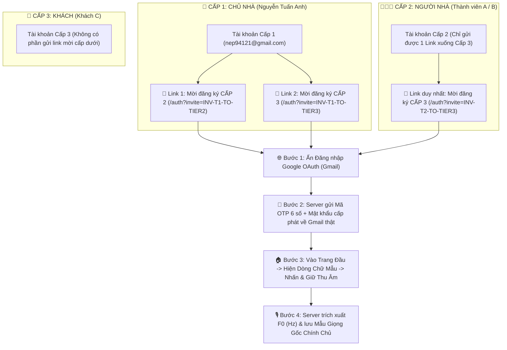

# 🔐 TÀI LIỆU KỸ THUẬT: HỆ THỐNG XÁC THỰC 3 LỚP, PHÂN CẤP LINK MỜI, OAUTH GMAIL OTP, THU ÂM TRANG ĐẦU & QUẢN TRỊ QUYỀN BẰNG GIỌNG NÓI

- **Dự án:** Hệ thống Nhà Thông Minh Điều Khiển Bằng Giọng Nói Tiếng Việt Thời Gian Thực (Smart Home Voice AI)
- **Tác giả / Admin Cấp 1:** Nguyễn Tuấn Anh (`nep94121@gmail.com`)
- **Mã nguồn thực thi:**
  - Lõi xử lý xác thực 3 lớp, link mời, đọc/gửi Gmail OTP & thu hồi quyền: [`simulator/auth_3layer.py`](file:///c:/Users/LENOVO/Desktop/%C4%91%E1%BB%93%20%C3%A1n%20t%E1%BB%91t%20nghi%E1%BB%87p/simulator/auth_3layer.py)
  - API Endpoints & tích hợp Voice Engine: [`simulator/server.py`](file:///c:/Users/LENOVO/Desktop/%C4%91%E1%BB%93%20%C3%A1n%20t%E1%BB%91t%20nghi%E1%BB%87p/simulator/server.py)
  - Giao diện Trung tâm Quản trị 3 Lớp & Link Mời trên Web: [`simulator/static/auth.html`](file:///c:/Users/LENOVO/Desktop/%C4%91%E1%BB%93%20%C3%A1n%20t%E1%BB%91t%20nghi%E1%BB%87p/simulator/static/auth.html)
  - Giao diện Trang Đầu (Nhà 3D & Đọc câu mẫu thu âm): [`simulator/static/index.html`](file:///c:/Users/LENOVO/Desktop/%C4%91%E1%BB%93%20%C3%A1n%20t%E1%BB%91t%20nghi%E1%BB%87p/simulator/static/index.html)
  - Ứng dụng Android Native (`Samsung Galaxy S9`): [`android_app/app-core/src/main/kotlin/vn/edu/hust/seee/smarthome/ui/main/MainScreen.kt`](file:///c:/Users/LENOVO/Desktop/%C4%91%E1%BB%93%20%C3%A1n%20t%E1%BB%91t%20nghi%E1%BB%87p/android_app/app-core/src/main/kotlin/vn/edu/hust/seee/smarthome/ui/main/MainScreen.kt)
  - Kịch bản kiểm thử tự động 14 trường hợp (có gửi & đọc ngược Gmail thật): [`scripts/test_auth_3layer_and_invite.py`](file:///c:/Users/LENOVO/Desktop/%C4%91%E1%BB%93%20%C3%A1n%20t%E1%BB%91t%20nghi%E1%BB%87p/scripts/test_auth_3layer_and_invite.py)

---

## 1. Sơ Đồ Kiến Trúc Luồng Phân Cấp Link Mời, OAuth Gmail OTP & Thu Âm Giọng Gốc



---

## 2. Quy Tắc Phân Cấp Đường Link Mời Đăng Ký (`Hierarchical Invitation Links`)

Hệ thống kiểm soát chặt chẽ quyền tạo và gửi đường link mời theo đúng cấp bậc của tài khoản đang đăng nhập (`get_invite_links_for_account` và `create_custom_invite_link` trong [`simulator/auth_3layer.py`](file:///c:/Users/LENOVO/Desktop/%C4%91%E1%BB%93%20%C3%A1n%20t%E1%BB%91t%20nghi%E1%BB%87p/simulator/auth_3layer.py#L281-L407)):

| Cấp tài khoản người gửi | Số đường link mời hiển thị | Các đường link được phép gửi xuống cấp dưới | Hành vi khi cố tạo link vượt quyền |
| :--- | :---: | :--- | :--- |
| **Cấp 1 (Chủ nhà)** | **2 đường link** | 1. `http://localhost:8088/auth?invite=INV-T1-TO-TIER2` *(Mời Cấp 2 - Người nhà)*<br>2. `http://localhost:8088/auth?invite=INV-T1-TO-TIER3` *(Mời Cấp 3 - Khách)* | Toàn quyền mời Cấp 2 và Cấp 3. |
| **Cấp 2 (Người nhà)** | **1 đường link** | 1. `http://localhost:8088/auth?invite=INV-T2-TO-TIER3` *(Chỉ mời Cấp 3 - Khách)* | Nếu cố tạo link mời Cấp 1 hoặc Cấp 2 $\rightarrow$ Server chặn ngay (`🚫 Từ chối: Tài khoản Cấp 2 chỉ được gửi link mời xuống Cấp 3!`). |
| **Cấp 3 (Khách)** | **0 đường link (Ẩn)** | **Không có phần gửi link mời cấp dưới** | Mọi yêu cầu tạo link từ Cấp 3 đều bị từ chối hoàn toàn. |

---

## 3. Đăng Ký Tài Khoản Bằng Google OAuth (Gmail) & Cấp Mật Khẩu Qua OTP

Khi người cấp dưới bấm vào đường link mời (`/auth?invite=...`):
1. **Kết nối Google OAuth (Gmail):** Người dùng bấm nút **"🌐 Ấn Đăng Nhập Google OAuth (Gmail)"** (`POST /api/auth3/invite_oauth_start`).
2. **Gửi Email OTP & Mật khẩu thật về Gmail:** Hệ thống sử dụng Google Workspace CLI (`gws gmail users messages send`) gửi thư HTML đến địa chỉ Gmail chứa:
   - **Mã xác nhận OTP 6 chữ số** (`OTP:xxxxxx`).
   - **Mật khẩu được cấp phát** cho tài khoản đó (được băm chuẩn `PBKDF2-HMAC-SHA256` với 100.000 vòng lặp trên Server).
   - **Cấp quyền được mời** (`Tầng 2` hoặc `Tầng 3`) và tên người cấp trên đã mời.
3. **Tự động đọc ngược Hộp thư Gmail để kiểm thử (`Round-Trip Gmail Verification`):** Hàm `read_latest_otp_from_gmail_inbox` ([`simulator/auth_3layer.py`](file:///c:/Users/LENOVO/Desktop/%C4%91%E1%BB%93%20%C3%A1n%20t%E1%BB%91t%20nghi%E1%BB%87p/simulator/auth_3layer.py#L486-L547)) tự động gọi `gws gmail users messages get` vào hộp thư `nep94121@gmail.com`, đọc bức thư vừa gửi và trích xuất đúng 6 số OTP để xác nhận tự động 100%.

---

## 4. Trang Đầu: Hiển Thị Dòng Chữ Mẫu Để Đọc & Nhấn Giữ Thu Âm (`Hold-to-Record Voice Enrollment`)

Ngay sau khi xác nhận mã OTP từ Gmail xong và bước vào **Trang Đầu** (`/` hoặc `/auth` trên Web và Tab **`🏠 Trang chủ`** trên App Android):
- Hệ thống bật cờ `needs_first_page_voice_enroll = True` và hiển thị **Banner Thu Âm Giọng Nói Gốc** ngay đầu trang kèm **Dòng chữ mẫu bắt buộc đọc**:
  > *"Xin chào hệ thống Nhà Thông Minh Bách Khoa, tôi là [Họ tên], tôi đọc câu này để lưu mẫu giọng nói gốc Cấp [2/3] lên máy chủ."*
- Người dùng **nhấn và giữ nút thu âm (`Hold-to-Record`)**, đọc to dòng chữ mẫu rồi thả tay ra:
  - Dữ liệu âm thanh `PCM 16-bit 16kHz` được đẩy thẳng lên `POST /api/auth3/enroll_first_page_voice`.
  - Server phân tích tần số cơ bản `F0 (Hz)` (Autocorrelation + ZCR) và `Spectral Centroid`, lưu vào hồ sơ tài khoản (`voiceprint.enrolled = True`, `reading_prompt_verified = True`).
  - Từ thời điểm đó, khi người dùng nói vào Điện thoại hoặc Web, Server tự động đối chiếu và nhận diện chính xác họ tên cùng phân tầng!

---

## 5. Chủ Nhà (Cấp 1) Xóa Cấp Quyền & Bật Lại Quyền Bằng Giọng Nói Trên Thiết Bị

Đúng theo cơ chế thực tế tại nhà (`set_account_permission_by_voice_or_admin` và `parse_and_execute_voice_permission_command` trong [`simulator/auth_3layer.py`](file:///c:/Users/LENOVO/Desktop/%C4%91%E1%BB%93%20%C3%A1n%20t%E1%BB%91t%20nghi%E1%BB%87p/simulator/auth_3layer.py#L714-L838)):
1. **Khi Chủ nhà (Cấp 1) nói xóa cấp quyền trên thiết bị:**
   - Ví dụ câu nói: *"Xóa cấp quyền của Thành viên A"*, *"Thu hồi quyền Thành viên B"*, *"Tắt quyền của Khách C"*.
   - **Tài khoản của người đó VẪN CÒN NGUYÊN trên hệ thống** (không bị xóa mất tài khoản hay mật khẩu), nhưng trạng thái chuyển sang:
     - `permission_active = False`
     - `permission_status = "REVOKED"`
     - Hiển thị rõ nhãn: **`🚫 TÀI KHOẢN HIỆN KHÔNG CÓ QUYỀN (Đã bị Chủ nhà xóa/tạm thu hồi quyền)`**.
   - Khi người đó đăng nhập hoặc nói vào điện thoại/mic: Hệ thống nhận ra tài khoản/giọng nói nhưng chặn mọi thao tác điều khiển thiết bị và báo rõ *"Tài khoản hiện không có quyền"*.
2. **Khi Chủ nhà (Cấp 1) nói bật lại quyền:**
   - Ví dụ câu nói: *"Bật lại quyền cho Thành viên A"*, *"Cấp lại quyền cho Khách C"*.
   - Hệ thống lập tức khôi phục `permission_active = True`, `permission_status = "ACTIVE"` và trả lại đúng Cấp độ gốc (`saved_tier`) cùng mẫu giọng nói như cũ mà không cần đăng ký lại!

---

## 6. Bảng 14 Kịch Bản Kiểm Thử Tự Động Toàn Diện (`14/14 PASS`)

Chạy lệnh kiểm thử tự động:
```powershell
python -X utf8 scripts/test_auth_3layer_and_invite.py
```

| Mã Test | Hạng mục kiểm thử | Kịch bản chi tiết | Kết quả |
| :--- | :--- | :--- | :---: |
| **`TEST-01`** | Lớp 1 (Mật khẩu Cấp 1) | Đăng nhập Chủ nhà (`nep94121@gmail.com` / `[REDACTED_PASSWORD]`) & gửi OTP về Gmail thật | **PASS** |
| **`TEST-02`** | Lớp 2 (Đọc Gmail Thật) | Tự động truy cập hộp thư `nep94121@gmail.com` đọc bức thư vừa gửi để lấy mã OTP 6 số | **PASS** |
| **`TEST-03`** | Lớp 2 (Chống giả mạo OTP) | Nhập mã OTP sai (`000000`) khác với mã gửi về Gmail $\rightarrow$ Bị chặn | **PASS** |
| **`TEST-04`** | Lớp 2 (Xác nhận OTP) | Nhập đúng mã OTP 6 số vừa đọc từ hộp thư Gmail $\rightarrow$ Mở khóa Lớp 2 | **PASS** |
| **`TEST-05`** | Phân cấp Link Mời (Cấp 1) | Kiểm tra Cấp 1 có đúng **2 đường link mời** xuống Cấp 2 và Cấp 3 (`[2, 3]`) | **PASS** |
| **`TEST-06`** | Phân cấp Link Mời (Cấp 2) | Kiểm tra Cấp 2 chỉ có **1 đường link mời** xuống Cấp 3 (`[3]`) & chặn khi cố tạo link Cấp 2 | **PASS** |
| **`TEST-07`** | Phân cấp Link Mời (Cấp 3) | Kiểm tra Cấp 3 **không có phần gửi link mời** (`0 link`, `can_invite = False`) | **PASS** |
| **`TEST-08`** | Link Mời + Google OAuth | Ấn vào link `INV-T1-TO-TIER2` $\rightarrow$ Đăng ký Google OAuth $\rightarrow$ Xác nhận OTP Gmail cấp mật khẩu | **PASS** |
| **`TEST-09`** | Trang Đầu (Giữ Thu Âm) | Vào Trang Đầu hiện dòng chữ mẫu $\rightarrow$ Đọc và giữ nút thu âm (`3.5s`, `F0=206Hz`) lưu lên Server | **PASS** |
| **`TEST-10`** | Lớp 3 (Nhận diện giọng mới) | Người vừa đăng ký nói vào Điện thoại (`F0=205.5Hz`) $\rightarrow$ Server tự nhận diện đúng tên & Tầng 2 | **PASS** |
| **`TEST-11`** | Giọng nói Xóa Cấp Quyền | Chủ nhà nói *"Xóa cấp quyền của Thành viên A"* $\rightarrow$ Tài khoản vẫn còn nhưng hiện `🚫 KHÔNG CÓ QUYỀN` | **PASS** |
| **`TEST-12`** | Chặn khi Đã Xóa Quyền | Thành viên A (đang bị xóa quyền) nói lệnh qua Điện thoại $\rightarrow$ Server báo `TÀI KHOẢN HIỆN KHÔNG CÓ QUYỀN` | **PASS** |
| **`TEST-13`** | Giọng nói Bật Lại Quyền | Chủ nhà nói *"Bật lại quyền cho Thành viên A"* $\rightarrow$ Khôi phục lại đúng quyền Tầng 2 như cũ | **PASS** |
| **`TEST-14`** | Lớp 3 (Chặn Người lạ) | Điện thoại gửi giọng Người lạ (`F0=262.0Hz`) $\rightarrow$ Server từ chối & cảnh báo an ninh | **PASS** |
