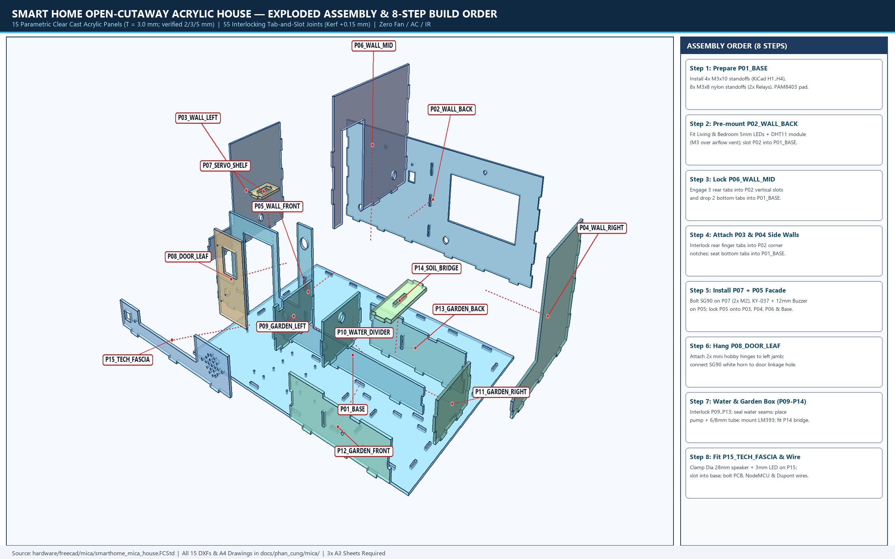
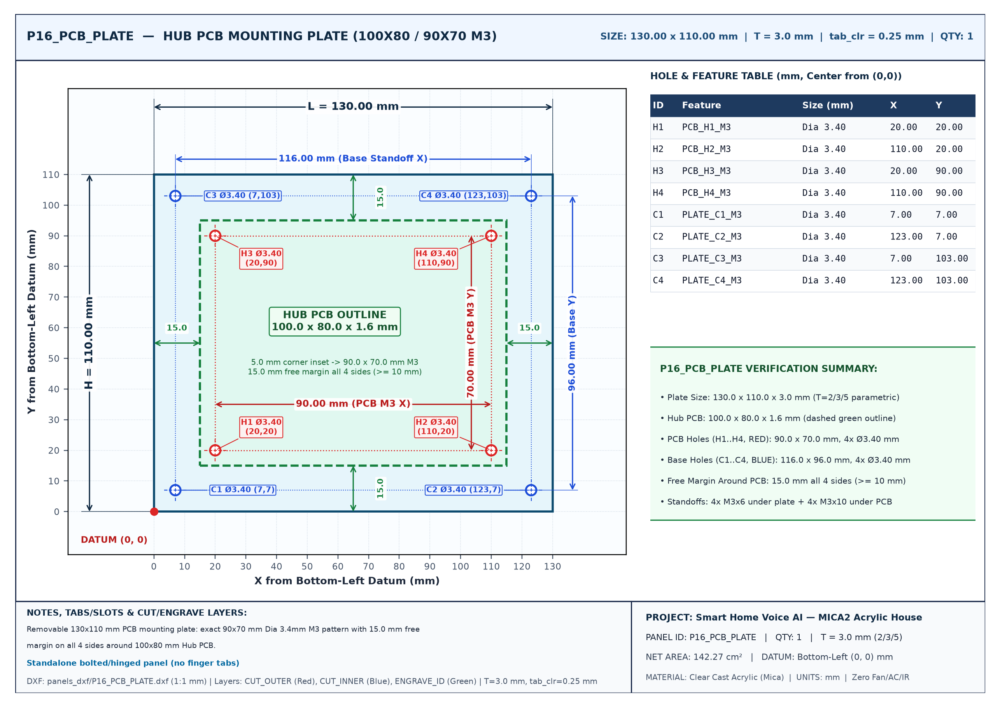
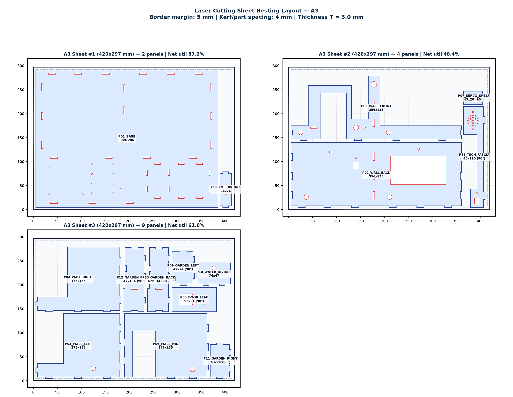

# Hướng Dẫn Cắt, Khoan & Lắp Ráp Mô Hình Nhà Mica — Smart Home Voice AI (MICA2)

- **Nguồn thiết kế tham số FreeCAD:** [`../../../hardware/mica/smarthome_mica_house.FCStd`](../../../hardware/mica/smarthome_mica_house.FCStd) (sinh bởi `hardware/freecad/mica/build_mica.py`, đã kiểm chứng 0 va chạm 3D trên FreeCAD `1.1.4.20260928`)
- **Vật liệu mặc định:** Mica đúc trong suốt (Clear Cast Acrylic) dày **`T = 3.0 mm`** (tham số đơn `Params.T_mm` hỗ trợ đổi nhanh `2.0 / 3.0 / 5.0 mm`)
- **Thông số thân thiện cắt tay:** Khe hở mộng–khe **`tab_clr = 0.25 mm`** (`slot_w = T + tab_clr = 3.25 mm`, đã kiểm chứng `0.20 / 0.25 / 0.30 mm`); độ rộng mộng tối thiểu **`14.0 mm`** (`>= 12.0 mm`); tổng cộng **`59` mối ghép mộng–khe**
- **Kích thước tổng thể mở rộng:** Tấm đáy ghép 2 nửa **`406.0 × 390.0 mm`** (`P01A_BASE_TECH` + `P01B_BASE_HOUSE` + `2× P17_BASE_JOINER`); khung nhà mở mặt cắt **`386.0 × 190.0 × 150.0 mm`**
- **Quy mô phôi & lỗ khoan:** **`18` tấm duy nhất / `19` chi tiết vật lý** (tính `2× P17_BASE_JOINER`), **`76` lỗ tròn** định nghĩa trong [`holes_table.csv`](holes_table.csv) (`80` lỗ khoan thực tế trên 19 chi tiết)
- **Tài liệu & bản vẽ đi kèm:**
  - Hình chiếu phân rã 3D: [`assembly_exploded.png`](assembly_exploded.png) · [`assembly_exploded.pdf`](assembly_exploded.pdf)
  - Bản vẽ tấm gá Hub PCB `100×80 mm`: [`drawings/P16_PCB_PLATE.png`](drawings/P16_PCB_PLATE.png)
  - Xếp tấm cắt khổ A3 (`6` tờ, đủ `19/19` chi tiết): [`sheet_layout_A3.png`](sheet_layout_A3.png) · [`sheet_layout_A3_1to1.pdf`](sheet_layout_A3_1to1.pdf)
  - Xếp tấm cắt khổ A4 (`5` tờ cho `15` chi tiết + `9` trang ghép nối 1:1 cho `4` tấm lớn): [`sheet_layout_A4_1to1.pdf`](sheet_layout_A4_1to1.pdf) · [`sheet_layout_A4_tiled_oversized_1to1.pdf`](sheet_layout_A4_tiled_oversized_1to1.pdf)
  - Bảng thống kê 18 tấm & báo giá tham khảo: [`MICA_PANELS.md`](MICA_PANELS.md)
  - Bảng tọa độ 76 lỗ tròn (gốc `(0, 0)` góc dưới-trái): [`holes_table.csv`](holes_table.csv)
  - Bảng đấu dây chuẩn 40 dây & hợp đồng 10 chân ESP8266: [`../WIRING_TABLE.md`](../WIRING_TABLE.md)
  - Phiên bản **In 3D FDM v2 (`180 × 200 × 250 mm`, 100% lắp mộng không vít/keo)** gồm 57 chi tiết + nội thất đóng gói sẵn trên 17 bàn in `3MF`/`STL`: [`../../../hardware/in 3 d/README.md`](../../../hardware/in%203%20d/README.md)

---

## 1. Sơ Đồ Bố Trí 14 Module Ngoại Vi + Hub PCB 100×80 mm

> **Xác nhận phạm vi phần cứng nghiêm ngặt:** Hệ thống **KHÔNG có quạt (zero fan), KHÔNG có điều hòa / điện lưới 220V (zero AC), KHÔNG có hồng ngoại (zero IR)**. Toàn bộ mô hình vận hành an toàn ở điện áp thấp **5 V DC / 3.3 V DC**.
> **Khoảng hở đi dây nội bộ:** Đã kiểm chứng tự động trên `135` cặp module không ghép trực tiếp (`verification_report.json`) — khoảng hở nhỏ nhất đạt **`18.0 mm`** (`>= 15.0 mm`, giữa `Relay 1` và `Relay 2`), đảm bảo đi bó dây Dupont thoải mái, không chồng lấn.

Bảng dưới đây ánh xạ đầy đủ **Hub PCB `100×80 mm`**, **14 module/cụm ngoại vi** (tách rõ 2 LED 5 mm và cụm cảm biến độ ẩm đất gồm đầu dò `YL-69` + mạch `LM393`), cùng **LED báo nguồn 3 mm** trên mặt nạ kỹ thuật (`17` thực thể phần cứng khớp tuyệt đối với `verification_report.json` và hợp đồng 10 chân ESP8266 trong [`../WIRING_TABLE.md`](../WIRING_TABLE.md)):

| STT | Module / Thiết bị | Tấm gắn & Khu vực | Chân ESP8266 & Cổng Hub | Lỗ / Khe khoét (mm) | Cách bắt giữ & Ghi chú kỹ thuật |
|---:|---|---|---|---|---|
| 0 | **Hub PCB trung tâm `100 × 80 × 1.6 mm`** | `P16_PCB_PLATE` (Khoang kỹ thuật) | Toàn bộ `J1`–`J15`, socket `U1/U2` | `4× Ø3.4` chuẩn **`90.0 × 70.0`** | 4 trụ đồng `M3×10`; dư viền tự do **`15.0 mm`** cả 4 phía trên tấm `130×110 mm`. |
| 1 | **NodeMCU v2 Amica (ESP8266, CP2102)** | Cắm trên Hub PCB (`P16_PCB_PLATE`) | `D0`–`D8`, `A0`, `VIN`, `3V3`, `GND` | Rãnh mở USB rộng **`128.0 mm`** trên `P15` | Cắm socket cái `2× 1×15` (bước `22.86 mm`); cổng Micro-USB hướng thẳng mặt trước. |
| 2 | **LED phòng khách 5 mm** (`WP7113`) | `P02_WALL_BACK` (Phòng khách) | **`D0` (`GPIO16`)** · `J4` | `1× Ø5.5` | Vòng nhựa giữ LED 5 mm; Active-HIGH qua điện trở `R1 220Ω` trên Hub. |
| 3 | **Servo SG90 9g (cửa chính)** | `P07_SERVO_SHELF` (Khung cửa chính) | **`D1` (`GPIO5`)** · `J3` | Khe `12.7 × 23.3` + **`2× Ø2.5`** (bước `27.8`) | 2 ốc `M2×8` hoặc `M2×10` + **long-đen M2** + đai ốc M2 *(ngoại lệ duy nhất `< 3.0 mm`)*. |
| 4 | **Cảm biến nhiệt–ẩm DHT11 (3 chân)** | `P02_WALL_BACK` (Phòng khách) | **`D2` (`GPIO4`)** · `J13` | `1× Ø3.5` + khe gió `12.5 × 16.0` | 1 trụ nhựa `M3×8`; cấp **`+3.3 V`**, kéo lên `R3 10kΩ` trên Hub. |
| 5 | **Mạch khuếch đại âm thanh PAM8403** | `P01A_BASE_TECH` (Khoang kỹ thuật) | **`D3` (`GPIO0`)** · `J12` (tín hiệu) + `J11` (nguồn từ Relay 2) | `2× Ø3.0` (khoảng cách `26.0`) | Dây rút nhựa mảnh qua 2 lỗ `Ø3.0` + băng dính xốp 2 mặt; bảo vệ boot qua `C4/R4`. |
| 6 | **LED phòng ngủ 5 mm** (`WP7113`) | `P02_WALL_BACK` (Phòng ngủ) | **`D4` (`GPIO2`)** · `J5` | `1× Ø5.5` | Vòng nhựa giữ LED 5 mm; **Active-LOW** an toàn boot (`R2 220Ω` + `R7 10kΩ`). |
| 7 | **Cảm biến âm thanh KY-037 / KY-038** | `P05_WALL_FRONT` (Bệ trước phòng khách) | **`D5` (`GPIO14`)** · `J15` (`DO`; `AO` để trống) | `1× Ø10.5` (micro) + `1× Ø3.5` (ốc M3) | 1 trụ nhựa `M3×8`; **bắt buộc cấp `+3.3 V`** (tuyệt đối không cấp `5 V`). |
| 8 | **Relay 1 xanh 5V 1 kênh** (`SRD-05VDC`) | `P01A_BASE_TECH` (Khoang kỹ thuật) | **`D6` (`GPIO12`)** · `J7` (điều khiển) + `J8` (`COM/NO`) | `4× Ø3.5` (bước `44.5 × 20.5`) | 4 trụ nhựa `M3×8`; kích mức cao (`Active-HIGH`), đóng cắt nguồn bơm qua `COM → NO`. |
| 9 | **Relay 2 đỏ cách ly quang 5V 1 kênh** | `P01A_BASE_TECH` (Khoang kỹ thuật) | **`D7` (`GPIO13`)** · `J9` (điều khiển) + `J10` (`COM/NO`) | `4× Ø3.5` (bước `44.5 × 20.5`) | 4 trụ nhựa `M3×8`; **bắt buộc đặt jumper mức `H`**, tự ngắt nguồn `PAM8403` sau `1.5 s`. |
| 10 | **Còi Buzzer chủ động 5V (`TMB12A05`)** | `P05_WALL_FRONT` (Trụ giữa mặt tiền) | **`D8` (`GPIO15`)** · `J6` | `1× Ø12.5` | Lắp khít lỗ `Ø12.5` + chấm silicone/keo nến mặt sau; `R9 10kΩ` + diode `D2 1N4007`. |
| 11a | **Mạch so sánh độ ẩm đất LM393 (YL-38)** | `P12_GARDEN_FRONT` (**Mặt khô ngoài** chậu cây) | **`A0` (`ADC0`)** · `J14` (`AO`; `DO` để trống) | `1× Ø3.5` | 1 trụ nhựa `M3×8`; **bắt buộc cấp `+3.3 V`** (bảo vệ `ADC0` của ESP8266). |
| 11b | **Đầu dò độ ẩm đất 2 nhánh YL-69** | `P14_SOIL_BRIDGE` (Ngang đỉnh chậu cây) | Đấu 2 dây sang đầu cắm 2 chân của `LM393` | Khe `22.0 × 3.5` | Cắm thẳng đứng xuống đất trồng; tách biệt hoàn toàn khỏi nước bể. |
| 12 | **Máy bơm chìm mini 3–6V DC + ống 6/8 mm** | Khoang bể nước (`P01A` / `P10` / `P09`) | `J2` (`PUMP_OUT`, cấp `5V` qua Relay 1 + diode `D1`) | `1× Ø10.0` trên `P10` (ống `OD 8 mm`) + rãnh `10×8` trên `P09` | Đặt nằm ngang trong bể nước đã chống thấm silicone; dẫn ống sang chậu cây. |
| 13 | **Loa mini tròn `Ø28 mm` 8 Ω 0.5 W** | `P15_TECH_FASCIA` (Mặt nạ kỹ thuật) | Đấu vi sai BTL vào `PAM8403 L_OUT+ / L_OUT-` | Lưới `19× Ø3.0` + `2× Ø3.5` (bước `36.0`) | Kẹp sau mặt nạ bằng 2 ốc `M3×10` + long-đen nhựa rộng; **không nối `L_OUT-` ra `GND`**. |
| 14 | **Giắc nguồn tròn DC-022 (5V 2A, 5.5×2.1)** | `P15_TECH_FASCIA` (Mặt nạ kỹ thuật) | `J1` (`PWR_5V_IN`, cực tâm dương `+5V`) | `1× Ø12.5` (ren `M12×1.0`) | Siết đai ốc M12 đi kèm giắc; dùng được cho cả mica `2 / 3 / 5 mm`. |
| + | **LED báo nguồn 3 mm** *(chỉ thị phụ)* | `P15_TECH_FASCIA` (Mặt nạ kỹ thuật) | Song song `+5V` (qua trở hạn dòng `1 kΩ`) | `1× Ø3.5` | Vòng giữ LED 3 mm kế bên giắc nguồn `DC-022`. |

---

## 2. Dụng Cụ & Vật Tư Cần Chuẩn Bị

- **Phôi mica:** Mica đúc trong suốt `3.0 mm` — `6` tấm khổ **A3 (`420 × 297 mm`)** hoặc `1` tấm khổ **`600 × 900 mm`** (khuyên dùng **`600 × 1200 mm`** nếu cắt thủ công để có phôi dự phòng).
- **Ốc vít, trụ đỡ & phụ kiện cơ khí:**
  - `4×` trụ đồng `M3×10` + ốc M3 (gắn Hub PCB `100×80` lên `P16_PCB_PLATE`).
  - `4×` trụ đồng/nhựa `M3×6` + ốc M3 (gắn `P16_PCB_PLATE` lên `P01A_BASE_TECH`).
  - `11×` trụ nhựa `M3×8` + ốc/đai ốc M3 (`4` Relay 1 + `4` Relay 2 + `1` DHT11 + `1` KY-037 + `1` LM393).
  - `8×` ốc `M3×10` (hoặc `M3×12` nếu kẹp thêm long-đen) + đai ốc M3 (ghép `2× P17_BASE_JOINER` dưới khe nối `P01A + P01B`).
  - `2×` ốc `M3×10` + long-đen nhựa đường kính rộng + đai ốc M3 (kẹp loa `Ø28 mm` sau `P15_TECH_FASCIA`).
  - `2×` ốc `M2×8` (hoặc `M2×10`) + **`2×` long-đen M2** + `2×` đai ốc M2 (bắt tai Servo SG90 trên `P07_SERVO_SHELF`).
  - `2×` bản lề mini (ốc `M2.5/M3` ngắn) + thanh thép/kẽm cứng `Ø1–1.5 mm` làm tay kéo cửa + dây rút nhựa nhỏ (buộc `PAM8403`) + vòng nhựa giữ LED (`2×` 5 mm, `1×` 3 mm).
- **Keo dán & chống thấm:** Keo dán mica dung môi (**Chloroform / Weld-On #3 hoặc #4**) kèm kim tiêm nhỏ; **keo silicone trung tính trong suốt** (chống thấm bể nước).
- **Dụng cụ cắt/khoan thủ công (nếu không cắt laser CO2):** Dao rọc mica chuyên dụng (hook knife), thước thép dài `>= 50 cm`, kẹp chữ C, băng keo giấy (masking tape), máy khoan cầm tay chỉnh tốc chậm, tấm gỗ phẳng lót dưới, mũi khoan bước / mũi khoan sắt-nhựa (`Ø2.5`, `3.0`, `3.4`/`3.5`, `5.5`, `10.0`, `10.5`, `12.5`, `14.0 mm`), dũa kim loại dẹt nhỏ, giấy nhám mịn `P400–P600`.

---

## 3. Kỹ Thuật Cắt & Khoan Mica Thủ Công Chống Nứt Vỡ

Thiết kế MICA2 đã mở rộng toàn bộ mộng (`>= 14.0 mm`), nới khe mộng (`tab_clr = 0.25 mm`, `slot_w = 3.25 mm`) và cộng sẵn `+0.5 mm` dung sai cho mọi lỗ/khe linh kiện. Khi gia công thủ công, hãy tuân thủ đúng **6 kỹ thuật** sau:

1. **In mẫu giấy tỉ lệ thật 1:1 và kiểm chuẩn `50.0 mm`:**
   - Chọn [`sheet_layout_A3_1to1.pdf`](sheet_layout_A3_1to1.pdf) (`6` tờ A3 chứa đủ **`19/19`** chi tiết) hoặc dùng máy in A4 với [`sheet_layout_A4_1to1.pdf`](sheet_layout_A4_1to1.pdf) (`5` tờ cho `15` chi tiết) kết hợp [`sheet_layout_A4_tiled_oversized_1to1.pdf`](sheet_layout_A4_tiled_oversized_1to1.pdf) (`9` trang A4 có đường nét đứt xanh và dấu thập `+` căn chỉnh cho `4` tấm lớn: `P01A_BASE_TECH` 2 trang, `P01B_BASE_HOUSE` 3 trang, `P02_WALL_BACK` 2 trang, `P05_WALL_FRONT` 2 trang).
   - Khi in PDF, bắt buộc chọn **`Actual Size / 100%`** (tắt *Fit to Page / Shrink*). Dùng thước đo lại thanh chuẩn **`50.0 mm`** ở góc trang in — sai lệch phải `< 0.3 mm` trước khi dán lên phôi mica.
2. **Dán băng keo giấy (masking tape) bảo vệ hai mặt:**
   - Giữ nguyên lớp giấy/nilon bảo vệ zin của tấm mica trong suốt quá trình cắt khoan. Nếu đã bóc giấy bảo vệ, dán phủ **băng keo giấy hai mặt** tại toàn bộ vùng cắt và khoan để chống trầy xước, giúp mũi khoan không trượt tâm và giảm mẻ mép mặt thoát.
3. **Cắt đường thẳng bằng dao rọc mica (hook knife / scoring):**
   - Kẹp chặt thước thép dọc theo đường mực màu đỏ (`CUT_OUTER`). Rạch **5–8 đường nhẹ, đều tay** (không tì quá mạnh ở nhát đầu tiên) cho tới khi rãnh sâu đạt khoảng **1/3–1/2 chiều dày tấm** (`~1.0–1.5 mm` với mica `3.0 mm`).
   - Đặt đường rạch trùng khít mép bàn phẳng (lót thêm thanh gỗ phẳng ép phía trên), giữ chặt phần thân trên bàn rồi **bẻ dứt khoát** phần thừa xuống dưới theo đúng chiều rãnh. Dùng giấy nhám mịn `P400–P600` mài nhẹ mép cắt để hết bavia sắc.
4. **Khoan lỗ tốc độ chậm (slow drilling) và kê gỗ chắc chắn:**
   - Dùng **mũi khoan bước (step drill)** hoặc mũi khoan nhựa/sắt đã mài giảm góc cắt (zero-rake) để mũi không "ngoạm" gây nứt chân chim.
   - **Luôn kê tấm gỗ phẳng ép sát mặt dưới** chỗ khoan để đỡ khi mũi khoan xuyên qua mặt sau. Chỉnh máy khoan tốc độ thấp **`400–800 RPM`**, ấn cực nhẹ, nhấp nhả liên tục để thoát phoi nóng và xịt thêm vài giọt **nước xà phòng loãng** làm mát.
   - Chấm tâm trước, khoan mồi toàn bộ bằng mũi **`Ø3.0 mm`**, rồi mới mở rộng dần lên đúng kích thước trong [`holes_table.csv`](holes_table.csv): **`Ø3.4 / 3.5 / 5.5 / 10.0 / 10.5 / 12.5 / 14.0 mm`**.
   - **Lưu ý đặc biệt cho `P07_SERVO_SHELF`:** 2 lỗ bắt tai Servo SG90 (`SG90_M2_Front`, `SG90_M2_Rear`) có đường kính **`Ø2.5 mm`** và chỉ cách mép khe thân servo **`1.00 mm`** (do khoảng cách lỗ tai SG90 chuẩn datasheet là `27.8 mm` so với thân `23.3 mm`). Hãy **khoan 2 lỗ `Ø2.5 mm` trước khi khoét khe `12.7×23.3 mm`**, và khi lắp bắt buộc đệm **long-đen M2** để phân tán lực siết.
5. **Khoét lỗ chữ nhật & khe mộng (`slot_w = 3.25 mm`, `tab_clr = 0.25 mm`):**
   - Với các khe mộng rộng `3.25 mm` và ô cửa/khe gió (`DHT11`, `SG90`, `YL-69`, cửa sổ phòng ngủ `124×64 mm`, cửa đi), khoan một chuỗi lỗ **`Ø3.0 mm`** sát nhau nằm hoàn toàn **bên trong đường vẽ màu xanh (`CUT_INNER`)** (chừa `~0.5 mm` tránh lẹm).
   - Dùng lưỡi cưa lọng mini hoặc dao rọc nối thông chuỗi lỗ lấy lõi ra, sau đó dùng **dũa kim loại dẹt** dũa thẳng các cạnh và góc vuông tới sát đường mực. Luôn **ướm thử khô** từng mộng vào đúng khe tương ứng trước khi dán keo.
6. **Dán kết cấu bằng keo dung môi & chống thấm bể nước bằng silicone:**
   - Lắp khô cố định bằng băng keo giấy cho vuông góc, sau đó dùng kim tiêm đầu nhỏ bơm từng giọt **keo dán mica (Chloroform / Weld-On #3 hoặc #4)** dọc theo khe tiếp giáp để keo tự hút vào khe bằng lực mao dẫn. Giữ yên `5–10 phút` cho se cứng (đạt cường độ tối đa sau `24 giờ`); không nhỏ tràn lên mặt trong suốt để tránh làm đục mica.
   - Riêng khoang **bể chứa nước** (`P01A_BASE_TECH`, `P09_GARDEN_LEFT`, `P10_WATER_DIVIDER`, `P12_GARDEN_FRONT`, `P13_GARDEN_BACK`), sau khi keo mica khô, bơm và miết kín **keo silicone trung tính trong suốt** dọc toàn bộ các cạnh đáy và cạnh đứng phía trong bể; chờ keo đóng rắn rồi **đổ nước thử rò trong 15 phút** trên tờ giấy ăn khô trước khi lắp bất kỳ mạch điện nào.

---

## 4. Quy Trình Lắp Ráp Theo Từng Bước (Bước 1 → Bước 9)

### Bước 1: Kiểm tra phôi, ướm khô mộng–khe & ghép tấm đáy (`P01A` + `P01B` + `2× P17`)
- Đối chiếu đủ **`18` mã tấm / `19` chi tiết** (`P01A`–`P17`, có **`2` tấm `P17_BASE_JOINER`**) theo bảng trong [`MICA_PANELS.md`](MICA_PANELS.md).
- Ướm thử khô các mộng chính (`tab_clr = 0.25 mm`, độ rộng mộng `14.0–24.0 mm`); nếu khe nào còn cấn do cắt tay thì dũa nhẹ thêm `0.1–0.2 mm` cho đến khi trượt êm tay.
- Ghép khớp 4 mộng khóa `24.0 mm` giữa **`P01A_BASE_TECH`** (`406.0 × 181.9 mm`) và **`P01B_BASE_HOUSE`** (`406.0 × 215.9 mm`) trên mặt bàn phẳng để tạo thành đế tổng **`406.0 × 390.0 mm`**.
- Đặt **`2× P17_BASE_JOINER`** (`64.0 × 28.0 mm`) áp sát **mặt dưới** đường nối tại hai vị trí trái/phải (`X = 100 mm` và `X = 306 mm`), siết chặt bằng **8 ốc `M3×10`** (hoặc `M3×12` nếu kẹp thêm long-đen) + 8 đai ốc M3 qua 8 lỗ `Ø3.4 mm`.

### Bước 2: Lắp Hub PCB `100 × 80 mm` + NodeMCU lên `P16_PCB_PLATE` và gắn lên `P01A`
- Bắt **4 trụ đồng `M3×10`** vào 4 lỗ chuẩn **`90.0 × 70.0 mm`** (`PCB_H1..H4_M3`, `Ø3.4 mm`) trên tấm **`P16_PCB_PLATE`** (`130.0 × 110.0 mm`, dư viền `15.0 mm` đều cả 4 phía).
- Cố định **Hub PCB `100 × 80 mm`** lên 4 trụ đồng (đã cắm sẵn **NodeMCU v2 Amica** vào 2 hàng socket `U1/U2`), lưu ý quay **cổng Micro-USB hướng về cạnh trước** (`Y-`) để sau này cắm cáp thẳng qua rãnh mở của `P15_TECH_FASCIA`.
- Bắt **4 trụ `M3×6`** vào 4 lỗ góc ngoài `116.0 × 96.0 mm` (`PLT_H1..H4_M3`, `Ø3.4 mm`) trên `P01A_BASE_TECH`, sau đó đặt cụm `P16_PCB_PLATE` lên và siết 4 ốc M3 tại 4 lỗ `PLATE_C1..C4_M3`. *(Thiết kế tấm gá rời giúp tháo nhanh cả bo Hub khi cần bảo trì/hàn lại).*

### Bước 3: Lắp Relay 1, Relay 2 và mạch PAM8403 lên khoang kỹ thuật `P01A_BASE_TECH`
- Lắp **Relay 1** (xanh `SRD-05VDC`, điều khiển bơm `D6`) vào nhóm 4 lỗ `RLY1_H1..H4_M3` (`Ø3.5 mm`, bước `44.5 × 20.5 mm`, phía trên) bằng **4 trụ nhựa `M3×8`**.
- Lắp **Relay 2** (đỏ cách ly quang, cấp nguồn `PAM8403` `D7`) vào nhóm 4 lỗ `RLY2_H1..H4_M3` (`Ø3.5 mm`, bước `44.5 × 20.5 mm`, phía dưới) bằng **4 trụ nhựa `M3×8`**. **Kiểm tra ngay jumper kích trên Relay 2 đang cắm ở vị trí `H` (High-Level Trigger)**.
- Dán băng dính xốp 2 mặt cách điện dưới bụng mạch **`PAM8403`** (`D3`), đặt giữa 2 lỗ `PAM_CLAMP_L/R` (`Ø3.0 mm`, cách nhau `26.0 mm`) và buộc cố định thêm bằng 1 dây rút nhựa mảnh (tránh siết đè lên chân linh kiện SMD).
- Kiểm tra bằng mắt khoảng hở giữa `P16_PCB_PLATE`, `Relay 1`, `Relay 2`, `PAM8403` đều rộng rãi (`>= 18.0 mm`) để cắm đầu nối Dupont dễ dàng.

### Bước 4: Gắn linh kiện lên tường sau `P02_WALL_BACK` và dựng vào `P01B_BASE_HOUSE`
- Trước khi dựng tường, lắp sẵn linh kiện lên **`P02_WALL_BACK`** (`386.0 × 150.0 mm`) cho thao tác thuận tay:
  - Gắn **2 LED 5 mm** qua 2 lỗ **`Ø5.5 mm`** cùng vòng nhựa giữ LED: `LED_Living_5mm` (phòng khách, **`D0`**) ở phía trái và `LED_Bedroom_5mm` (phòng ngủ, **`D4`**) ở phía phải; bẻ chân gọn vào trong và đánh dấu cực Anode (`+`) / Cathode (`-`).
  - Gắn cảm biến **`DHT11`** (**`D2`**) bằng 1 trụ nhựa `M3×8` tại lỗ `DHT11_Mount_M3` (`Ø3.5 mm`) sao cho thân lưới xanh của cảm biến áp ngay trước khe thoáng gió **`12.5 × 16.0 mm`**.
- Cắm 6 mộng đáy (`18.0 mm`) của `P02_WALL_BACK` thẳng đứng vào 6 khe phía sau của **`P01B_BASE_HOUSE`**, giữ tạm bằng băng keo giấy cho vuông `90°`.

### Bước 5: Lắp vách ngăn giữa `P06_WALL_MID` và 2 vách hông cắt mở `P03_WALL_LEFT`, `P04_WALL_RIGHT`
- Lắp vách ngăn phòng khách / phòng ngủ **`P06_WALL_MID`** (`190.0 × 150.0 mm`, có cửa thông phòng `52.0 × 104.0 mm` hướng về phía trước, bậc vát góc trên-trước `u < 22 mm, Z > 112 mm` chừa khoang trống `19 mm` sau còi Buzzer `TMB12A05`, và lỗ luồn dây `Ø14.0 mm` ở phía sau): đẩy 3 mộng sau của `P06` vào 3 khe đứng giữa `P02_WALL_BACK` đồng thời hạ 2 mộng đáy vào `P01B_BASE_HOUSE`.
- Lắp vách hông trái **`P03_WALL_LEFT`** (`190.0 × 150.0 mm`, có lỗ luồn dây bảo trì `Ø14.0 mm`, phần trước hạ thấp `34.0 mm` dạng open-cutaway) khớp vào 3 ngàm cạnh trái của `P02_WALL_BACK` và 3 khe trái của `P01B_BASE_HOUSE`.
- Lắp vách hông phải **`P04_WALL_RIGHT`** (`190.0 × 150.0 mm`, hạ thấp `34.0 mm` phía trước) khớp vào 3 ngàm cạnh phải của `P02_WALL_BACK` và 3 khe phải của `P01B_BASE_HOUSE`.

### Bước 6: Lắp Servo SG90 (`P07`), KY-037 & Buzzer (`P05`) rồi khóa khung mặt tiền
- Lắp **Servo SG90** (**`D1`**) vào khe chữ nhật `12.7 × 23.3 mm` của kệ **`P07_SERVO_SHELF`** (`34.0 × 49.1 mm`), luồn dây servo gọn xuống dưới và siết **2 ốc `M2×8` (hoặc `M2×10`) + 2 long-đen M2 + 2 đai ốc M2** qua 2 lỗ **`Ø2.5 mm`** (`SG90_M2_Front`, `SG90_M2_Rear`). Không siết quá chặt làm nứt gờ mỏng `1.00 mm`.
- Trên tường mặt tiền **`P05_WALL_FRONT`** (`386.0 × 150.0 mm`), gắn sẵn:
  - Cảm biến âm thanh **`KY-037 / KY-038`** (**`D5`**) ở mặt trong bệ thấp: căn đầu micro điện dung nằm chính giữa lỗ **`Ø10.5 mm`** (`KY037_Mic_Aperture`), cố định bo mạch bằng 1 trụ nhựa `M3×8` tại lỗ **`Ø3.5 mm`** (`KY037_Mount_M3`), hướng biến trở xanh `3296W` lên trên/vào trong dễ chỉnh độ nhạy bằng tua-vít nhỏ.
  - **Còi Buzzer chủ động `TMB12A05`** (**`D8`**) lắp vào lỗ **`Ø12.5 mm`** (`Buzzer_12mm`) trên trụ giữa mặt tiền, chấm một vòng nhỏ keo silicone hoặc keo nến ở mặt sau để giữ chắc.
- Gài mộng `16.0 mm` của kệ **`P07_SERVO_SHELF`** vào khe ngang `SlotServoShelf` bên trái khung cửa của `P05_WALL_FRONT`.
- Đặt **`P05_WALL_FRONT`** khớp đồng thời vào 4 khe đáy của `P01B_BASE_HOUSE`, 2 khe giữa nhận mộng trước của `P06_WALL_MID`, và 2 ngàm góc trước của `P03_WALL_LEFT` / `P04_WALL_RIGHT`. Kiểm tra vuông góc toàn khung nhà rồi nhỏ keo dán mica cố định các mối ghép kết cấu tường–đáy (không dán dính tấm `P16_PCB_PLATE` hay cửa `P08`).

### Bước 7: Treo cửa chính `P08_DOOR_LEAF` và nối thanh kéo Servo SG90
- Đặt cánh cửa **`P08_DOOR_LEAF`** (`56.0 × 100.0 mm`, ô cửa trang trí `26.0 × 30.0 mm`) vào khung cửa `60.0 × 104.0 mm` trên `P05_WALL_FRONT`, căn khe hở đều **`2.0 mm`** cả 4 cạnh.
- Bắt **2 bản lề mini** vào mép trái cánh cửa qua 2 lỗ **`Ø3.0 mm`** (`Door_Hinge_Bot`, `Door_Hinge_Top`) và cố định cánh bản lề còn lại vào mép khung cửa `P05_WALL_FRONT` (dán keo hoặc bắt vít mini).
- Xoay tay trục Servo SG90 về góc đóng (`0°`), lắp tay đòn servo rồi uốn thanh kéo thép/kẽm cứng nối giữa tay đòn servo và lỗ **`Door_Servo_Link` (`Ø3.0 mm`)** trên `P08_DOOR_LEAF`. Xoay thử bằng tay toàn hành trình `0°` (đóng) ↔ `90°` (mở) để đảm bảo cửa đóng mở êm, không cạ đáy hoặc khung.

### Bước 8: Lắp cụm bể nước & chậu cây (`P09`–`P13`), chống thấm, lắp bơm và cảm biến đất (`LM393`, `P14`, `YL-69`)
- Lắp khung 5 tấm cụm vườn–bể nước vào 12 khe phía trước bên phải của `P01A_BASE_TECH` (cách mặt tiền ngôi nhà một khoảng hở khô an toàn **`40.0 mm`**):
  - 3 vách đứng dọc: **`P09_GARDEN_LEFT`** (vách trái bể nước, cao `54 mm`, có rãnh dây bơm `10.0 × 8.0 mm` trên đỉnh), **`P10_WATER_DIVIDER`** (vách ngăn giữa bể nước `52 mm` và chậu cây `78 mm`, có lỗ ống **`Ø10.0 mm`**), **`P11_GARDEN_RIGHT`** (vách phải chậu cây, cao `48 mm`).
  - 2 vách trước/sau khóa mộng: **`P12_GARDEN_FRONT`** (phía trước, có lỗ `Ø3.5 mm` gắn `LM393`) và **`P13_GARDEN_BACK`** (phía sau).
- Nhỏ keo dán mica cố định các mối ghép cụm `P09`–`P13` với `P01A_BASE_TECH`. Sau khi keo mica khô, bơm và miết kín **keo silicone trung tính trong suốt** dọc toàn bộ các đường ghép bên trong **khoang bể nước** (`P01A / P09 / P10 / P12 / P13`). Chờ keo silicone khô hoàn toàn rồi **đổ nước sạch cao ~35 mm thử rò 15 phút** trên giấy khô; nếu còn thấm phải lau khô và miết bổ sung trước khi tiếp tục.
- Đặt **máy bơm chìm mini 3–6V DC** nằm ngang trong bể nước, cắm **ống silicon `6/8 mm` (`OD 8.0 mm`)** vào vòi bơm và luồn qua lỗ **`Ø10.0 mm`** (`Pump_Tube_Hole`) trên `P10_WATER_DIVIDER` hướng sang chậu đất; đưa cặp dây nguồn máy bơm vòng lên qua rãnh **`10.0 × 8.0 mm`** ở đỉnh `P09_GARDEN_LEFT` về cổng `J2` của Hub PCB.
- Gắn mạch so sánh **`LM393`** (**`A0`**) lên **mặt khô bên ngoài** của `P12_GARDEN_FRONT` bằng 1 trụ nhựa `M3×8` tại lỗ **`Ø3.5 mm`** (`LM393_Mount_M3`).
- Gài cầu **`P14_SOIL_BRIDGE`** (`32.0 × 126.0 mm`, 2 mộng `14.0 mm`) ngang đỉnh chậu cây vào hai ngàm trên đỉnh `P12` và `P13`, rồi cắm thẳng đứng đầu dò **`YL-69`** qua khe **`22.0 × 3.5 mm`** xuống lớp đất trồng và nối 2 dây sang mạch `LM393`.

### Bước 9: Lắp mặt nạ kỹ thuật `P15_TECH_FASCIA`, đi dây Dupont & kiểm tra an toàn trước khi cấp nguồn
- Lắp sẵn 3 linh kiện mặt trước lên **`P15_TECH_FASCIA`** (`246.0 × 51.0 mm`):
  - **Giắc nguồn tròn `DC-022`** (5V 2A, `5.5×2.1 mm`): xỏ thân ren M12 qua lỗ **`Ø12.5 mm`** (`DC022_Power_Jack`) và siết đai ốc phía sau; hàn sẵn 2 dây 22 AWG (Đỏ `+5V` tâm dương, Đen `GND` vỏ ngoài) về cổng `J1` của Hub PCB.
  - **LED báo nguồn 3 mm:** lắp qua lỗ **`Ø3.5 mm`** (`LED_Power_3mm`) với vòng giữ LED 3 mm.
  - **Loa mini `Ø28 mm` 8 Ω 0.5 W:** áp màng loa vào mặt sau lưới **19 lỗ `Ø3.0 mm`**, kẹp chặt hai bên vành loa bằng **2 ốc `M3×10` + long-đen nhựa đường kính rộng** qua 2 lỗ **`Ø3.5 mm`** (`Speaker_Clamp_L/R`, khoảng cách `36.0 mm`).
- Cắm 3 mộng đáy (`18.0 mm`) của `P15_TECH_FASCIA` vào 3 khe mép trước `P01A_BASE_TECH` (có thể giữ dạng lắp trượt tháo được hoặc chấm keo nhẹ hai mộng ngoài để vẫn bảo trì được khoang kỹ thuật).
- Đi toàn bộ **40 dây nối** theo đúng mã màu và thứ tự chân trong [`../WIRING_TABLE.md`](../WIRING_TABLE.md), luồn gọn qua **6 lỗ đi dây `Ø14.0 mm`** (`P02_WALL_BACK` ×2, `P03_WALL_LEFT` ×1, `P05_WALL_FRONT` ×2, `P06_WALL_MID` ×1).
- Cắm thử **cáp Micro-USB** từ mặt trước qua **rãnh mở rộng `128.0 mm`** trên `P15_TECH_FASCIA` vào NodeMCU để xác nhận nạp code & đọc Serial Monitor thuận tiện mà không cần tháo vỏ.

#### Danh sách kiểm tra an toàn điện bắt buộc trước khi cắm nguồn 5V 2A
- [ ] **Đúng điện áp cảm biến (`+3.3 V`):** `LM393` (`J14`), `KY-037/038` (`J15`), và `DHT11` (`J13`) đều lấy nguồn từ **`+3V3`** (tuyệt đối KHÔNG nối `5V` vào `LM393` hay `KY-037`).
- [ ] **An toàn chân boot-strap ESP8266 (`D3 / D4 / D8`):**
  - `D3` (`GPIO0` → `PAM8403 L` qua `J12`): đi qua tụ chặn DC `C4 10µF` + bộ phân áp `R5/R6 2.2kΩ` + kéo lên `R4 10kΩ` trên Hub; firmware giữ `INPUT` lúc rảnh.
  - `D4` (`GPIO2` → LED phòng ngủ `J5`): đấu đúng chiều **Active-LOW** (`J5.1 = Anode +`, `J5.2 = Cathode -`), có `R7 10kΩ` kéo lên.
  - `D8` (`GPIO15` → Buzzer `J6`): đấu đúng chiều **Active-HIGH**, có `R9 10kΩ` kéo xuống và diode `D2 1N4007` trên Hub (còi không kêu bíp khi khởi động).
- [ ] **Cảnh báo ngõ ra loa vi sai BTL (`PAM8403`):** Hai dây `L_OUT+` và `L_OUT-` nối thẳng riêng biệt vào 2 cực loa `28 mm`; **tuyệt đối KHÔNG nối `L_OUT-` xuống `GND`** (gây chập tầng cầu H làm hỏng IC `PAM8403`).
- [ ] **Relay & cực tính nguồn:** Jumper Relay 2 đặt đúng mức **`H`**; đầu `COM/NO` của Relay 1 và Relay 2 đấu đúng (`NC` để trống); kiểm tra đồng hồ vạn năng xác nhận không chạm chập `+5V ↔ GND` trên giắc `DC-022` trước khi cắm adapter **5V 2A**.
- [ ] **Chống thấm bể nước:** Đã hoàn tất thử nước **15 phút** không rò rỉ trước khi đổ nước vận hành thử máy bơm.
