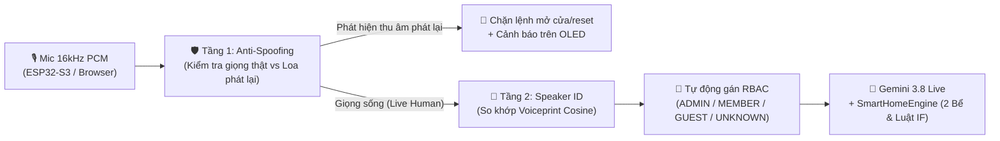

# 📋 KẾ HOẠCH KỸ THUẬT (CHUẨN BỊ): PHÂN TÍCH GIỌNG NÓI (SPEAKER ID) & CHỐNG THU ÂM PHÁT LẠI (ANTI-SPOOFING)

> **Trạng thái:** Bản thiết kế kỹ thuật chuẩn bị cho Giai đoạn tiếp theo (chưa nạp vào luồng chạy chính theo đúng chỉ đạo của Sếp).

---

## 1. Bài Toán 1: Phân Tích Giọng Nói — Nhận Diện "Ai Đang Nói" (Speaker Identification & RBAC)

### 1.1. Mục tiêu
- Khi một người nói vào Mic (hoặc gửi luồng PCM 16kHz từ ESP32-S3 INMP441), hệ thống tự động trích xuất **Vector đặc trưng giọng nói (Voiceprint / Speaker Embedding)** để biết chính xác:
  - **Ai đang nói?** (VD: *Sếp / Chủ nhà*, *Bố/Mẹ*, *Trẻ em*, hay *Người lạ*).
  - **Tự động gán quyền RBAC (`ADMIN`, `MEMBER`, `CHILD_GUEST`, `UNKNOWN`)** trước khi thực thi lệnh nhạy cảm (như *Mở cửa chính*, *Tắt còi báo động*, *Đổi lệnh*, *Reset hệ thống*).

### 1.2. Kiến trúc & Mô hình Đề xuất (Chạy Local siêu nhẹ, độ trễ < 35 ms)
1. **Mô hình trích xuất đặc trưng (Speaker Embedding):**
   - **Phương án 1 (Khuyên dùng cho Gateway / Raspberry Pi / Laptop):** **`Sherpa-ONNX` hoặc `SpeechBrain ECAPA-TDNN`** (`wespeaker-voxceleb-resnet34` định dạng ONNX INT8, nặng ~25 MB).
   - **Đầu vào:** Gói âm thanh giọng nói 16kHz PCM độ dài `1.0s – 2.5s` (lấy trực tiếp từ bộ đệm `mic_chunk` hiện có trước khi kết thúc câu).
   - **Đầu ra:** Vector `192 chiều` hoặc `256 chiều` đã chuẩn hóa L2 (`L2-normalized embedding`).
2. **Cơ chế Đăng ký Giọng (Voice Enrollment - 3 câu mẫu):**
   - Mỗi thành viên đọc 3 câu mẫu ngắn (mỗi câu ~2 giây). Hệ thống tính trung bình cộng 3 vector (`centroid_vector`) và lưu vào `simulator/data/voiceprints.json`.
3. **So khớp Cosine Similarity (`Cosine Scoring`):**
   - Khi có câu lệnh mới $\rightarrow$ tính $\text{score} = \cos(\vec{u}_{\text{live}}, \vec{u}_{\text{profile}})$:
     - $\text{score} \ge 0.72$: Xác nhận đúng người dùng đã đăng ký $\rightarrow$ Tự động chuyển quyền RBAC sang đúng vai trò của người đó (`ADMIN` / `MEMBER`).
     - $0.55 \le \text{score} < 0.72$: Nghi ngờ $\rightarrow$ Cho phép bật/tắt đèn, quạt nhưng yêu cầu đọc mật khẩu âm thanh nếu đòi mở cửa chính.
     - $\text{score} < 0.55$: **Người lạ (`UNKNOWN`)** $\rightarrow$ Chặn toàn bộ lệnh mở cửa, đổi luật, reset.

---

## 2. Bài Toán 2: Chống Thu Âm Phát Lại (Replay Attack / Anti-Spoofing Detection)

### 2.1. Nguy cơ Thực tế
- Kẻ gian đứng ngoài cửa dùng điện thoại thu âm lén câu *"Vừng ơi mở ra"* của Chủ nhà, sau đó bật loa điện thoại phát lại vào Mic của hệ thống để đánh lừa cả Gemini lẫn bộ nhận diện giọng nói.

### 2.2. Giải pháp Kết hợp 3 Lớp Phòng Thủ (3-Layer Liveness Defense)

| Lớp phòng thủ | Kỹ thuật xử lý tín hiệu (DSP / AI) | Nguyên lý phát hiện loa phát lại |
| :--- | :--- | :--- |
| **Lớp 1: Phổ tần số & Độ phẳng phổ (Spectral Flatness & High-Pass Roll-off)** | Phân tích FFT trên luồng PCM 16kHz (`0 – 8000 Hz`) | Loa điện thoại nhỏ bị suy hao mạnh ở dải trầm `< 120 Hz` (thiếu cộng hưởng lồng ngực thật) và tạo đỉnh méo hài bậc cao (`Harmonic Distortion`) + nhiễu nền băng thông hẹp ở `6.5 – 8 kHz`. |
| **Lớp 2: Áp suất hơi bật âm (Pop-Noise / Sub-bass Plosive Energy trên INMP441)** | Đo tỷ số năng lượng dải cận trầm `20 – 80 Hz` so với `300 – 3000 Hz` | Khi người thật nói gần mic MEMS (`INMP441`), các phụ âm bật hơi (*p, b, t, m, v*) tạo ra xung áp suất khí động học tần số thấp rất đặc trưng mà màng loa điện thoại phát lại không tái tạo được. |
| **Lớp 3: Thách đố ngẫu nhiên (Dynamic Challenge-Response) cho lệnh tối mật** | AI hỏi ngẫu nhiên 1 câu ngắn khi nghi ngờ (`Spoof Score > 0.5`) | Nếu phát hiện dấu hiệu âm thanh phát qua loa khi gọi lệnh *"Mở cửa chính"* hoặc *"Reset"*, AI hỏi ngẫu nhiên: *"Để mở cửa, vui lòng đọc số 4-8-2"*. Băng thu âm sẵn hoàn toàn vô dụng! |

---

## 3. Sơ Đồ Ghép Nối Vào Hệ Thống Hiện Tại (Khi Sếp Duyệt Triển Khai)

