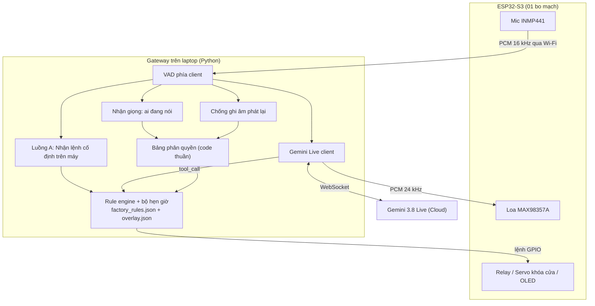
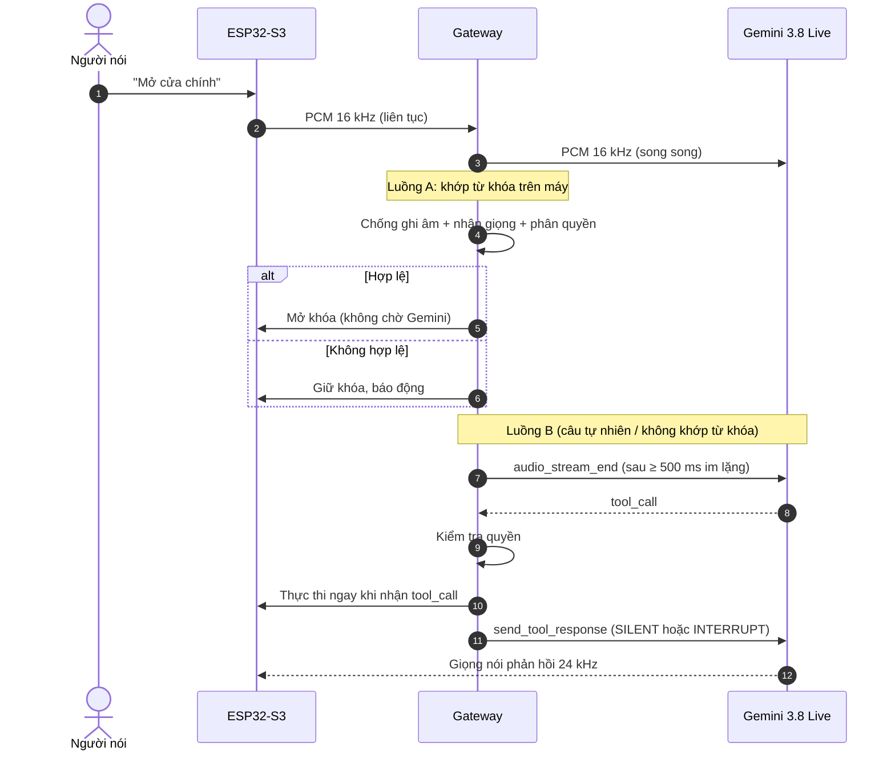
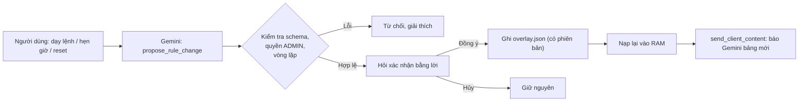

<metadata>
Title: Thiết kế Smart Home điều khiển bằng giọng nói — Bản v2 (đã đính chính)
Project: Đồ án tốt nghiệp Cử nhân Bách Khoa (1 sinh viên)
Supersedes: de_tai_smart_home_voice_ai_jev_1_nguoi.md
Updated: 2026-10-19
Status: DRAFT — mọi con số độ trễ trong tài liệu này là ƯỚC LƯỢNG, chưa đo
</metadata>

<context>
## 0. Đọc trước

Bản v1 có một số chỗ sai hoặc nói quá. Bản này sửa lại:

| Bản v1 nói | Thực tế |
|---|---|
| Đặt chờ im lặng (VAD) 200 ms | Tài liệu Google khuyến nghị 500–800 ms (mặc định server ~800 ms). Dưới 200 ms làm câu bị cắt vụn, Gemini nghe kém đi. Nếu tự phát hiện dứt lời ở phía mình (client-side VAD) thì nên ≥ 500 ms. |
| Tổng độ trễ ~551 ms / ~626 ms | Là số em tự ước lượng, chưa đo. Phải đo trên phần cứng thật. |
| Gemini luôn gửi tool_call trước giọng nói | Tài liệu không cam kết thứ tự này. |
| Chống ghi âm "chặn 100%" | Không có mô hình nào chặn 100%. Giọng nhân bản AI có thể qua mặt. |
| Dùng Jev | Đã bỏ — Gemini Live đã gọi hàm trực tiếp từ giọng nói, Jev bị thừa. |
</context>

<specifications>

## 1. Gemini Live API — tài liệu chính thức nói gì

Nguồn: [Changelog Gemini API](https://ai.google.dev/gemini-api/docs/changelog), [Model card gemini-3.8-live](https://ai.google.dev/gemini-api/docs/models/gemini-3.8-live), [Live API Tool Use](https://ai.google.dev/gemini-api/docs/live-tools), [Live API Capabilities](https://ai.google.dev/gemini-api/docs/live-guide).

### 1.1. Các cập nhật liên quan

| Ngày | Cập nhật |
|---|---|
| 15/09/2026 | `gemini-3.8-live` và `gemini-3.8-live-extended-thinking` chính thức (GA). 3.8 Live: gọi hàm bất đồng bộ là mặc định, cập nhật nội dung hội thoại trong suốt phiên. |
| 26/08/2026 | `gemini-3.5-transcribe-live` (nhận dạng giọng nói streaming) và `gemini-3.5-transcribe` (không streaming, có phân biệt người nói `spk_1`, `spk_2`). |
| 22/09/2026 | `gemini-3.8-flash-tts`, `gemini-3.8-flash-lite-tts` (đọc văn bản thành giọng nói). |

### 1.2. Gemini 3.8 Live làm được

| Khả năng | Ghi chú theo tài liệu |
|---|---|
| Nhận giọng nói, trả giọng nói | Vào: PCM 16-bit 16 kHz mono. Ra: PCM 24 kHz. |
| Tiếng Việt | Có (`vi`, nằm trong 99 ngôn ngữ). |
| Gọi hàm (function calling) | Có. Mặc định `NON_BLOCKING`: model vẫn nói tiếp trong khi hàm chạy. Kết quả hàm gửi lại kèm `scheduling`: `INTERRUPT` / `WHEN_IDLE` / `SILENT`. |
| Phải tự xử lý kết quả hàm | Live API không tự xử lý kết quả hàm. Code của mình nhận `tool_call` và gửi `send_tool_response`. |
| Xuất chữ từ giọng nói | Bật `input_audio_transcription` / `output_audio_transcription`. |
| Cập nhật ngữ cảnh giữa phiên | `send_client_content` dùng được suốt phiên → báo cho Gemini bảng lệnh mới mà không cần kết nối lại. |
| Hybrid VAD | Client gửi `audio_stream_end` khi phát hiện dứt lời → server trả lời ngay, bỏ qua thời gian chờ im lặng. Server VAD vẫn làm dự phòng. |

### 1.3. Gemini 3.8 Live KHÔNG làm được (phải tự làm)

| Việc | Lý do | Giải pháp |
|---|---|---|
| Biết ai đang nói (định danh) | Live API không có tính năng này. Diarization chỉ có ở `gemini-3.5-transcribe` (không streaming), và chỉ gắn nhãn `spk_1`/`spk_2`, không biết là ai. | Mô hình nhận giọng chạy trên máy (ECAPA-TDNN / 3D-Speaker qua sherpa-onnx). |
| Chống ghi âm phát lại | Không có. | Mô hình anti-spoofing chạy trên máy. |
| Hẹn giờ, dây chuyền, lưu luật, reset | Gemini chỉ phát ra lời gọi hàm. Không chạy nền, không lưu trạng thái lâu dài. | Rule engine + bộ hẹn giờ do mình viết. |
| Đảm bảo < 1 giây | Không có cam kết độ trễ trong tài liệu. Phụ thuộc mạng. | Lệnh quan trọng chạy trên máy (Luồng A, mục 3). |
| Phiên dài | Phiên chỉ có âm thanh: ~15 phút nếu không nén ngữ cảnh. Một kết nối sống ~10 phút. | Bật nén ngữ cảnh + session resumption, tự kết nối lại. |
| Structured outputs, code execution | Model card ghi "Not supported". | Dùng function calling với schema tham số chặt. |

---

## 2. Kiến trúc chốt (không Jev)

Nguyên tắc:
1. **Quyết định cho phép hay chặn là code thuần**, không giao cho AI: `chấp nhận = giọng_thật AND điểm_giọng ≥ ngưỡng(lệnh) AND vai_trò ≥ yêu_cầu(lệnh)`.
2. **Gemini không trực tiếp điều khiển phần cứng.** Gemini chỉ đề xuất qua `tool_call`. Rule engine kiểm tra rồi mới thực thi.
3. **Lệnh quan trọng (mở cửa) có đường chạy trên máy**, không phụ thuộc mạng.

---

## 3. Hai luồng thực thi

### Luồng A — Lệnh đã biết (mở cửa, bật đèn, từ khóa đã dạy): chạy trên máy

- Nhận dạng cụm từ ngay trên laptop (nhận dạng từ khóa hoặc ASR streaming + so khớp bảng alias).
- Ưu điểm: nhận dạng từ khóa có thể kích hoạt ngay khi nghe xong cụm từ, **không cần chờ 500 ms im lặng**. Đây là cách duy nhất có cơ hội thực sự để đạt < 1 giây ổn định.
- Gemini vẫn được gửi âm thanh song song để trả lời bằng giọng nói, nhưng cửa không chờ Gemini.

> [!WARNING]
> Cần kiểm tra: có mô hình nhận dạng từ khóa / ASR streaming **tiếng Việt** chạy được trên máy hay không (sherpa-onnx, v.v.). ESP-SR MultiNet của Espressif theo em biết chỉ hỗ trợ tiếng Anh và tiếng Trung — cần xác minh lại. Nếu không có model tiếng Việt phù hợp, Luồng A phải dùng phương án khác (ví dụ: từ khóa tiếng Anh, hoặc Gemini Live Transcribe rồi so khớp — chậm hơn).

### Luồng B — Câu nói tự nhiên, dạy lệnh mới, hẹn giờ, reset: qua Gemini Live

- Hybrid VAD: client phát hiện dứt lời (khuyến nghị ≥ 500 ms im lặng) → gửi `audio_stream_end`.
- Gemini trả `tool_call` → Gateway kiểm tra quyền → thực thi ngay → gửi `send_tool_response` với `scheduling="SILENT"` (nếu được phép) hoặc `"INTERRUPT"` (nếu bị chặn).
- **Kích hoạt trước, nói sau** (phía mình đảm bảo được): hễ nhận `tool_call` là kích GPIO luôn, không chờ âm thanh. Nhưng **không đảm bảo** cửa mở trước khi Gemini bắt đầu nói, vì tài liệu không cam kết thứ tự.
- Luồng B **không cam kết < 1 giây**: 500 ms chờ im lặng + thời gian mạng + thời gian model (chưa biết) — rất có thể vượt 1 giây.

---

## 4. Định danh người nói và phân quyền

1. **Đăng ký:** mỗi người nói 3–5 câu → model nhận giọng tạo vector đặc trưng → lưu trung bình vào `voiceprints.json` kèm vai trò.
2. **Nhận dạng:** đoạn âm thanh lệnh → vector → độ tương đồng cosine với từng người → lấy người cao nhất.
3. **Quyết định:** nếu điểm cao nhất < ngưỡng sàn → người lạ. Nếu không, so vai trò với yêu cầu của lệnh.

Ngưỡng (0.65 / 0.72 / 0.78 trong v1) là **ví dụ minh họa**. Ngưỡng thật phải chọn từ dữ liệu đo: thu giọng của người trong nhà và người ngoài, vẽ đường cong FAR/FRR, chọn điểm làm việc cho từng cấp lệnh.

Lưu ý: câu lệnh ngắn (~1 giây) cho độ chính xác nhận giọng thấp hơn câu dài. Đây là rủi ro thật, cần đo.

---

## 5. Chống ghi âm phát lại

- Lớp 1: mô hình anti-spoofing chạy trên máy. Báo cáo bằng EER (tỷ lệ lỗi cân bằng) đo trên dữ liệu tự thu: phát lại bằng 2–3 điện thoại khác nhau, ở các khoảng cách khác nhau.
- Lớp 2 (cho lệnh mở cửa): mã ngẫu nhiên trên OLED, người nói phải đọc kèm. Chặn được ghi âm cũ, nhưng **không chặn được** người đứng tại chỗ dùng giọng nhân bản AI đọc mã.
- Kết luận đúng để ghi trong luận văn: hệ thống **giảm rủi ro**, không **loại bỏ** rủi ro. Khóa cửa thật phải có phương án dự phòng (chìa cơ / bàn phím).

---

## 6. Rule engine: đổi từ, nâng cấp lệnh, dây chuyền, hẹn giờ, reset

### 6.1. Hàm giao cho Gemini

| Hàm | Việc |
|---|---|
| `execute_command(command_id)` | Chạy một lệnh đã có |
| `propose_rule_change(change)` | Đề xuất thay đổi luật — **chưa áp dụng** |
| `confirm_rule_change(proposal_id)` | Áp dụng sau khi người dùng xác nhận bằng lời |
| `reset_rules()` | Đề xuất reset — cũng cần xác nhận |

Gemini **không sửa code**. Gemini tạo đề xuất JSON. Code của mình:
1. Kiểm tra theo JSON Schema (thiết bị có tồn tại không, hành động hợp lệ không).
2. Kiểm tra quyền: chỉ ADMIN được đổi luật.
3. **Kiểm tra vòng lặp dây chuyền** (A bật B, B bật A → lặp vô hạn) — dùng phát hiện chu trình trên đồ thị.
4. Hỏi xác nhận → ghi `overlay.json` (giữ lại các phiên bản cũ để hoàn tác) → nạp lại vào RAM.
5. Gửi bảng lệnh mới cho Gemini qua `send_client_content` để Gemini biết.

### 6.2. Reset

`factory_rules.json` chỉ đọc. Reset = xóa `overlay.json` + hủy các hẹn giờ đang chờ + nạp lại bản gốc. Vẫn cần xác nhận bằng lời và quyền ADMIN.

### 6.3. Hẹn giờ và độ trễ dây chuyền

Chạy bằng bộ hẹn giờ trong Gateway (ví dụ APScheduler). Lưu lịch xuống đĩa để không mất khi khởi động lại.

---

## 7. Kế hoạch đo độ trễ (bắt buộc trước khi viết số vào luận văn)

**Định nghĩa:** độ trễ = thời điểm dứt lời → thời điểm relay đóng.

**Cách đo khách quan:** dùng 1 mic ghi cùng lúc giọng nói và tiếng "click" của relay (hoặc đưa tín hiệu GPIO vào kênh âm thanh thứ 2). Đo khoảng cách trên dạng sóng.

**Ghi log từng mốc trong Gateway:** dứt lời (VAD) → khớp từ khóa → nhận giọng xong → chống giả mạo xong → nhận `tool_call` → gửi GPIO → ESP32 xác nhận.

**Kịch bản:** mỗi trường hợp ≥ 50 lần.
- Luồng A, mạng tốt
- Luồng B, mạng tốt
- Luồng B, hotspot 4G
- Phòng yên tĩnh vs có tiếng TV

**Báo cáo:** trung vị, p95, tối đa. Kết luận "< 1 giây" chỉ khi p95 < 1 giây.

---

## 8. Rủi ro còn mở

| Rủi ro | Mức | Việc cần làm |
|---|---|---|
| Không có model nhận dạng tiếng Việt chạy trên máy cho Luồng A | Cao | Tìm và thử ngay tuần đầu |
| Luồng B vượt 1 giây | Cao | Chấp nhận; chỉ cam kết < 1 giây cho Luồng A |
| Nhận giọng kém với câu ngắn | Trung bình | Đo FAR/FRR; cân nhắc yêu cầu câu dài hơn cho lệnh mở cửa |
| Mất mạng khi bảo vệ | Trung bình | Luồng A vẫn chạy; mang hotspot dự phòng |
| Gemini hiểu sai, gọi nhầm hàm | Trung bình | Rule engine kiểm tra; lệnh nguy hiểm luôn qua cổng phân quyền |

</specifications>
