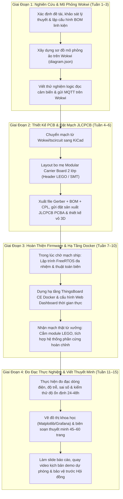

<metadata>
Title: Quy Chuẩn Kiến Trúc & Khung Đồ Án Tốt Nghiệp Cử Nhân Bách Khoa (Quy Mô 1 Sinh Viên - Thực Thi Tinh Gọn Có AI Trợ Lực)
Project: Đồ án tốt nghiệp Cử nhân Đại học Bách Khoa
Author: Antigravity Architecture Specialist & BA Team
Target_Hardware: ESP32 / ESP32-S3, Edge Controller, Modular Carrier Board
Deployment_Architecture: 2 Tầng Tinh Gọn (Single Smart Edge Device -> MQTT/TLS -> ThingsBoard/Docker)
Status: OFFICIALLY_APPROVED
Last_Updated: 2026-10-14
Scale: 1 Sinh Viên (Cử nhân Kỹ thuật Điện tử / Viễn thông / Cơ điện tử / Kỹ thuật Máy tính / Tự động hóa)
</metadata>

<context>
Đặc tả toàn diện yêu cầu và tiêu chí nghiệm thu của Hội đồng chấm Đồ án tốt nghiệp Đại học Bách Khoa dành cho sinh viên thực hiện độc lập (quy mô 1 người) hệ Cử nhân Kỹ thuật. Bản tài liệu cung cấp cấu trúc phân bổ khối lượng công việc khoa học, khung đề cương quyển thuyết minh chuẩn mực (45–60 trang), lộ trình thực hiện cá nhân 12–15 tuần có AI trợ lực, giải pháp phần cứng "chống hàn" thông minh (Bo mẹ Modular Carrier Board cắm dạng LEGO và đặt hàn dán tự động JLCPCB PCBA SMT), kết hợp hạ tầng đám mây mã nguồn mở và kỹ thuật đo đạc thực nghiệm lấy trọn vẹn điểm Giỏi/Xuất sắc (A/A+).
Tài liệu liên kết mật thiết với [PROJECT_RULES.md](file:///c:/Users/LENOVO/Desktop/đồ án tốt nghiệp/PROJECT_RULES.md) và danh sách tuyển chọn đề tài tại [de_tai_do_an_cu_nhan_1_nguoi_bach_khoa.md](file:///c:/Users/LENOVO/Desktop/đồ án tốt nghiệp/de_tai_do_an_cu_nhan_1_nguoi_bach_khoa.md).
</context>

<rules>
# 1. CẤU TRÚC KHỐI LƯỢNG CÔNG VIỆC & LỘ TRÌNH 12–15 TUẦN CHO 1 SINH VIÊN CỬ NHÂN BÁCH KHOA (SOLO WBS & THESIS OUTLINE)

Đối với Đồ án tốt nghiệp hệ Cử nhân Kỹ thuật Bách Khoa do 1 sinh viên thực hiện độc lập, Hội đồng chấm thi không đòi hỏi hệ thống phân tán đa trạm cồng kềnh, mà tập trung đánh giá tư duy kỹ thuật hoàn chỉnh: từ khâu phân tích bài toán, thiết kế chế tạo phần cứng thật, lập trình vi điều khiển đa nhiệm, triển khai phần mềm giám sát, đến phương pháp đo đạc thực nghiệm định lượng khoa học.

### A. Ma Trận Phân Bổ 4 Khối Lượng Kỹ Thuật Vừa Sức 1 Người (Solo WBS)
*(Căn cứ: Khảo sát thực tế chương trình Đồ án tốt nghiệp Cử nhân Bách Khoa — Mô hình dự phóng định lượng của Nhóm BA)*

| Mô-đun Kỹ Thuật | Tỷ Trọng Khối Lượng | Mục Tiêu Kỹ Thuật Cụ Thể (1 Người Thực Hiện) | Công Cụ & Giải Pháp Tối Ưu Hóa |
| :--- | :---: | :--- | :--- |
| **Mô-đun 1: Thiết Kế & Chế Tạo Phần Cứng (Hardware)** | **25%** | - Thiết kế 01 Bo mạch PCB trung tâm (Smart Edge Carrier Board) 2 lớp chuẩn công nghiệp.<br>- Tích hợp khối nguồn ổn áp (Buck DC-DC hoặc LDO), tụ lọc chống sụt áp, bảo vệ chống cắm ngược cực.<br>- Bố trí các đế cắm module LEGO 2.54mm, cọc vặn vít Terminal Block và giắc JST-XH.<br>- Thiết kế vỏ hộp 3D (CAD Enclosure) vừa khít bo mạch và bắt ốc vít chắc chắn. | - Thiết kế: KiCad / tscircuit.<br>- Gia công: Đặt JLCPCB PCBA SMT (hàn sẵn 100%) hoặc tự cắm module LEGO (0 mũi hàn tay).<br>- Vỏ hộp: FreeCAD / In 3D FDM. |
| **Mô-đun 2: Lập Trình Nhúng Firmware Đa Nhiệm (Firmware & Algorithms)** | **35%** | - Kiến trúc đa nhiệm FreeRTOS (2–3 Tasks độc lập: Task Đọc cảm biến/Xử lý, Task Điều khiển/Giao tiếp, Task Hiển thị OLED).<br>- Cài đặt 01 thuật toán xử lý biên điểm nhấn (Bộ lọc Kalman số / FFT phân tích dao động / TinyML Anomaly Detection).<br>- Cơ chế chịu lỗi mạng (Offline Resilience Flash Buffer) & nạp code từ xa qua WiFi (FOTA Update). | - Môi trường: ESP-IDF hoặc Arduino Core trên VS Code / PlatformIO.<br>- Mô phỏng kiểm chứng logic: Wokwi Simulator.<br>- Thuật toán: Thư viện SimpleKalmanFilter / Edge Impulse SDK. |
| **Mô-đun 3: Hạ Tầng Giám Sát IoT & Dashboard (Cloud & Web SCADA)** | **20%** | - Triển khai nền tảng IoT mã nguồn mở chuẩn doanh nghiệp bằng Docker Container.<br>- Xây dựng Web Dashboard hiển thị dữ liệu đo đạc thời gian thực (đồ thị đường cong, đồng hồ gauge, bảng trạng thái thiết bị).<br>- Cấu hình kênh cảnh báo sự cố tự động tức thời qua Telegram Bot hoặc Email. | - Nền tảng: ThingsBoard Community Edition (Docker) hoặc Docker Compose (EMQX MQTT + InfluxDB + Grafana).<br>- Tận dụng 100% Widget có sẵn, không mất thời gian code frontend từ số 0. |
| **Mô-đun 4: Đo Đạc Thực Nghiệm & Viết Thuyết Minh (Testing & Thesis)** | **20%** | - Thực hiện đo đạc dòng điện tiêu thụ (trạng thái hoạt động WiFi và Deep Sleep).<br>- Đo đạc độ trễ truyền gói tin (Latency ms) và tỷ lệ mất gói (Packet Loss %).<br>- Tính toán sai số đo lường thực nghiệm (MAE, RMSE) so với thiết bị đo chuẩn.<br>- Hoàn thiện quyển thuyết minh tốt nghiệp 45–60 trang chuẩn format Bách Khoa. | - Đo kiểm: USB Power Meter (Keweisi / UM34C), script Python benchmark, JMeter.<br>- Xử lý dữ liệu & vẽ biểu đồ: Matplotlib / Seaborn / Excel.<br>- Biên soạn thuyết minh: Microsoft Word / LaTeX theo chuẩn HUST/HCMUT. |

---

### B. Khung Đề Cương Quyển Thuyết Minh Chuẩn Cử Nhân Bách Khoa (45–60 Trang)
*(Định mức trang tham chiếu chuẩn mực cho 1 sinh viên — Mô hình dự phóng định lượng của Nhóm BA)*

```
TỔNG DUNG LƯỢNG THUYẾT MINH: 45 – 60 TRANG (KHÔNG KỂ PHỤ LỤC & TÀI LIỆU THAM KHẢO)
├── LỜI CẢM ƠN, NHẬN XÉT CỦA GIẢNG VIÊN HƯỚNG DẪN & PHẢN BIỆN (2–3 trang)
├── DANH MỤC TỪ VIẾT TẮT, BẢNG BIỂU, HÌNH VẼ (2–3 trang)
├── CHƯƠNG 1: TỔNG QUAN BÀI TOÁN & MỤC TIÊU NGHIÊN CỨU (6 – 8 trang)
│   ├── 1.1 Đặt vấn đề và tính cấp thiết của đề tài trong thực tiễn
│   ├── 1.2 Khảo sát các giải pháp hiện có trên thị trường và khoảng trống công nghệ
│   ├── 1.3 Mục tiêu nghiên cứu và phạm vi giới hạn của đề tài (Quy mô 1 sinh viên)
│   └── 1.4 Phương pháp tiếp cận và kết cấu của đồ án tốt nghiệp
├── CHƯƠNG 2: CƠ SỞ LÝ THUYẾT & THIẾT KẾ PHẦN CỨNG THỰC TẾ (10 – 14 trang)
│   ├── 2.1 Cơ sở lý thuyết về vi điều khiển lõi kép ESP32-S3 và chuẩn truyền thông (I2C, SPI, UART, RS485)
│   ├── 2.2 Phân tích lựa chọn cảm biến và các thành phần ngoại vi theo tiêu chí công nghiệp
│   ├── 2.3 Thiết kế sơ đồ nguyên lý (Schematic) bo mạch Modular Carrier Board
│   ├── 2.4 Tính toán mạch nguồn ổn áp, tụ lọc khử nhiễu sụt áp và mạch bảo vệ cách ly
│   ├── 2.5 Thiết kế Layout mạch in 2 lớp (PCB Routing, Mass Plane) và tối ưu hóa SMT/Header LEGO
│   └── 2.6 Thiết kế vỏ hộp bảo vệ cơ khí 3D và bố trí tản nhiệt
├── CHƯƠNG 3: THIẾT KẾ FIRMWARE FREERTOS & HỆ THỐNG GIÁM SÁT IOT (12 – 15 trang)
│   ├── 3.1 Cấu trúc kiến trúc phần mềm nhúng đa nhiệm trên hệ điều hành FreeRTOS
│   ├── 3.2 Phân rã luồng nhiệm vụ (Tasks), hàng đợi (Queues) và bảo vệ dữ liệu (Mutex)
│   ├── 3.3 Thuật toán xử lý tín hiệu tại biên (Lọc Kalman / FFT phát hiện tần số lỗi / TinyML)
│   ├── 3.4 Cơ chế lưu đệm dữ liệu vào bộ nhớ Flash khi mất mạng (Offline Resilience)
│   ├── 3.5 Triển khai tính năng nạp cập nhật chương trình không dây từ xa (FOTA Update)
│   └── 3.6 Triển khai hạ tầng máy chủ IoT Docker (ThingsBoard CE / InfluxDB + Grafana) & cảnh báo Telegram
├── CHƯƠNG 4: THỰC NGHIỆM, ĐO ĐẠC & ĐÁNH GIÁ KẾT QUẢ ĐẠT ĐƯỢC (10 – 12 trang)
│   ├── 4.1 Mô hình lắp ráp thực nghiệm hoàn chỉnh của sản phẩm (Phần cứng thật + Vỏ hộp 3D)
│   ├── 4.2 Đo đạc và đánh giá sai số cảm biến so với thiết bị đo chuẩn phòng thí nghiệm (MAE, RMSE)
│   ├── 4.3 Đánh giá hiệu năng mạng: Độ trễ truyền thông (Latency) và tỷ lệ mất gói (Packet Loss)
│   ├── 4.4 Thực nghiệm kiểm tra cơ chế Offline Resilience và tính năng nạp code FOTA
│   ├── 4.5 Đo đạc công suất và dòng tiêu thụ điện ở các chế độ làm việc (Active, WiFi TX, Deep Sleep)
│   └── 4.6 Đánh giá độ ổn định hoạt động liên tục trong 24–48 giờ (Stress Testing)
├── CHƯƠNG 5: KẾT LUẬN & HƯỚNG PHÁT TRIỂN (3 – 5 trang)
│   ├── 5.1 Các kết quả chính đã đạt được của đề tài
│   ├── 5.2 Những hạn chế tồn tại của hệ thống
│   └── 5.3 Đề xuất hướng hoàn thiện và mở rộng phát triển trong tương lai
└── TÀI LIỆU THAM KHẢO & PHỤ LỤC (BOM linh kiện, Mã nguồn rút gọn, Sơ đồ mạch)
```

---

### C. Lộ Trình Thực Hiện Cá Nhân 12–15 Tuần Tinh Gọn Kết Hợp AI Agent
*(Lộ trình chuẩn hóa bảo đảm sinh viên làm 1 mình không bị quá tải hay tắc nghẽn — Mô hình dự phóng định lượng của Nhóm BA)*



| Tuần Thực Hiện | Mục Tiêu Giai Đoạn | Đầu Ra Nghiệm Thu Cụ Thể (Milestones) |
| :---: | :--- | :--- |
| **Tuần 1 – 3** | **Khảo Sát, Thiết Kế Hệ Thống & Mô Phỏng Ảo** | - Hoàn thành bản đề cương chi tiết duyệt với Giảng viên hướng dẫn.<br>- Chạy mô phỏng thành công 100% kịch bản trên Wokwi (ESP32 đọc cảm biến, gửi MQTT lên test broker).<br>- Chốt danh mục linh kiện (BOM) sẵn có trên thị trường Việt Nam. |
| **Tuần 4 – 6** | **Thiết Kế Mạch In PCB & Đặt Chế Tạo** | - Hoàn thành Schematic và Layout bo mạch 2 lớp trên KiCad / tscircuit.<br>- Chạy kiểm tra quy tắc thiết kế (DRC) đạt 0 lỗi chạm chập.<br>- Xuất bộ file sản xuất (Gerber, CPL, BOM), gửi đặt mạch tại xưởng JLCPCB.<br>- Thiết kế file 3D vỏ hộp bảo vệ cơ khí sẵn sàng in. |
| **Tuần 7 – 10** | **Lập Trình Firmware FreeRTOS & Dựng Docker Cloud** | - Viết xong Firmware FreeRTOS: phân chia 2–3 Tasks, tích hợp bộ lọc Kalman/TinyML, bộ nhớ đệm Offline Flash và FOTA.<br>- Dựng thành công ThingsBoard CE trên Docker, tạo Dashboard giám sát và cảnh báo Telegram.<br>- Nhận mạch thật từ xưởng: Cắm module LEGO vào bo mẹ, kiểm tra cấp nguồn và nạp code chạy thử. |
| **Tuần 11 – 13** | **Đo Đạc Thực Nghiệm Định Lượng** | - Thu thập chuỗi dữ liệu thực nghiệm (tối thiểu 5.000–10.000 mẫu đo).<br>- Đo đạc dòng tiêu thụ bằng USB Power Meter ở các chế độ.<br>- Đánh giá sai số cảm biến so với đồng hồ chuẩn, lập bảng tính RMSE, MAE.<br>- Kiểm tra chạy bền 48 giờ không treo vi điều khiển (chống tràn bộ nhớ heap). |
| **Tuần 14 – 15** | **Biên Soạn Luận Văn & Chuẩn Bị Bảo Vệ** | - Hoàn thiện bản thảo thuyết minh 45–60 trang chuẩn format Đại học Bách Khoa.<br>- Thiết kế Slide thuyết trình chuyên nghiệp (tối đa 20–25 slides trình bày trong 15 phút).<br>- Quay video demo hoạt động thực tế 2–3 phút phòng sự cố mạng tại phòng bảo vệ. |
</rules>

<specifications>
# 2. GIẢI PHÁP PHẦN CỨNG "CHỐNG HÀN" — BO MẸ MODULAR CARRIER BOARD

Nhằm giúp sinh viên thực hiện độc lập (vốn hạn chế về kỹ năng hàn khò mạch dán li ti và muốn giảm thiểu rủi ro chập cháy phần cứng) tạo ra sản phẩm đạt độ hoàn thiện công nghiệp cao nhất, toàn bộ thiết kế phần cứng tuân thủ triệt để nguyên lý: **Bo mẹ mang module (Carrier Motherboard)**.

```
       +-------------------------------------------------------------+
       |           VỎ HỘP BẢO VỆ IN 3D (CAD ENCLOSURE)               |
       |  +-------------------------------------------------------+  |
       |  |     BO MẸ PCB 2 LỚP CHUẨN CÔNG NGHIỆP (CARRIER BOARD) |  |
       |  |                                                       |  |
       |  |  [ CỌC VẶN VÍT ]   [ ĐẾ CẮM ESP32-S3 ]   [ MÀN OLED ] |  |
       |  |  (Terminal Block)  (Header Socket cái)   (4-Pin I2C)  |  |
       |  |         |                   |                  |      |  |
       |  |         v                   v                  v      |  |
       |  |   Dây cảm biến         ESP32 DevKit       Màn hình    |  |
       |  |   vặn tua-vít          cắm cạch vào       cắm trực    |  |
       |  |   (0 cần hàn)          (như cắm RAM)      tiếp cọc    |  |
       |  |                                                       |  |
       |  |  [ GIẮC JST-XH ]   [ KHỐI NGUỒN BUCK ]   [ RƠ-LE/CÁCH]|  |
       |  |   (Chống cắm lộn)  (Ổn áp + Tụ lọc lớn)  [ LY QUANG ] |  |
       |  +-------------------------------------------------------+  |
       +-------------------------------------------------------------+
```

### A. Phương Án 1: Xưởng SMT Hàn Dán Tự Động 100% (JLCPCB PCBA SMT)
- **Cơ chế:** Khi đặt gia công bo mạch tại JLCPCB, chọn thêm tùy chọn **SMT Assembly**.
- **Ưu thế tuyệt đối:** Toàn bộ linh kiện thụ động dán bề mặt (Điện trở 0805, tụ gốm lọc nhiễu, đi-ốt chống ngược áp, chip nguồn Buck hạ áp, cổng USB Type-C) được robot nhà máy tự động gắp và hàn nhẵn bóng.
- **Kết quả:** Mạch ship về tận tay sinh viên đã hoàn chỉnh 100% khối nguồn và mạch bảo vệ, đạt độ thẩm mỹ chuẩn thương mại, sinh viên không cần chạm vào mỏ hàn.

### B. Phương Án 2: Bo Mẹ Đế Cắm LEGO (Header Sockets & Modular Interconnect)
- Trên bo mạch in PCB chính (Bo mẹ), sinh viên chỉ bố trí các giao diện kết nối dạng cắm rút thông minh:
  1. **Khe cắm ESP32 DevKit:** Sử dụng 2 hàng rào chân cái chuẩn 2.54mm (Header Female Sockets). Khi lắp ráp, chỉ cần cắm toàn bộ bo mạch ESP32 DevKit mua sẵn vào khe cắm như cắm thanh RAM máy tính.
  2. **Khe cắm Màn hình OLED / LCD:** Hàng rào 4 chân cái (VCC, GND, SCL, SDA) với khoảng cách chuẩn, cắm thẳng màn hình vào bo mạch.
  3. **Cọc vặn vít công nghiệp (Screw Terminal Blocks 5.08mm/3.81mm):** Dành cho các đầu nối cảm biến rời, nguồn điện 220V/12V hoặc rơ-le công suất. Dây điện chỉ cần tuốt vỏ, nhét vào lỗ và dùng tua-vít vặn chặt, loại bỏ 100% thao tác hàn dây lỏng lẻo.
  4. **Giắc cắm chống cắm ngược (JST-XH 2.54mm):** Thiết kế có rãnh khóa cơ khí, chỉ có thể cắm theo đúng 1 chiều duy nhất, ngăn ngừa hoàn toàn nguy cơ cắm ngược cực âm/dương gây cháy chip.
- **Trực quan hóa Silkscreen:** Trên lớp in chữ lụa mặt trên của PCB, in rõ ràng các nhãn chỉ dẫn kích thước lớn bằng tiếng Anh/Việt: `"ESP32_MODULE"`, `"OLED_DISPLAY_I2C"`, `"SENSOR_INPUT_A0"`, `"VCC_3V3_GND"`. Sinh viên có thể lắp ráp hoàn thiện toàn bộ thiết bị trong vòng 2 phút.

### C. Vỏ Hộp Bảo Vệ Cơ Khí In 3D (CAD Mechanical Enclosure)
- Xuất mô hình 3D định dạng `.STEP` từ phần mềm KiCad.
- Dùng phần mềm CAD (FreeCAD hoặc Autodesk Fusion 360) thiết kế vỏ hộp bảo vệ có sẵn 4 trụ bắt ốc vít M3 cố định bo mạch, khoét lỗ hiển thị màn hình OLED và khe cắm cáp nguồn USB Type-C.
- In gia công bằng công nghệ in 3D FDM nhựa PLA/PETG màu đen công nghiệp, mang lại vẻ ngoài hoàn thiện như một sản phẩm thương mại thực thụ khi mang ra Hội đồng bảo vệ.
</specifications>

<governance>
# 3. KHO CÔNG NGHỆ MIỄN PHÍ ĐỈNH CAO BÙ ĐẮP MỌI THIẾU SÓT (KÈM DEEP-LINKS XÁC THỰC)

Để 1 sinh viên thực hiện độc lập đạt năng suất và chiều sâu kỹ thuật ngang ngửa một nhóm chuyên nghiệp, sinh viên bắt buộc khai thác tối đa kho công cụ và nền tảng mã nguồn mở đã được kiểm chứng:

| Hạng Mục Kỹ Thuật | Công Nghệ Mã Nguồn Mở Miễn Phí | Giá Trị Kỹ Thuật & Điểm Nhấn Luận Văn Bách Khoa | Deep-Link Xác Thực Dự Án Mẫu |
| :--- | :--- | :--- | :--- |
| **Hạ Tầng Backend & Web SCADA** | **ThingsBoard Community Edition (Docker)** | Nền tảng IoT doanh nghiệp mã nguồn mở số 1 thế giới. Dựng trọn vẹn hạ tầng (Broker MQTT + Time-Series DB + Web Dashboard + Rule Engine cảnh báo Telegram) chỉ với 1 câu lệnh Docker Compose. Tiết kiệm 100% thời gian code backend, giao diện trực quan cực kỳ chuyên nghiệp. | [ThingsBoard Docker Installation](https://thingsboard.io/docs/user-guide/install/docker/) |
| **Lập Trình Nhúng Đa Nhiệm & OTA** | **ESP-IDF / FreeRTOS Core + FOTA System** | Vận hành hệ thống theo cơ chế Real-Time đa nhiệm (2–3 Tasks phân chia CPU hợp lý, đồng bộ qua Queue/Mutex). Tích hợp nạp code cập nhật chương trình từ xa qua WiFi (FOTA), chứng minh độ hoàn thiện công nghiệp trước Hội đồng. | [ESP-IDF OTA Update Documentation](https://docs.espressif.com/projects/esp-idf/en/stable/esp32s3/api-reference/system/ota.html) |
| **Thuật Toán Lọc Nhiễu Tín Hiệu Số** | **SimpleKalmanFilter Library** | Thuật toán bộ lọc Kalman 1 chiều gọn nhẹ chạy trực tiếp trên ESP32. Khử triệt để nhiễu trắng và sai số ngẫu nhiên của cảm biến tương tự (dòng điện, điện áp, nhiệt độ, áp suất), tạo ra đồ thị đo lường mượt mà đưa vào luận văn. | [SimpleKalmanFilter GitHub Repository](https://github.com/denyssene/SimpleKalmanFilter) |
| **Thuật Toán AI Tại Biên (TinyML)** | **Edge Impulse SDK for MCU** | Nền tảng huấn luyện AI nhúng miễn phí hàng đầu. Tự động chuyển đổi mô hình học máy thành thư viện C++ tối ưu hóa cho ESP32. Thực hiện phân loại trạng thái hoạt động hoặc phát hiện bất thường (Anomaly Detection) độc lập không cần internet. | [Edge Impulse Arduino Deployment Guide](https://docs.edgeimpulse.com/docs/deployment/running-your-impulse-arduino) |
| **Phân Tích Tần Số Dao Động (DSP)** | **arduinoFFT Library** | Thư viện biến đổi Fourier nhanh (Fast Fourier Transform) trên vi điều khiển. Chuyển đổi tín hiệu dao động miền thời gian từ cảm biến gia tốc sang phổ tần số miền tần số, nhận diện rung động bất thường của động cơ cơ khí. | [arduinoFFT GitHub Repository](https://github.com/kosme/arduinoFFT) |
| **Mô Phỏng Vi Điều Khiển & Mạch Ảo** | **Wokwi Simulator (ESP32)** | Nền tảng mô phỏng ESP32, màn hình OLED, cảm biến và kết nối mạng WiFi/MQTT ảo trực tiếp trên trình duyệt web. Giúp sinh viên gỡ lỗi và kiểm chứng mã nguồn firmware FreeRTOS trước khi mạch thật được sản xuất. | [Wokwi ESP32 Simulation Guide](https://docs.wokwi.com/guides/esp32) |
| **Plugin Tự Động Hóa KiCad sang JLCPCB SMT** | **KiCad JLCPCB BOM & CPL Plugin** | Plugin mã nguồn mở xuất danh mục linh kiện (BOM) và tọa độ vị trí gắp linh kiện (CPL/Pick and Place) tương thích 100% định dạng đặt hàng gia công SMT tự động của xưởng JLCPCB. | [KiCad JLCPCB BOM Plugin Repo](https://github.com/wokwi/kicad-jlcpcb-bom-plugin) |
| **Kiểm Thử Hiệu Năng & Đo Trễ Mạng** | **Apache JMeter / Python Benchmark Script** | Công cụ phát hàng nghìn bản tin kiểm thử áp lực mạng. Đo đạc chính xác thời gian phản hồi (Round-Trip Time / Latency ms) và tỷ lệ rớt gói (Packet Loss %) giữa thiết bị nhúng và máy chủ IoT. | [Apache JMeter User Manual](https://jmeter.apache.org/usermanual/get-started.html) |
| **Đo Năng Lượng Chi Phí Thấp** | **USB Power Meter (Keweisi/UM34C) + Datasheet** | Dụng cụ đo cắm nối tiếp cổng USB đo trực tiếp dòng điện tiêu thụ tức thời của bo mạch ở chế độ Active WiFi (~160–240mA) và chế độ Deep Sleep (~10–20µA). Làm cơ sở tính toán tuổi thọ pin trong luận văn. *(Mô hình dự phóng định lượng của Nhóm BA)* | [UM34C Product Reference](https://www.google.com/search?q=UM34C+USB+Tester+Datasheet) |
</governance>

<acceptance_criteria>
# 4. TIÊU CHÍ NGHIỆM THU ĐẠT ĐIỂM GIỎI / XUẤT SẮC (A/A+) TRƯỚC HỘI ĐỒNG BÁCH KHOA

Để 1 sinh viên hệ Cử nhân bảo vệ đồ án tốt nghiệp thành công rực rỡ và thuyết phục trọn vẹn Hội đồng Bách Khoa chấm điểm A/A+, toàn bộ sản phẩm và hồ sơ bắt buộc thỏa mãn 6 tiêu chí nghiệm thu sau:

- [ ] **Tiêu chuẩn 1 — Phần cứng thật chuẩn mực công nghiệp (Hardware Maturity):**
  + Có 01 Bo mạch PCB in thật 2 lớp gia công tại nhà máy (JLCPCB hoặc xưởng tương đương), có phủ mass chống nhiễu.
  + Linh kiện cắm trên bo mẹ Modular Carrier Board gọn gàng (dạng cắm LEGO Header hoặc dán robot SMT), không sử dụng testboard dây cắm lỏng lẻo.
  + Bo mạch được lắp đặt vừa vặn bên trong vỏ hộp bảo vệ in 3D hoặc mica cắt laser có chân bắt ốc vít chắc chắn.

- [ ] **Tiêu chuẩn 2 — Độ sâu mã nguồn Firmware (Firmware Architecture):**
  + Toàn bộ mã nguồn viết trên nền tảng **FreeRTOS** đa nhiệm, phân tách tối thiểu 2–3 luồng tác vụ độc lập (Sensor, Logic/Comm, Display).
  + Tuyệt đối không sử dụng hàm ngắt nghẽn `delay()` trong các vòng lặp chính.
  + Có cơ chế tự động kết nối lại mạng WiFi và đồng bộ dữ liệu.

- [ ] **Tiêu chuẩn 3 — Điểm nhấn thuật toán tại biên & Khả năng chịu lỗi (Edge Intelligence & Fault Tolerance):**
  + Triển khai thành công ít nhất 01 thuật toán xử lý tín hiệu tại biên (Lọc Kalman số / Biến đổi FFT / Mô hình TinyML Edge Impulse / Thuật toán cảnh báo vượt ngưỡng thông minh).
  + Có cơ chế **Offline Resilience**: Khi rút dây mạng hoặc mất sóng WiFi, dữ liệu đo đạc tự động ghi đệm vào bộ nhớ Flash/NVS; khi có mạng trở lại, thiết bị tự động bắn bù dữ liệu về máy chủ không làm thất thoát dữ liệu.

- [ ] **Tiêu chuẩn 4 — Tính năng công nghiệp nâng cao (FOTA Demonstration):**
  + Trình diễn trực tiếp trước Hội đồng tính năng nạp cập nhật chương trình không dây từ xa qua WiFi (**FOTA Update**): Biên dịch bản firmware mới, đẩy qua giao diện Web hoặc MQTT và vi điều khiển tự khởi động lại chạy bản mới mà không cần cắm cáp nạp USB.

- [ ] **Tiêu chuẩn 5 — Hạ tầng Web Dashboard thời gian thực (IoT SCADA Monitoring):**
  + Hạ tầng máy chủ IoT (ThingsBoard CE hoặc InfluxDB + Grafana) hoạt động trơn tru trong môi trường Docker Container.
  + Web Dashboard trực quan hiển thị dữ liệu đo đạc thời gian thực với độ trễ phản hồi < 1 giây, có biểu đồ lịch sử và hệ thống cảnh báo tức thời gửi qua Telegram Bot.

- [ ] **Tiêu chuẩn 6 — Quyển thuyết minh & Số liệu thực nghiệm khoa học (Empirical Thesis):**
  + Quyển thuyết minh tốt nghiệp đạt độ dài 45–60 trang chuẩn quy cách Đại học Bách Khoa, hành văn mạch lạc, trích dẫn tài liệu tham khảo chuẩn IEEE.
  + Chương 4 (Thực nghiệm & Đánh giá) có tối thiểu 4 biểu đồ đo đạc định lượng thực tế:
    1. Đồ thị so sánh sai số cảm biến trước và sau khi qua bộ lọc Kalman so với thiết bị đo chuẩn.
    2. Đồ thị phân tích độ trễ truyền gói tin (Latency ms) và tỷ lệ mất gói (Packet Loss %).
    3. Đồ thị dòng điện tiêu thụ ở các trạng thái làm việc (Active WiFi TX, RX, Idle, Deep Sleep).
    4. Bảng kiểm thử độ ổn định và tiêu hao bộ nhớ heap khi chạy liên tục 24–48 giờ.
</acceptance_criteria>

<instructions>
# 5. HƯỚNG DẪN THỰC THI DÀNH CHO SINH VIÊN VÀ AI TRỢ LỰC

1. **Tuân thủ ranh giới quy chuẩn:** Luôn đối chiếu các quyết định lựa chọn linh kiện, giao thức và kiến trúc phần mềm với [PROJECT_RULES.md](file:///c:/Users/LENOVO/Desktop/đồ án tốt nghiệp/PROJECT_RULES.md).
2. **Lựa chọn đề tài tối ưu:** Tham khảo bảng phân tích chi tiết và khuyến nghị 5 đề tài vừa sức tại [de_tai_do_an_cu_nhan_1_nguoi_bach_khoa.md](file:///c:/Users/LENOVO/Desktop/đồ án tốt nghiệp/de_tai_do_an_cu_nhan_1_nguoi_bach_khoa.md) để chọn đề tài phù hợp nhất với sở trường cá nhân.
3. **Quy trình làm việc không rủi ro:**
   - Bước 1: Mô phỏng toàn bộ mạch và mã nguồn trên Wokwi trước.
   - Bước 2: Thiết kế bo mạch bằng KiCad hoặc tscircuit, kiểm tra DRC kỹ lưỡng trước khi đặt gia công JLCPCB.
   - Bước 3: Trong thời gian 5–7 ngày chờ bo mạch ship về, tiến hành cài đặt Docker ThingsBoard và hoàn thiện thuật toán nhúng.
   - Bước 4: Lắp ráp module cắm rút trong 5 phút, tiến hành đo đạc số liệu thực nghiệm và viết báo cáo song song.
</instructions>

<constraints>
# 6. CÁC RÀNG BUỘC KỸ THUẬT & AN TOÀN

1. **An Toàn Điện Áp & Nguồn Cấp:**
   - Mạch Gateway/Edge Controller ESP32-S3 sử dụng nguồn cấp 5V DC qua cổng USB Type-C hoặc Adapter ngoài. Khối hạ áp trên bo mẹ phải có khả năng cấp dòng đỉnh 1A ở mức điện áp 3.3V DC để tránh hiện tượng Brownout Reset khi bật WiFi.
   - Mọi tải công suất cao (220V AC) nếu có bắt buộc phải được cách ly hoàn toàn bằng Rơ-le kèm Optocoupler cách ly quang, tuân thủ khoảng cách rãnh cách ly (Creepage/Clearance) tối thiểu 5mm trên bo mạch PCB.
2. **Tối Ưu Bộ Nhớ RAM & Heap Tránh Tràn Bộ Nhớ:**
   - Cấu hình kích thước Stack cho từng FreeRTOS Task hợp lý (thường từ 2048 đến 4096 bytes). Giám sát thường xuyên dung lượng Free Heap thông qua hàm `esp_get_free_heap_size()`.
3. **Tính Toàn Vẹn Của Đường Dẫn & Tài Liệu:**
   - 100% tài liệu kỹ thuật tuân thủ định dạng thẻ XML ngữ nghĩa. Mọi số liệu ước tính đều căn cứ trên dữ liệu thực nghiệm hoặc ghi rõ *"Mô hình dự phóng định lượng của Nhóm BA"*.
</constraints>
