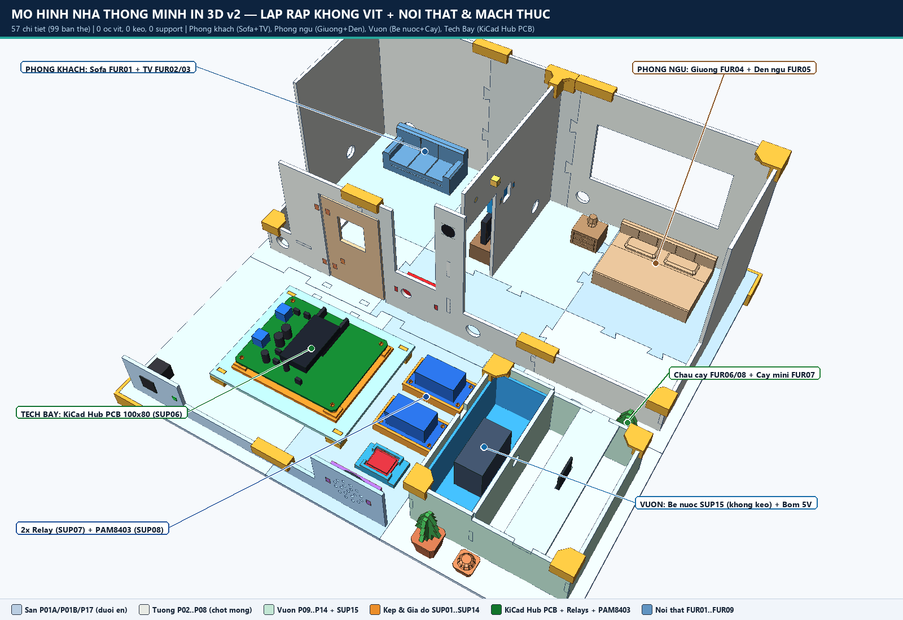
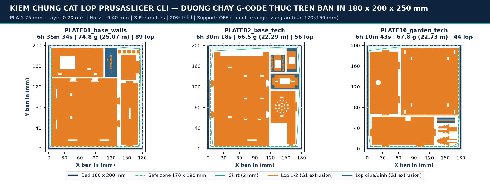
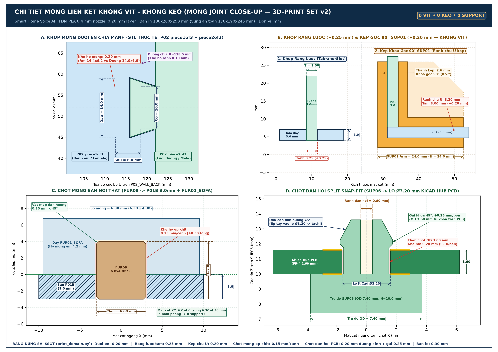
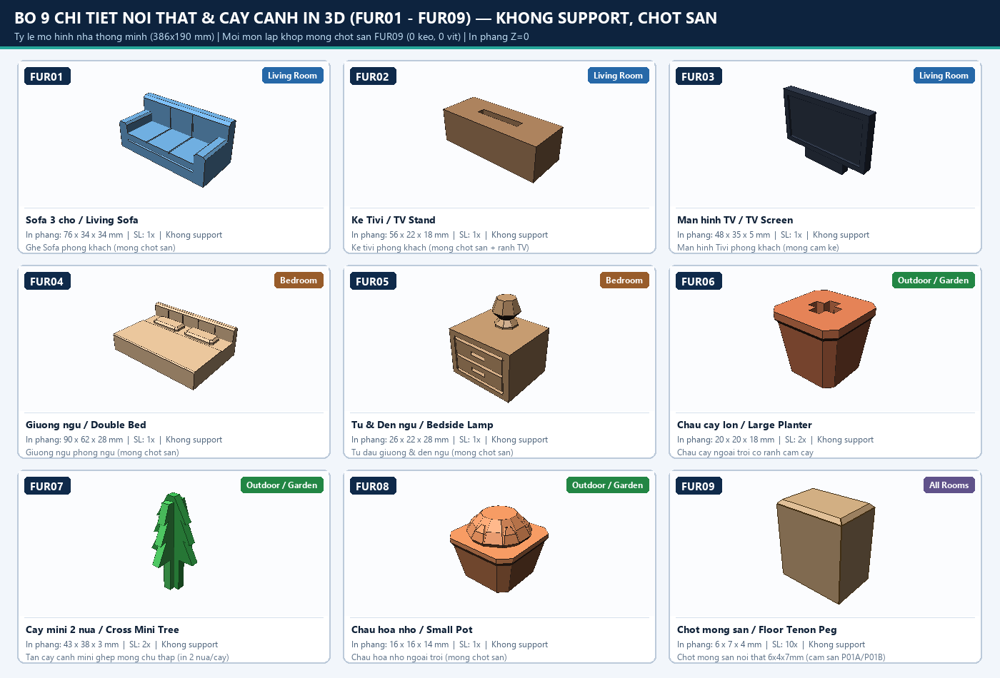

# Bộ Tệp In 3D Vỏ Nhà Thông Minh v2 — 100% Lắp Mộng, Bàn In 180×200×250 mm (`hardware/in 3 d/`)

> **Nguyên tắc lắp ghép v2 (duy nhất):** Toàn bộ mô hình được thiết kế **100% bằng khớp mộng tự khóa (mộng đuôi én, mộng răng lược, kẹp chữ U, chốt mộng rời và chốt đàn hồi snap-fit) — không cần ốc vít, không cần keo dán** ở bất kỳ vị trí nào.
> **Nguồn sự thật duy nhất (SSOT):** Mọi kích thước vỏ nhà lấy từ [`hardware/mica/mica_design.py`](../mica/mica_design.py), biên dạng mạch Hub PCB thực đọc trực tiếp từ [`hardware/kicad/smarthome_hub/smarthome_hub.kicad_pcb`](../kicad/smarthome_hub/smarthome_hub.kicad_pcb) (đã kiểm chứng bằng `kicad-cli`), và toàn bộ tệp in đều sinh tự động từ [`scripts/`](scripts/).

---

## 1. Tổng Quan & Kết Quả Kiểm Định Tự Động

- **Khổ máy in 3D mục tiêu:** **`180 × 200 × 250 mm`** (chừa lề an toàn `5 mm` mỗi cạnh → vùng in khả dụng **`170 × 190 × 245 mm`**).
- **Quy mô bộ chi tiết:** **`57` chi tiết duy nhất / `99` bản thể vật lý**, gồm:
  - **`30` mảnh vỏ nhà** (`P01A`–`P17`, đã tự động chia mảnh cho 5 tấm vượt khổ `170 × 190 mm` với khớp đuôi én và khắc chìm mã + kích thước trên mặt trên).
  - **`18` phụ kiện kẹp góc, ngàm giữ mạch, bản lề & lòng bể nước liền khối** (`SUP01`–`SUP15`).
  - **`9` món nội thất tỷ lệ nhà** (`FUR01`–`FUR09`: sofa, kệ + tivi phòng khách, giường + tủ đèn ngủ phòng ngủ, chậu cây + cây mini ngoài trời, chốt mộng sàn).
- **Xếp bàn in tối ưu (`plates/`):** Toàn bộ `99` bản thể được đóng gói tự động bằng thuật toán 2D MaxRects (cho phép xoay `0°/90°`, khe hở `>= 3.0 mm`) vào đúng **`17` bàn in** (`PLATE01`–`PLATE17`, mỗi bàn có đủ tệp `STL` ghép sẵn và `3MF` đa đối tượng đặt đúng tọa độ bàn `180 × 200 mm`).
  - **Cận dưới lý thuyết vs thực đạt:** Tổng diện tích hình chiếu đặc = `392797 mm²` → cận dưới diện tích đặc **`13` bàn** (`12.16`); tổng diện tích khung bao = `483932 mm²` → cận dưới khung bao **`15` bàn** (`14.98`); **đạt `17` bàn** (mật độ bàn in `76.6%` – `96.4%`, không có bàn nào chỉ chứa 1 chi tiết nhỏ lẻ).
- **Kiểm chứng cắt lớp thực tế (`PrusaSlicer 2.9.7 CLI`, PLA `0.20 mm`, `3` thành, `20% gyroid`, `0% support`, `--dont-arrange`):**
  - Toàn bộ **`57/57` chi tiết lẻ** và **`17/17` bàn in (`STL` + `3MF`)** đạt **`manifold = yes`** (`100%`).
  - Toàn bộ **`17/17` bàn in** cắt lớp thành công không lỗi, đường chạy G-code nằm trọn trong bàn `180 × 200 × 250 mm`.
  - **Tổng thời gian in ước tính:** **`109g 21p 07s`** (`109.35 giờ`).
  - **Tổng nhựa PLA tiêu thụ:** **`1035.80 g`** (**`347.29 m`** sợi `1.75 mm`, ~`1.04` cuộn PLA `1 kg`).
- **Kiểm định lắp ráp ảo 3D BRep (FreeCAD 1.1):** Sai số tái ghép mảnh chia **`0.0000 mm`**, **`0` va chạm** trên toàn bộ `31` mảnh vỏ + `47` kẹp/giá đỡ + `22` nội thất + `17` mạch/linh kiện + góc mở cửa `95°`; bảng lắp khít linh kiện đạt **`12/12` PASS**.




---

## 2. Cấu Trúc Thư Mục `hardware/in 3 d/`

```text
hardware/in 3 d/
├── README.md                  # Tài liệu hướng dẫn tiếng Việt này
├── manifest.json              # Danh mục JSON đầy đủ từng tệp, chi tiết, bàn in, kích thước & SHA-256
├── verification_report.json   # Báo cáo kiểm định hợp nhất (lắp ráp, lắp khít, PrusaSlicer, R9)
├── plates/                    # 17 bàn in hoàn chỉnh (PLATEnn_*.3mf đa đối tượng + PLATEnn_*.stl)
├── parts/                     # 57 chi tiết rời (STL kín khối phẳng Z=0 + STEP CAD BRep)
├── drawings/                  # 118 bản vẽ kỹ thuật PNG + PDF (57 chi tiết + cận cảnh mộng + lắp khít PCB)
├── previews/                  # 23 ảnh xem trước 3D, bố cục từng bàn in 180x200 và đường chạy G-code
└── scripts/                   # Bộ mã nguồn tái tạo toàn bộ tự động (FreeCAD 1.1 + Python + PrusaSlicer)
```

---

## 3. Danh Mục 17 Bàn In Tối Ưu (`180 × 200 × 250 mm`, Sẵn Sàng Mở Trong PrusaSlicer)

Mở trực tiếp tệp `.3mf` trong [`plates/`](plates/) bằng **PrusaSlicer** (khổ bàn `180 × 200 mm`, chiều cao `250 mm`). Các vật thể đã nằm phẳng `Z = 0`, giữ đúng vị trí trong vùng an toàn `170 × 190 mm` (cách nhau `>= 3.0 mm`), chỉ cần chọn profile PLA `0.20 mm`, bật `Skirt = 1 vòng, khoảng cách 2 mm` và bấm **Slice**.


| Bàn in (`plates/`) | SL | Các chi tiết trên bàn | Khung sử dụng (mm) | Mật độ | Thời gian in | Nhựa (g / m) | Manifold / Slice | Bố cục |
| :--- | :---: | :--- | :---: | :---: | :---: | :---: | :---: | :---: |
| [`PLATE01_base_walls`](plates/PLATE01_base_walls.3mf) ([STL](plates/PLATE01_base_walls.stl)) | `10` | `P01B_piece4of6`, `P08_DOOR_LEAF`, `P14_SOIL_BRIDGE`, `FUR03_TV_SCREEN`, `FUR02_TV_STAND`, `FUR09_FLOOR_TENON_PEG`×3, `SUP05B_CARRIER_TENON_PEG`×2 | `170.0×189.9×18.0` | `92.7%` | `7g 26p 36s` | `71.0 g` / `23.80 m` | `ĐẠT / ĐẠT` | [Xem](previews/_plate01_layout.png) |
| [`PLATE02_base_tech`](plates/PLATE02_base_tech.3mf) ([STL](plates/PLATE02_base_tech.stl)) | `5` | `P01A_piece2of3`, `P15_piece2of2`, `SUP07_RELAY_SNAP_CADDY`, `SUP12_DHT11_SNAP_CRADLE`, `SUP13_KY037_SNAP_CRADLE` | `168.8×189.4×11.4` | `90.3%` | `7g 11p 06s` | `63.3 g` / `21.21 m` | `ĐẠT / ĐẠT` | [Xem](previews/_plate02_layout.png) |
| [`PLATE03_base_mounts`](plates/PLATE03_base_mounts.3mf) ([STL](plates/PLATE03_base_mounts.stl)) | `7` | `P01B_piece2of6`, `P01B_piece3of6`, `P17_BASE_JOINER`, `FUR05_BEDSIDE_TABLE`, `SUP03_SEAM_U_CLIP`×2, `SUP05_P16_TENON_RISER` | `167.5×186.4×28.0` | `90.1%` | `7g 21p 00s` | `68.6 g` / `22.99 m` | `ĐẠT / ĐẠT` | [Xem](previews/_plate03_layout.png) |
| [`PLATE04_base`](plates/PLATE04_base.3mf) ([STL](plates/PLATE04_base.stl)) | `1` | `P01A_piece3of3` | `156.5×181.9×3.0` | `88.1%` | `6g 12p 20s` | `55.8 g` / `18.71 m` | `ĐẠT / ĐẠT` | [Xem](previews/_plate04_layout.png) |
| [`PLATE05_base_tech`](plates/PLATE05_base_tech.3mf) ([STL](plates/PLATE05_base_tech.stl)) | `10` | `P01B_piece6of6`, `P17_BASE_JOINER`, `P15_piece1of2`, `FUR06_PLANT_POT_LARGE`×2, `FUR08_PLANT_POT_SMALL`, `SUP08_PAM8403_SNAP_TRAY`, `SUP02_CORNER_CLIP_LOW`, `SUP05B_CARRIER_TENON_PEG`×2 | `168.9×189.0×18.0` | `88.0%` | `6g 50p 33s` | `63.2 g` / `21.19 m` | `ĐẠT / ĐẠT` | [Xem](previews/_plate05_layout.png) |
| [`PLATE06_base_garden`](plates/PLATE06_base_garden.3mf) ([STL](plates/PLATE06_base_garden.stl)) | `7` | `P01B_piece5of6`, `P11_GARDEN_RIGHT`, `FUR07_MINI_TREE`, `FUR09_FLOOR_TENON_PEG`×4 | `167.0×187.4×4.0` | `86.7%` | `5g 58p 10s` | `54.6 g` / `18.32 m` | `ĐẠT / ĐẠT` | [Xem](previews/_plate06_layout.png) |
| [`PLATE07_base`](plates/PLATE07_base.3mf) ([STL](plates/PLATE07_base.stl)) | `1` | `P01A_piece1of3` | `149.9×181.9×3.0` | `84.4%` | `5g 58p 45s` | `54.9 g` / `18.41 m` | `ĐẠT / ĐẠT` | [Xem](previews/_plate07_layout.png) |
| [`PLATE08_walls`](plates/PLATE08_walls.3mf) ([STL](plates/PLATE08_walls.stl)) | `3` | `P05_piece2of3`, `P05_piece3of3`, `P07_SERVO_SHELF` | `169.1×190.0×3.0` | `96.3%` | `3g 39p 24s` | `34.1 g` / `11.45 m` | `ĐẠT / ĐẠT` | [Xem](previews/_plate08_layout.png) |
| [`PLATE09_walls_base`](plates/PLATE09_walls_base.3mf) ([STL](plates/PLATE09_walls_base.stl)) | `11` | `P01B_piece1of6`, `P02_piece2of3`, `FUR01_SOFA`, `FUR09_FLOOR_TENON_PEG`×3, `SUP03_SEAM_U_CLIP`×2, `SUP05_P16_TENON_RISER`×2, `SUP05B_CARRIER_TENON_PEG` | `167.9×190.0×34.0` | `91.5%` | `8g 38p 31s` | `85.4 g` / `28.62 m` | `ĐẠT / ĐẠT` | [Xem](previews/_plate09_layout.png) |
| [`PLATE10_walls`](plates/PLATE10_walls.3mf) ([STL](plates/PLATE10_walls.stl)) | `1` | `P03_WALL_LEFT` | `150.0×190.0×3.0` | `88.2%` | `4g 39p 44s` | `43.3 g` / `14.52 m` | `ĐẠT / ĐẠT` | [Xem](previews/_plate10_layout.png) |
| [`PLATE11_walls`](plates/PLATE11_walls.3mf) ([STL](plates/PLATE11_walls.stl)) | `1` | `P04_WALL_RIGHT` | `150.0×190.0×3.0` | `88.2%` | `4g 29p 05s` | `41.7 g` / `13.98 m` | `ĐẠT / ĐẠT` | [Xem](previews/_plate11_layout.png) |
| [`PLATE12_walls`](plates/PLATE12_walls.3mf) ([STL](plates/PLATE12_walls.stl)) | `1` | `P06_WALL_MID` | `150.0×190.0×3.0` | `88.2%` | `4g 53p 29s` | `45.3 g` / `15.19 m` | `ĐẠT / ĐẠT` | [Xem](previews/_plate12_layout.png) |
| [`PLATE13_walls_garden`](plates/PLATE13_walls_garden.3mf) ([STL](plates/PLATE13_walls_garden.stl)) | `5` | `P02_piece1of3`, `P12_GARDEN_FRONT`, `SUP07_RELAY_SNAP_CADDY`, `SUP05B_CARRIER_TENON_PEG`×2 | `163.4×188.3×11.4` | `84.9%` | `6g 35p 34s` | `59.5 g` / `19.96 m` | `ĐẠT / ĐẠT` | [Xem](previews/_plate13_layout.png) |
| [`PLATE14_walls`](plates/PLATE14_walls.3mf) ([STL](plates/PLATE14_walls.stl)) | `1` | `P02_piece3of3` | `150.0×182.5×3.0` | `84.8%` | `4g 10p 28s` | `39.4 g` / `13.21 m` | `ĐẠT / ĐẠT` | [Xem](previews/_plate14_layout.png) |
| [`PLATE15_walls_garden`](plates/PLATE15_walls_garden.3mf) ([STL](plates/PLATE15_walls_garden.stl)) | `16` | `P05_piece1of3`, `P13_GARDEN_BACK`, `SUP04_BASE_FOOT_CLIP`×2, `SUP14_LM393_SNAP_CRADLE`, `SUP11_SG90_SNAP_SADDLE`, `SUP01_CORNER_CLIP_WALL`×2, `SUP10_DOOR_MORTISE_HINGE`×2, `SUP03_SEAM_U_CLIP`×2, `SUP10B_SERVO_LINK_CLIP`, `SUP05B_CARRIER_TENON_PEG`×3 | `170.0×189.6×14.0` | `83.4%` | `6g 17p 24s` | `60.9 g` / `20.41 m` | `ĐẠT / ĐẠT` | [Xem](previews/_plate15_layout.png) |
| [`PLATE16_garden_tech`](plates/PLATE16_garden_tech.3mf) ([STL](plates/PLATE16_garden_tech.stl)) | `5` | `P09_GARDEN_LEFT`, `P10_WATER_DIVIDER`, `P16_PCB_PLATE`, `FUR07_MINI_TREE`, `SUP03_SEAM_U_CLIP` | `170.0×190.0×9.0` | `94.8%` | `6g 57p 07s` | `63.9 g` / `21.41 m` | `ĐẠT / ĐẠT` | [Xem](previews/_plate16_layout.png) |
| [`PLATE17_mounts_furniture`](plates/PLATE17_mounts_furniture.3mf) ([STL](plates/PLATE17_mounts_furniture.stl)) | `14` | `FUR04_BED`, `SUP06_HUB_PCB_SNAP_CARRIER`, `SUP15_WATER_TANK_LINER`, `SUP04_BASE_FOOT_CLIP`×2, `SUP01B_T_CLIP_WALL`, `SUP09_SPEAKER_SNAP_RETAINER`, `SUP02_CORNER_CLIP_LOW`×5, `SUP03_SEAM_U_CLIP`, `SUP05_P16_TENON_RISER` | `166.7×190.0×45.0` | `77.3%` | `12g 01p 51s` | `131.0 g` / `43.91 m` | `ĐẠT / ĐẠT` | [Xem](previews/_plate17_layout.png) |
| **TỔNG CỘNG (17 bàn)** | **`99`** | **Đủ 57 chi tiết duy nhất (99 bản thể)** | **`<= 170×190×45`** | **TB `88.0%`** | **`109g 21p 07s`** | **`1035.80 g` / `347.29 m`** | **`17/17` ĐẠT** | [Tổng quan](previews/_plates_overview.png) |

### Ghi chú Support Slicer & Thông số in khuyến nghị
- **Đánh giá Support Slicer:** **`0/17` bàn in cần support** (`--support-material=0`). Mọi chi tiết đều đặt mặt phẳng lớn nhất xuống bàn in (`Z = 0`), góc vươn ngoài `<= 45°`, các hốc mộng ngầm trên `SUP06`/`SUP07`/`SUP08` có mái vòm `45°` tự đỡ, và hốc chốt sàn đáy nội thất chỉ có nhịp cầu ngắn `4.3 mm` tự bắt cầu sạch.
- **Thông số in chuẩn:** Nhựa **PLA / PLA+** `1.75 mm`, đầu phun **`0.4 mm`**, lớp **`0.20 mm`**, **`3` thành (perimeters)**, ruột **`20% Gyroid`**, **`Skirt = 1 vòng` (khoảng cách `2 mm`)**, bật `Elephant foot compensation = 0.15 mm` để lắp mộng êm tay.
- **Độ bám bàn cho chốt nhỏ:** Trên 8 bàn có chốt nhỏ (`FUR09`, `SUP05B`, `SUP10`), PrusaSlicer đưa khuyến nghị nhẹ `Low bed adhesion` — chỉ cần vệ sinh sạch mặt PEI (hoặc thêm `Brim 3 mm` cục bộ cho riêng chốt nhỏ), tuyệt đối không cần support.
- **Lòng bể nước chống thấm (`SUP15_WATER_TANK_LINER`):** Nên in **`4` thành** và **6 lớp đáy** (`0.20 mm`) để thành bể kín nước hoàn toàn mà không cần bất kỳ chất trám nào.



---

## 4. Bảng Dung Sai Khớp Mộng (Joint & Clearance Table — FDM PLA Đầu Phun 0.4 mm)

Mọi liên kết kết cấu, liên kết mạch và gắn nội thất đều dùng đúng 7 chuẩn khe hở định nghĩa tập trung trong [`scripts/print_domain.py`](scripts/print_domain.py):

| Loại khớp mộng | Khe hở thiết kế (mm) | Dải dung sai đạt | Ứng dụng trong mô hình |
| :--- | :---: | :---: | :--- |
| **Khop mong duoi en (tach manh tam lon)** (`dovetail_seam`) | **`0.20 mm`** | `0.18 - 0.22 mm` | Cac duong noi chia manh tren P01A, P01B, P02, P05, P15 |
| **Khop mong rang luoc (tab-and-slot) giua cac tam** (`panel_tab_slot`) | **`0.25 mm`** | `0.20 - 0.30 mm` | Toan bo canh noi tuong/day/vuon (ranh 3.25 mm cho tam 3.0 mm) |
| **Kep khoa goc 90 do & kep chu U khoa moi noi** (`corner_lock_clip`) | **`0.20 mm`** | `0.18 - 0.22 mm` | SUP01, SUP01B, SUP02, SUP03, SUP04 (ranh chu U 3.20 mm cho tam 3.0 mm) |
| **Mong chot vuong ep khit (mortise-and-tenon)** (`mortise_tenon_press`) | **`0.15 mm`** | `0.12 - 0.18 mm / canh (+0.30 mm tong)` | P17 thanh noi day, chan gia do SUP05..SUP14 va chot noi that FUR01..FUR08 cam xuong san |
| **Chot dan hoi tu khoa (split snap-fit peg)** (`snap_fit_peg`) | **`0.20 mm`** | `0.18 - 0.22 mm duong kinh + gai khoa 0.25 mm` | SUP06 (4 chot 3.0 mm vao lo 3.2 mm Hub PCB), SUP07 (4 chot 2.9 mm vao lo 3.1 mm Relay) |
| **Ranh truot & ngoam kep mep bo mach** (`edge_rail`) | **`0.20 mm`** | `0.20 mm / canh (+0.40 mm tong khoang trong)` | SUP08 (PAM8403), SUP09 (Loa 28mm), SUP11 (SG90), SUP12 (DHT11), SUP13 (KY-037), SUP14 (LM393) |
| **Truc xoay ban le mong cua chinh** (`hinge_pivot`) | **`0.30 mm`** | `0.25 - 0.35 mm duong kinh` | SUP10 ban le cua P08 <-> P05 (truc 2.7 mm trong ong 3.0 mm, xoay nhe theo Servo SG90) |

### Tài liệu hóa 32 lỗ tròn chức năng giữ lại trên tấm vỏ (không dùng làm lỗ bắt chi tiết kim loại)
Toàn bộ **44 lỗ tròn lắp ghép cũ** của bản mica đã bị loại bỏ hoàn toàn và thay bằng **51 rãnh mộng chữ nhật**. Chỉ giữ lại **32 lỗ tròn chức năng** phục vụ dây dẫn, quang học, âm thanh và ống nước:
- **`led`:** Lo den LED bao hieu 5mm (5.5mm) va LED nguon 3mm (3.5mm) — lo chuc nang quang hoc, lo chuc nang.
- **`buzzer`:** Lo coi bao dong chu dong TMB12A05 (12.5mm) — lo phat am thanh, lo chuc nang.
- **`mic`:** Lo thu am micro electret 9.7mm cho cam bien KY-037 (10.5mm) — lo cam bien am thanh.
- **`dcjack`:** Lo giac nguon DC-022 5.5x2.1mm (12.5mm) — lo cap nguon 5V 2A.
- **`cable`:** Lo luon bo day tin hieu Dupont (14.0mm) — lo di day dien lien phong.
- **`tube`:** Lo luon ong silicon bom tuoi cay OD 8mm (10.0mm) — lo ong nuoc.
- **`grille`:** Cum 19 lo luoi thoat am thanh (3.0mm) cho loa mini 28mm — luoi loa, lo chuc nang.



---

## 5. Bảng Kiểm Tra Lắp Khít PCB & Module Điện Tử (Fit Table — `12/12 PASS`)

Mọi giá đỡ mạch đều được đối chiếu kích thước trực tiếp với tệp KiCad PCB thực (`smarthome_hub.kicad_pcb`: `100.0 × 80.0 × 1.6 mm`, 4 lỗ định vị `Ø3.2 mm` bước `90.0 × 70.0 mm`, kiểm tra khoảng hở tới toàn bộ `47` footprint linh kiện bao gồm `C8`/`C9` trên tổng `51` footprint) và datasheet từng module:

| Linh kiện / Bo mạch | Nguồn kích thước | Kích thước bo / linh kiện (mm) | Kích thước lòng giá đỡ (mm) | Khe hở (mm) | Cơ chế giữ (lắp mộng) | Kết quả |
| :--- | :--- | :--- | :--- | :--- | :--- | :---: |
| **Hub PCB (Type 1)** | hardware/kicad/smarthome_hub/smarthome_hub.kicad_pcb (Edge.Cuts + 4x lo dinh vi 3.2 mm, 51 footprints incl. C8/C9) | `100.0 x 80.0 x 1.6 (holes 90.0x70.0, Dia 3.2)` | `Frame 104.0x84.0, 4x split pegs OD 3.00 @ 90.0x70.0` | `0.20 mm dia (nearest 7.9 mm; C8 14.9 mm, C9 20.7 mm)` | 4x split snap-fit pegs (0.25mm barb) + 4x SUP05B floor mortise tenons into P16 | **`PASS`** |
| **ESP8266 NodeMCU v2** | hardware/kicad/smarthome_hub/smarthome_hub.kicad_pcb (PinSocket_1x15 22.86mm) + Components101 datasheet | `48.3 x 25.4 x 7.1 (22.86 mm pin row spacing)` | `Center pin cutout 72.0 x 52.0 mm below PCB; open top above Z=20.6 mm` | `>= 10.0 mm underside pin clearance, full open USB access` | Plugged into Hub PCB U1/U2 female headers (cam truc tiep) | **`PASS`** |
| **Relay 1 & Relay 2 (SRD-05VDC)** | mica_design.py + Reichelt/HandsOnTech 1-Ch Relay datasheet | `50.0 x 26.0 x 18.5 (holes 44.5x20.5, Dia 3.1)` | `Cavity 50.4x26.4, 4x split pegs OD 2.90 @ 44.5x20.5` | `0.20 mm/side edge, 0.20 mm peg dia` | 4x split snap-fit pegs + edge rim + 2x SUP05B mortise tenons into P01A | **`PASS`** |
| **PAM8403 3W Audio Amp** | mica_design.py + Elecrow PAM8403 datasheet | `21.0 x 18.0 x 3.4 (bare stamp PCB)` | `Cavity 21.4 x 18.4 x 4.0 + 0.4 mm snap ribs` | `0.20 mm/side X, 0.20 mm/side Y` | Edge rails + 45-deg side snap ribs + 2x SUP05B mortise tenons into P01A | **`PASS`** |
| **Mini Speaker 28mm (PUI AS02808MR-R)** | mica_design.py + PUI Audio AS02808MR-R datasheet | `Dia 28.0 x 5.2 mm` | `Bridge span 28.4 mm, depth 5.4 mm` | `0.20 mm radial, 0.20 mm axial` | Rear pressure bridge locked via 2x integral 4x6x3 tenons into P15 mortises | **`PASS`** |
| **SG90 9g Micro Servo** | mica_design.py + HandsOnTech SG90 datasheet | `Body 22.8 x 12.2 x 22.5, ear span 32.2, ear t 2.5` | `Cutout 23.3x12.7, saddle ear span 32.5, ear gap 2.6` | `0.25 mm/side body cutout, 0.15 mm/side ear span, 0.10 mm ear Z` | Drop-in P07 cutout clamped by SUP11 saddle locking into 2x P07 mortises (0 chot kim loai) | **`PASS`** |
| **DHT11 Temp/Humidity Breakout** | mica_design.py + Aosong/DFRobot DHT11 datasheet | `28.0 x 14.0 x 7.1 (sensor 15.5 x 12.0)` | `Cavity 14.4 x 28.4, vent window 12.5x16.0` | `0.20 mm/side Y, 0.20 mm/side Z` | Edge-rail slide-in cradle locked via 2x integral 3x6x3 tenons into P06_WALL_MID mortises | **`PASS`** |
| **KY-037 Sound Sensor** | mica_design.py + Joy-IT KY-038/KY-037 datasheet | `35.0 x 15.0 x 13.1 (mic Dia 9.7)` | `Cavity 35.4 x 15.4, P05 mic hole Dia 10.5` | `0.20 mm/side X, 0.20 mm/side Z, 0.40 mm mic radial` | Edge-rail slide-in cradle locked via 2x integral 3x6x3 tenons into P05 mortises | **`PASS`** |
| **YL-69 Soil Moisture Probe** | mica_design.py + HandsOnTech Soil Sensor datasheet | `60.0 x 20.0 x 1.6 (2-prong PCB)` | `Slot 22.0 x 3.5 mm` | `1.00 mm/side width, 0.95 mm/side thickness` | Direct vertical drop-in bridge slot (khong dung chi tiet kim loai) | **`PASS`** |
| **LM393 Soil Comparator (YL-38)** | mica_design.py + HandsOnTech Soil Sensor datasheet | `32.0 x 14.0 x 12.0` | `Cavity 32.4 x 14.4` | `0.20 mm/side X, 0.20 mm/side Z` | Dry exterior rear edge-rail cradle locked via 2x integral 3x6x3 tenons into P13 mortises | **`PASS`** |
| **Door Leaf & Hinge / Linkage** | mica_design.py (P08 56x100 in 60x104 frame) | `Door 56.0 x 100.0 x 3.0; jamb gap 2.0 mm` | `Pin OD 2.7 in bore ID 3.0; 4x6x3 mortise tenons` | `0.30 mm pivot dia, 0.20 mm axial knuckle gap, 2.0 mm door perimeter` | 2-leaf lift-off mortise pin-and-knuckle hinge + mortise pushrod clip (lap mong) | **`PASS`** |
| **5V Mini Submersible Pump** | mica_design.py + Soldered/Mouser 101844 datasheet | `45.0 x 24.0 x 33.0 (tube OD 8.0)` | `Liner inner 42.5x115.0x42.6, notch 11.0` | `9.25 mm/side X, 35.0 mm/side Y, 1.50 mm/side tube notch` | Free-standing inside 1-piece watertight drop-in liner (khep kin lien khoi) | **`PASS`** |


---

## 6. Bộ Nội Thất Tỷ Lệ Nhà Thông Minh (`FUR01` – `FUR09`)

Tất cả nội thất được dựng đúng tỷ lệ phòng của `mica_design.py`, kiểm định **0 va chạm** với tường, mạch điện, đường dây và cánh cửa mở góc `95°`, gắn cố định vào sàn `P01A`/`P01B` bằng chốt mộng rời `FUR09` (`6.0 × 4.0 × 7.0 mm`, khe hở `0.15 mm/cạnh`):

| Mã chi tiết | Tên tiếng Việt | Không gian | SL | Kích thước in (mm) | Cách gắn mộng | Bản vẽ |
| :--- | :--- | :--- | :---: | :---: | :--- | :---: |
| `FUR01_SOFA` | Ghe Sofa phong khach (mong chot san) | Living Room | `1` | `76.0×34.0×34.0` | 2x floor mortise pegs (8x4 mm) pressing into P01B_BASE_HOUSE at X=56, 100, Y=352 | [PNG](drawings/FUR01_SOFA.png) · [PDF](drawings/FUR01_SOFA.pdf) |
| `FUR02_TV_STAND` | Ke tivi phong khach (mong chot san + ranh TV) | Living Room | `1` | `56.0×22.0×18.0` | 2x floor mortise pegs (4x8 mm) pressing into P01B_BASE_HOUSE at X=183, Y=288, 320 | [PNG](drawings/FUR02_TV_STAND.png) · [PDF](drawings/FUR02_TV_STAND.pdf) |
| `FUR03_TV_SCREEN` | Man hinh Tivi phong khach (mong cam ke) | Living Room | `1` | `48.0×35.0×5.0` | Integral bottom tenon (24x4x5 mm) pressing into FUR02_TV_STAND top mortise slot | [PNG](drawings/FUR03_TV_SCREEN.png) · [PDF](drawings/FUR03_TV_SCREEN.pdf) |
| `FUR04_BED` | Giuong ngu phong ngu (mong chot san) | Bedroom | `1` | `90.0×62.0×28.0` | 2x floor mortise pegs (8x4 mm) pressing into P01B_BASE_HOUSE at X=298, 354, Y=336 | [PNG](drawings/FUR04_BED.png) · [PDF](drawings/FUR04_BED.pdf) |
| `FUR05_BEDSIDE_TABLE` | Tu dau giuong & den ngu (mong chot san) | Bedroom | `1` | `26.0×22.0×28.0` | 1x anti-rotation floor mortise peg (8x4 mm) pressing into P01B_BASE_HOUSE at X=256, Y=350 | [PNG](drawings/FUR05_BEDSIDE_TABLE.png) · [PDF](drawings/FUR05_BEDSIDE_TABLE.pdf) |
| `FUR06_PLANT_POT_LARGE` | Chau cay ngoai troi co ranh cam cay | Outdoor / Garden | `2` | `20.0×20.0×18.0` | 1x floor mortise peg (6x4 mm) into P01A_BASE_TECH at (290, 13) and (376, 163) | [PNG](drawings/FUR06_PLANT_POT_LARGE.png) · [PDF](drawings/FUR06_PLANT_POT_LARGE.pdf) |
| `FUR07_MINI_TREE` | Tan cay canh mini ghep mong chu thap (in 2 nua/cay) | Outdoor / Garden | `2` | `43.0×38.0×3.0` | 2x halves cross-halving mong joint plugged into FUR06_PLANT_POT_LARGE top socket | [PNG](drawings/FUR07_MINI_TREE.png) · [PDF](drawings/FUR07_MINI_TREE.pdf) |
| `FUR08_PLANT_POT_SMALL` | Chau hoa nho ngoai troi (mong chot san) | Outdoor / Garden | `1` | `16.0×16.0×14.0` | 1x floor mortise peg (5x4 mm) pressing into P01A_BASE_TECH at (322, 13) | [PNG](drawings/FUR08_PLANT_POT_SMALL.png) · [PDF](drawings/FUR08_PLANT_POT_SMALL.pdf) |
| `FUR09_FLOOR_TENON_PEG` | Chot mong san noi that 6x4x7mm (cam san P01A/P01B) | Living Room / Bedroom / Outdoor | `10` | `6.0×7.0×4.0` | Floating press-fit floor tenons locking FUR01/02/04/05/06/08 into P01A/P01B floor mortises (zero supports) | [PNG](drawings/FUR09_FLOOR_TENON_PEG.png) · [PDF](drawings/FUR09_FLOOR_TENON_PEG.pdf) |



---

## 7. Thứ Tự Lắp Ráp (Thu tu lap rap — 100% Lắp Mộng Tự Khóa)

Thực hiện theo đúng **9 bước** dưới đây (chỉ cần tay ép nhẹ hoặc gõ nhẹ bằng đệm phẳng; cạo nhẹ bavia cạnh đáy nếu máy in có elephant's foot):

1. **Bước 1 — Phân loại chi tiết từ 17 bàn in:** Đọc chữ khắc chìm trên mặt trên từng chi tiết để chia thành 3 nhóm: `30` mảnh vỏ (`P01A`–`P17`), `18` bộ kẹp & giá đỡ (`SUP01`–`SUP15`), và `9` nhóm nội thất (`FUR01`–`FUR09`).
2. **Bước 2 — Ghép các tấm chia mảnh bằng khớp đuôi én & kẹp `SUP03`:** Trượt khớp đuôi én khe hở `0.20 mm` theo đúng số thứ tự mảnh: `P01A` (`3` mảnh), `P01B` (`6` mảnh), `P02` (`3` mảnh), `P05` (`3` mảnh), `P15` (`2` mảnh). Các mối nối ăn phẳng và khóa lực kéo ngang ngay khi lồng hết hành trình.
3. **Bước 3 — Ghép sàn tổng `P01A` + `P01B`, khóa thanh `P17` và chân đế `SUP04`:** Lồng 4 mộng khóa giữa `P01A` và `P01B` trên mặt bàn phẳng. Ép `2× P17_BASE_JOINER` từ mặt dưới sao cho 4 chấu mộng `8×4 mm` xuyên khít vào 4 lỗ mộng sàn. Lồng `4× SUP04_BASE_FOOT_CLIP` vào 4 góc ngoài tấm sàn để nâng mô hình cao `11 mm` khỏi mặt bàn.
4. **Bước 4 — Lắp khoang kỹ thuật (Hub PCB, Relay 1/2, PAM8403):**
   - Cắm `4× SUP05_P16_TENON_RISER` vào 4 lỗ mộng trên `P01A`, sau đó ấn tấm `P16_PCB_PLATE` lên 4 chấu trên của `SUP05`.
   - Đặt `4× SUP05B_CARRIER_TENON_PEG` vào 4 lỗ mộng `90×70 mm` trên `P16`, ép khung `SUP06_HUB_PCB_SNAP_CARRIER` xuống khít. Căn 4 lỗ định vị `Ø3.2 mm` của Hub PCB (đã cắm NodeMCU hướng cổng USB ra mặt trước) rồi ấn nhẹ để 4 chốt đàn hồi tách đôi tự bung khóa trên mặt mạch.
   - Cắm `4× SUP05B` vào `P01A`, ép `2× SUP07_RELAY_SNAP_CADDY` xuống rồi ấn `Relay 1` và `Relay 2` vào 4 chốt đàn hồi `44.5×20.5 mm`.
   - Cắm `2× SUP05B` vào `P01A`, ép khay `SUP08_PAM8403_SNAP_TRAY` xuống rồi bấm bo `PAM8403` qua 2 gờ khóa đàn hồi hai bên.
5. **Bước 5 — Dựng khung tường nhà & khóa kẹp góc `SUP01` / `SUP01B` / `SUP02` / `SUP03`:**
   - Cắm `P02_WALL_BACK`, `P06_WALL_MID`, `P03_WALL_LEFT`, `P04_WALL_RIGHT` và `P05_WALL_FRONT` vào đúng các khe mộng răng lược trên `P01B`.
   - Trượt từ trên xuống: `2× SUP01_CORNER_CLIP_WALL` khóa 2 góc sau trên cùng (`P02+P03`, `P02+P04`), `1× SUP01B_T_CLIP_WALL` khóa đỉnh chữ T (`P02+P06`), `2× SUP02_CORNER_CLIP_LOW` khóa 2 góc mặt tiền thấp (`P03+P05`, `P04+P05`), và trượt `SUP03_SEAM_U_CLIP` lên cạnh trên các đường nối chia mảnh của `P02` và `P05`.
6. **Bước 6 — Lắp cảm biến tường, Servo SG90 & cánh cửa chính `P08`:**
   - Lùa `DHT11` vào giá `SUP12_DHT11_SNAP_CRADLE` rồi cắm 2 chấu vào vách giữa `P06`; lùa `KY-037` vào `SUP13_KY037_SNAP_CRADLE` rồi cắm vào `P05`; lắp LED `5 mm` lên `P06` và còi `TMB12A05` vào đúng lỗ chức năng trên `P05`.
   - Cài kệ `P07_SERVO_SHELF` vào khung cửa `P05`, đặt thân Servo `SG90` qua ô chữ nhật rồi ép ngàm `SUP11_SG90_SNAP_SADDLE` vào 2 rãnh mộng của `P07` để khóa chặt tai servo.
   - Cắm 2 lá bản lề `A` của `SUP10_DOOR_MORTISE_HINGE` vào khung `P05`, cắm 2 lá `B` vào cánh cửa `P08_DOOR_LEAF`, gài tai kéo `SUP10B_SERVO_LINK_CLIP` vào `P08`, sau đó thả khớp ống lá `B` lên trục lá `A` và nối thanh đẩy thép mảnh sang tay đòn SG90.
7. **Bước 7 — Lắp cụm bể nước liền khối & chậu cây (`P09`–`P14`, `SUP14`, `SUP15`):**
   - Dựng 5 vách `P09`–`P13` vào khe sàn `P01A`, khóa 4 góc trên bằng `4× SUP02_CORNER_CLIP_LOW`.
   - Thả lòng bể nước liền khối `SUP15_WATER_TANK_LINER` vào khoang bể nước (`P09/P10/P12/P13`), đặt bơm chìm 5V vào trong lòng bể và luồn ống dẫn `Ø8 mm` qua rãnh chữ U của `SUP15` và lỗ `Ø10 mm` trên `P10`.
   - Lùa `LM393` vào `SUP14_LM393_SNAP_CRADLE` rồi cắm vào mặt sau khô ráo của `P13`, gài cầu `P14_SOIL_BRIDGE` và thả đầu dò `YL-69` qua khe `22 × 3.5 mm`.
8. **Bước 8 — Lắp mặt nạ kỹ thuật `P15_TECH_FASCIA` & loa `Ø28 mm`:**
   - Cắm `P15` (đã ghép 2 mảnh + kẹp `SUP03` phía trên rãnh USB) vào cạnh trước `P01A`. Lắp giắc nguồn `DC-022`, LED nguồn `3 mm`, áp loa `Ø28 mm` sau lưới 19 lỗ và ép thanh giữ `SUP09_SPEAKER_SNAP_RETAINER` vào 2 rãnh mộng trên `P15`.
9. **Bước 9 — Lắp nội thất tỷ lệ nhà (`FUR01`–`FUR09`) & đi dây Dupont:**
   - Cắm `10× FUR09_FLOOR_TENON_PEG` vào 10 lỗ mộng sàn trên `P01A`/`P01B`, sau đó ấn khít từng món nội thất vào đúng vị trí: **Phòng khách** (`FUR01_SOFA`, `FUR02_TV_STAND` + cắm `FUR03_TV_SCREEN` lên rãnh kệ), **Phòng ngủ** (`FUR04_BED`, `FUR05_BEDSIDE_TABLE`), và **Ngoài trời** (`2× FUR06_PLANT_POT_LARGE` + ghép 2 nửa chéo `FUR07_MINI_TREE` cắm vào chậu, `FUR08_PLANT_POT_SMALL`).
   - Đi đủ 40 dây Dupont theo [`docs/phan_cung/WIRING_TABLE.md`](../../docs/phan_cung/WIRING_TABLE.md) qua các lỗ `Ø14 mm` và kiểm tra an toàn nguồn trước khi cấp điện `5 V 2 A`.

---

## 8. Lệnh Tái Tạo Toàn Bộ Bộ Tệp v2 Từ Mã Nguồn (Reproducible Build)

```powershell
# 1. Kiểm tra nguồn sự thật (KiCad PCB + mô hình miền không chốt kim loại 180x200x250)
python "hardware/in 3 d/scripts/print_domain.py"

# 2. Sinh toàn bộ 57 chi tiết (STEP + STL trong parts/) bằng FreeCAD 1.1
python "hardware/in 3 d/scripts/build_all_v2.py"

# 3. Kiểm định lắp ráp ảo 3D BRep (0 va chạm) & xuất bảng lắp khít PCB/module
& "C:\Users\LENOVO\AppData\Local\Programs\FreeCAD 1.1\bin\freecadcmd.exe" "hardware/in 3 d/scripts/verify_assembly_fit.py"

# 4. Xếp bàn in 2D MaxRects -> 17 bàn plates/PLATEnn_*.stl & .3mf đa đối tượng
python "hardware/in 3 d/scripts/nest_plates.py"

# 5. Kiểm chứng PrusaSlicer CLI toàn bộ 57 chi tiết + 17 bàn in (R9)
python "hardware/in 3 d/scripts/verify_plates_v2.py"

# 6. Xuất 118 bản vẽ kỹ thuật (PNG + PDF) và 23 ảnh xem trước 3D / bàn in / G-code
python "hardware/in 3 d/scripts/export_drawings_v2.py"
& "C:\Users\LENOVO\AppData\Local\Programs\FreeCAD 1.1\bin\freecadcmd.exe" "hardware/in 3 d/scripts/render_previews_v2.py" -- --clean --mode freecad
python "hardware/in 3 d/scripts/render_previews_v2.py" --mode python

# 7. Xuất manifest.json (SHA-256), verification_report.json, README.md & kiểm toán Gate G5
python "hardware/in 3 d/scripts/generate_manifest_and_readme_v2.py"
```

---

## 9. Tài Liệu Liên Kết

- [Chỉ mục chế tạo & đấu nối phần cứng (`docs/HARDWARE_BUILD_GUIDE.md`)](../../docs/HARDWARE_BUILD_GUIDE.md)
- [Bảng đấu nối 40 dây & 10 chân ESP8266 (`docs/phan_cung/WIRING_TABLE.md`)](../../docs/phan_cung/WIRING_TABLE.md)
- [Tệp mạch in Hub PCB gốc KiCad (`hardware/kicad/smarthome_hub/smarthome_hub.kicad_pcb`)](../kicad/smarthome_hub/smarthome_hub.kicad_pcb)
- [Bản vẽ cận cảnh khớp mộng (`drawings/_joint_closeup_mong.pdf`)](drawings/_joint_closeup_mong.pdf)
- [Bản vẽ đối chiếu lắp khít PCB & module (`drawings/_pcb_module_fit.pdf`)](drawings/_pcb_module_fit.pdf)
