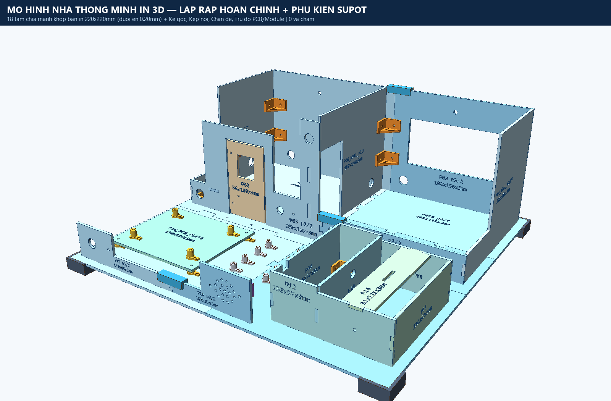
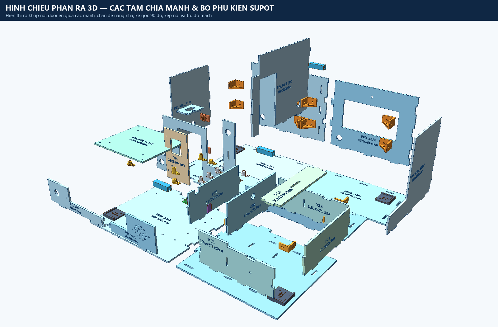
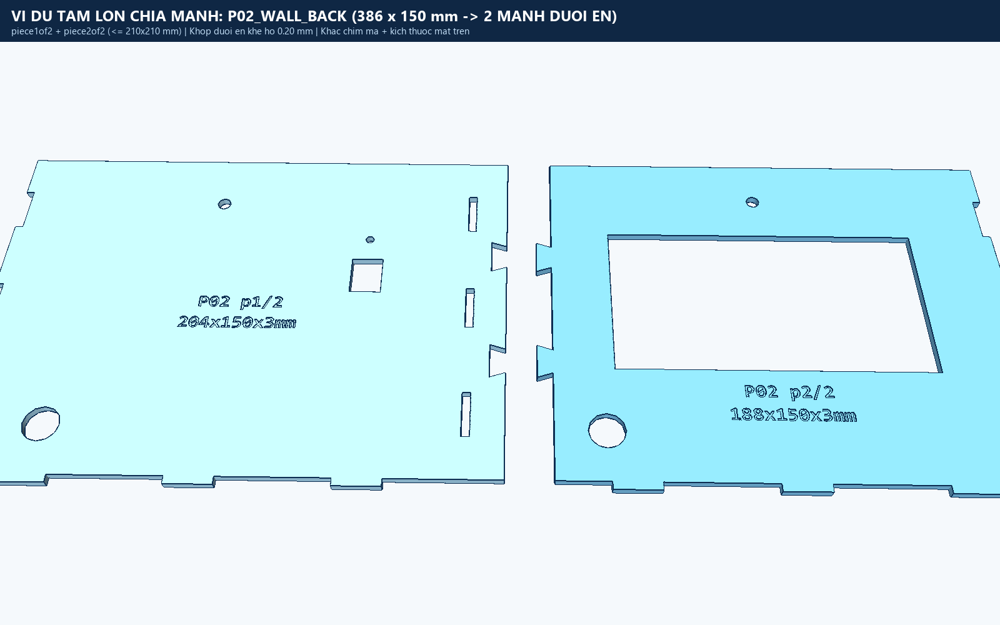
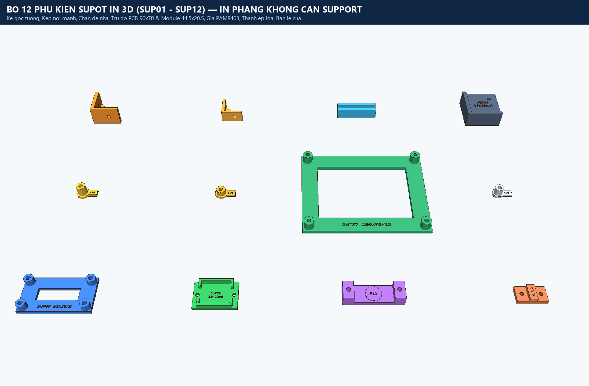
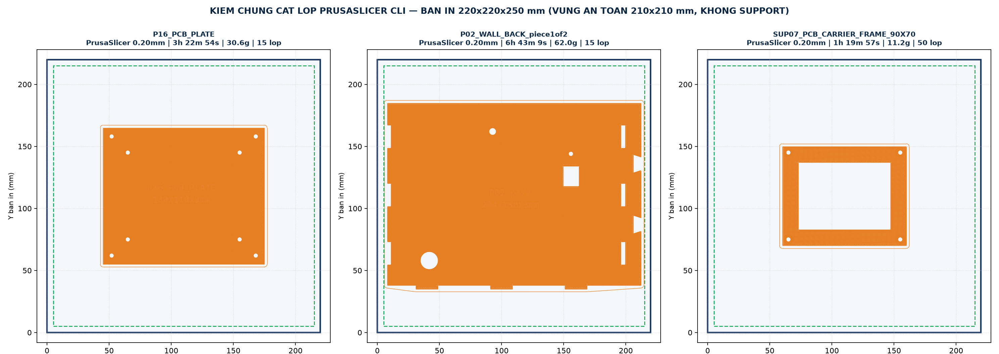

# Bộ Tệp In 3D Vỏ Nhà Thông Minh & Phụ Kiện Supot (`hardware/in 3 d/`)

Thư mục này chứa toàn bộ bộ tệp **in 3D sẵn sàng cắt lớp (print-ready)** được chuyển đổi trực tiếp từ mô hình tham số gốc [`hardware/mica/smarthome_mica_house.FCStd`](../mica/smarthome_mica_house.FCStd) và [`hardware/mica/mica_design.py`](../mica/mica_design.py) — giữ nguyên 100% kích thước bao, toàn bộ lỗ khoan linh kiện, **khắc chìm sẵn mã chi tiết + kích thước ngay trên từng mảnh**, bổ sung **12 phụ kiện gia cố & giá đỡ (supot)** in 3D, và **tự động chia mảnh bằng khớp đuôi én** cho các tấm lớn vượt khổ bàn in.

> **Nguồn sự thật duy nhất (SSOT):** Mọi hình học tấm, tọa độ 76 lỗ tròn, khoảng cách lỗ mạch `90 × 70 mm` (`P16_PCB_PLATE`), `44.5 × 20.5 mm` (`Relay 1/2`), và kiểm định va chạm đều sinh tự động từ mã nguồn tại [`scripts/`](scripts/) (không nhập tay kích thước).

---

## 1. Tổng Quan & Kết Quả Kiểm Định Tự Động

- **Khổ máy in 3D mục tiêu:** `220 × 220 × 250 mm` (chừa lề an toàn `5 mm` mỗi cạnh → vùng in khả dụng **`210 × 210 × 245 mm`**).
- **Tổng số tệp chi tiết in 3D:** **`37` tệp duy nhất** gồm **`25` mảnh vỏ nhà** (chuyển đổi từ `18` tấm gốc / `19` tấm vật lý) và **`12` phụ kiện supot** (`SUP01`–`SUP12`).
- **Định dạng xuất cho mỗi chi tiết:** `STL` ([`STL/`](STL/)), `3MF` ([`3MF/`](3MF/)), `STEP` ([`STEP/`](STEP/)), bản vẽ kỹ thuật có ghi kích thước `PDF + PNG` ([`drawings/`](drawings/)), và ảnh phối cảnh 3D `PNG` ([`previews/`](previews/)).
- **Khắc chìm kích thước trực tiếp lên vật thể:** Khắc sâu `0.60 mm` lên **mặt hướng lên trên** khi đặt in (`Z = T_mm`), giữ mặt đáy `Z = 0` phẳng hoàn toàn để bám bàn in chắc chắn và **không cần support của slicer**.
- **Dung sai ghép nối:** Khớp đuôi én có khe hở **`0.20 mm`** giữa mộng dương và rãnh âm (tái lắp ghép khít đúng kích thước tấm gốc với sai số **`0.000 mm`**).
- **Kiểm định kỹ thuật (`verification_report.json`):**
  - Khối kín manifold (`watertight`): **`37/37` ĐẠT** (`all_watertight = True`).
  - Vừa vùng an toàn bàn in `210 × 210 mm` & đặt phẳng `Z = 0`: **`37/37` ĐẠT**.
  - Cắt lớp thực tế bằng **`prusa-slicer-console.exe`** (PLA `0.20 mm`, không support): **`37/37` ĐẠT** — tổng thời gian in ước tính (tính đủ số lượng `qty`): **`96.13 giờ`**, tổng nhựa tiêu thụ ước tính: **`885.4 g`** (~1 cuộn PLA 1 kg).
  - Kiểm tra va chạm 3D BRep toàn hệ thống (`26` mảnh vỏ + `41` phụ kiện supot): **`0` va chạm vỏ** (`max = 0.0 mm³`), **`0` va chạm phụ kiện** (`max = 0.0 mm³`), **`0` lỗi sai kích thước tái ghép**.





---

## 2. Cấu Trúc Thư Mục `hardware/in 3 d/`

```text
hardware/in 3 d/
├── README.md                  # Tài liệu hướng dẫn tiếng Việt này
├── manifest.json              # Danh mục JSON đầy đủ kích thước, chia mảnh, thời gian & nhựa in
├── verification_report.json   # Báo cáo kiểm định manifold, bàn in, cắt lớp & 0 va chạm 3D
├── STL/                       # 37 tệp STL nhị phân kín khối, đặt phẳng Z = 0 sẵn sàng in
├── 3MF/                       # 37 tệp 3MF chuẩn đơn vị mm (kèm siêu dữ liệu tên chi tiết)
├── STEP/                      # 37 tệp CAD BRep chính xác để chỉnh sửa trong FreeCAD/SolidWorks
├── drawings/                  # 37 bộ bản vẽ kỹ thuật có ghi kích thước (PDF + PNG)
├── previews/                  # 37 ảnh xem trước 3D từng chi tiết + ảnh lắp ráp/phân rã/slicer
└── scripts/                   # Bộ script tái tạo toàn bộ tệp tự động (FreeCADCmd + Python)
```

---

## 3. Chiến Lược Chia Mảnh Cho 5 Tấm Lớn Vượt Bàn In `210 × 210 mm`

Trong `18` tấm vỏ gốc, có **`13` tấm vừa nguyên vẹn trong vùng an toàn `210 × 210 mm`** (in 1 mảnh duy nhất) và **`5` tấm vượt khổ** được tách tự động tại các dải trống không cắt ngang lỗ/khe linh kiện, ghép nối bằng khớp đuôi én khe hở **`0.20 mm`** và đặt tên theo quy ước `<TEN_TAM>_piece<k>of<n>`:

| Tấm gốc | Kích thước gốc (mm) | Lưới chia | Số mảnh | Vị trí đường cắt (mm) | Danh sách tệp mảnh |
| :--- | :---: | :---: | :---: | :---: | :--- |
| `P01A_BASE_TECH` | `406.0 × 181.9 × 3.0` | `2×1` | `2` | `U=[205.0]` | `P01A_BASE_TECH_piece1of2`, `P01A_BASE_TECH_piece2of2` |
| `P01B_BASE_HOUSE` | `406.0 × 215.9 × 3.0` | `2×2` | `4` | `U=[209.5], V=[90.5]` | `P01B_BASE_HOUSE_piece1of4`, `P01B_BASE_HOUSE_piece2of4`, `P01B_BASE_HOUSE_piece3of4`, `P01B_BASE_HOUSE_piece4of4` |
| `P02_WALL_BACK` | `386.0 × 150.0 × 3.0` | `2×1` | `2` | `U=[204.5]` | `P02_WALL_BACK_piece1of2`, `P02_WALL_BACK_piece2of2` |
| `P05_WALL_FRONT` | `386.0 × 150.0 × 3.0` | `2×1` | `2` | `U=[209.5]` | `P05_WALL_FRONT_piece1of2`, `P05_WALL_FRONT_piece2of2` |
| `P15_TECH_FASCIA` | `246.0 × 51.0 × 3.0` | `2×1` | `2` | `U=[143.0]` | `P15_TECH_FASCIA_piece1of2`, `P15_TECH_FASCIA_piece2of2` |



---

## 4. Danh Mục Chi Tiết 25 Mảnh Vỏ Nhà (`P01A` – `P17`)

Mọi mảnh đều có đủ 3 định dạng `STL` / `3MF` / `STEP`, bản vẽ `PDF + PNG` và ảnh 3D `PNG`. Thời gian và khối lượng nhựa được đo trực tiếp từ đầu ra G-code của `PrusaSlicer 2.9.7` (PLA, lớp `0.20 mm`, đầu phun `0.4 mm`, `3` thành, infill `20% gyroid`, **0% support**):

| Mã tệp | Tên tiếng Việt | SL | Kích thước bao L×W×T (mm) | Chữ khắc trên vật | Thời gian in | Nhựa (g) | Bản vẽ & Ảnh |
| :--- | :--- | :---: | :---: | :--- | :---: | :---: | :--- |
| `P01A_BASE_TECH_piece1of2` | Tam day truoc (Khoang ky thuat & Vuon) | `1` | `204.9 × 181.9 × 3.0` | `P01A p1/2 \| 205x182x3mm` | `8g 12p` | `74.8 g` | [PDF](drawings/P01A_BASE_TECH_piece1of2.pdf) · [PNG](previews/P01A_BASE_TECH_piece1of2.png) |
| `P01A_BASE_TECH_piece2of2` | Tam day truoc (Khoang ky thuat & Vuon) | `1` | `207.0 × 181.9 × 3.0` | `P01A p2/2 \| 207x182x3mm` | `8g 11p` | `74.0 g` | [PDF](drawings/P01A_BASE_TECH_piece2of2.pdf) · [PNG](previews/P01A_BASE_TECH_piece2of2.png) |
| `P01B_BASE_HOUSE_piece1of4` | Tam day sau (Phong khach & Phong ngu) | `1` | `209.4 × 90.5 × 3.0` | `P01B p1/4 \| 209x90x3mm` | `4g 11p` | `38.9 g` | [PDF](drawings/P01B_BASE_HOUSE_piece1of4.pdf) · [PNG](previews/P01B_BASE_HOUSE_piece1of4.png) |
| `P01B_BASE_HOUSE_piece2of4` | Tam day sau (Phong khach & Phong ngu) | `1` | `202.5 × 90.5 × 3.0` | `P01B p2/4 \| 202x90x3mm` | `3g 59p` | `37.1 g` | [PDF](drawings/P01B_BASE_HOUSE_piece2of4.pdf) · [PNG](previews/P01B_BASE_HOUSE_piece2of4.png) |
| `P01B_BASE_HOUSE_piece3of4` | Tam day sau (Phong khach & Phong ngu) | `1` | `209.4 × 131.4 × 3.0` | `P01B p3/4 \| 209x131x3mm` | `5g 55p` | `55.0 g` | [PDF](drawings/P01B_BASE_HOUSE_piece3of4.pdf) · [PNG](previews/P01B_BASE_HOUSE_piece3of4.png) |
| `P01B_BASE_HOUSE_piece4of4` | Tam day sau (Phong khach & Phong ngu) | `1` | `202.5 × 131.4 × 3.0` | `P01B p4/4 \| 202x131x3mm` | `5g 38p` | `52.4 g` | [PDF](drawings/P01B_BASE_HOUSE_piece4of4.pdf) · [PNG](previews/P01B_BASE_HOUSE_piece4of4.png) |
| `P02_WALL_BACK_piece1of2` | Tuong sau (Phong khach + Phong ngu) | `1` | `204.4 × 150.0 × 3.0` | `P02 p1/2 \| 204x150x3mm` | `6g 43p` | `62.0 g` | [PDF](drawings/P02_WALL_BACK_piece1of2.pdf) · [PNG](previews/P02_WALL_BACK_piece1of2.png) |
| `P02_WALL_BACK_piece2of2` | Tuong sau (Phong khach + Phong ngu) | `1` | `187.5 × 150.0 × 3.0` | `P02 p2/2 \| 188x150x3mm` | `4g 21p` | `40.9 g` | [PDF](drawings/P02_WALL_BACK_piece2of2.pdf) · [PNG](previews/P02_WALL_BACK_piece2of2.png) |
| `P03_WALL_LEFT` | Vach hong trai cat mo | `1` | `190.0 × 150.0 × 3.0` | `P03_WALL_LEFT \| 190x150x3mm` | `4g 39p` | `43.2 g` | [PDF](drawings/P03_WALL_LEFT.pdf) · [PNG](previews/P03_WALL_LEFT.png) |
| `P04_WALL_RIGHT` | Vach hong phai cat mo | `1` | `190.0 × 150.0 × 3.0` | `P04_WALL_RIGHT \| 190x150x3mm` | `4g 28p` | `41.6 g` | [PDF](drawings/P04_WALL_RIGHT.pdf) · [PNG](previews/P04_WALL_RIGHT.png) |
| `P05_WALL_FRONT_piece1of2` | Tuong mat tien & Khung cua chinh | `1` | `209.4 × 150.0 × 3.0` | `P05 p1/2 \| 209x150x3mm` | `3g 14p` | `30.7 g` | [PDF](drawings/P05_WALL_FRONT_piece1of2.pdf) · [PNG](previews/P05_WALL_FRONT_piece1of2.png) |
| `P05_WALL_FRONT_piece2of2` | Tuong mat tien & Khung cua chinh | `1` | `180.5 × 37.0 × 3.0` | `P05 p2/2 \| 180x37x3mm` | `1g 26p` | `13.6 g` | [PDF](drawings/P05_WALL_FRONT_piece2of2.pdf) · [PNG](previews/P05_WALL_FRONT_piece2of2.png) |
| `P06_WALL_MID` | Vach ngan giua (Phong khach / Phong ngu) | `1` | `190.0 × 150.0 × 3.0` | `P06_WALL_MID \| 190x150x3mm` | `4g 51p` | `45.4 g` | [PDF](drawings/P06_WALL_MID.pdf) · [PNG](previews/P06_WALL_MID.png) |
| `P07_SERVO_SHELF` | Ke gan Servo SG90 cua chinh | `1` | `34.0 × 49.1 × 3.0` | `P07 \| 34x49x3mm` | `20p 56s` | `3.4 g` | [PDF](drawings/P07_SERVO_SHELF.pdf) · [PNG](previews/P07_SERVO_SHELF.png) |
| `P08_DOOR_LEAF` | Canh cua chinh | `1` | `56.0 × 100.0 × 3.0` | `P08 \| 56x100x3mm` | `1g 11p` | `11.1 g` | [PDF](drawings/P08_DOOR_LEAF.pdf) · [PNG](previews/P08_DOOR_LEAF.png) |
| `P09_GARDEN_LEFT` | Vach trai be nuoc | `1` | `126.0 × 57.0 × 3.0` | `P09 \| 126x57x3mm` | `1g 32p` | `14.4 g` | [PDF](drawings/P09_GARDEN_LEFT.pdf) · [PNG](previews/P09_GARDEN_LEFT.png) |
| `P10_WATER_DIVIDER` | Vach ngan be nuoc & chau cay | `1` | `126.0 × 57.0 × 3.0` | `P10 \| 126x57x3mm` | `1g 33p` | `14.5 g` | [PDF](drawings/P10_WATER_DIVIDER.pdf) · [PNG](previews/P10_WATER_DIVIDER.png) |
| `P11_GARDEN_RIGHT` | Vach phai chau cay | `1` | `126.0 × 51.0 × 3.0` | `P11 \| 126x51x3mm` | `1g 23p` | `13.0 g` | [PDF](drawings/P11_GARDEN_RIGHT.pdf) · [PNG](previews/P11_GARDEN_RIGHT.png) |
| `P12_GARDEN_FRONT` | Vach truoc be nuoc & chau cay | `1` | `130.0 × 57.0 × 3.0` | `P12 \| 130x57x3mm` | `1g 34p` | `14.5 g` | [PDF](drawings/P12_GARDEN_FRONT.pdf) · [PNG](previews/P12_GARDEN_FRONT.png) |
| `P13_GARDEN_BACK` | Vach sau be nuoc & chau cay | `1` | `130.0 × 57.0 × 3.0` | `P13 \| 130x57x3mm` | `1g 33p` | `14.4 g` | [PDF](drawings/P13_GARDEN_BACK.pdf) · [PNG](previews/P13_GARDEN_BACK.png) |
| `P14_SOIL_BRIDGE` | Cau giu dau do am dat YL-69 | `1` | `32.0 × 126.0 × 3.0` | `P14 \| 32x126x3mm` | `56p 18s` | `8.9 g` | [PDF](drawings/P14_SOIL_BRIDGE.pdf) · [PNG](previews/P14_SOIL_BRIDGE.png) |
| `P15_TECH_FASCIA_piece1of2` | Mat na ky thuat (Nguon DC & Loa) | `1` | `142.9 × 45.0 × 3.0` | `P15 p1/2 \| 143x45x3mm` | `56p 00s` | `8.7 g` | [PDF](drawings/P15_TECH_FASCIA_piece1of2.pdf) · [PNG](previews/P15_TECH_FASCIA_piece1of2.png) |
| `P15_TECH_FASCIA_piece2of2` | Mat na ky thuat (Nguon DC & Loa) | `1` | `107.0 × 51.0 × 3.0` | `P15 p2/2 \| 107x51x3mm` | `1g 06p` | `8.9 g` | [PDF](drawings/P15_TECH_FASCIA_piece2of2.pdf) · [PNG](previews/P15_TECH_FASCIA_piece2of2.png) |
| `P16_PCB_PLATE` | Tam ga bo mach Hub PCB 100x80 | `1` | `130.0 × 110.0 × 3.0` | `P16_PCB_PLATE \| 130x110x3mm` | `3g 22p` | `30.6 g` | [PDF](drawings/P16_PCB_PLATE.pdf) · [PNG](previews/P16_PCB_PLATE.png) |
| `P17_BASE_JOINER` | Thanh noi day (mat duoi) | `2` | `64.0 × 28.0 × 3.0` | `P17 \| 64x28x3mm` | `29p 29s` | `4.3 g` | [PDF](drawings/P17_BASE_JOINER.pdf) · [PNG](previews/P17_BASE_JOINER.png) |

---

## 5. Danh Mục 12 Phụ Kiện Gia Cố & Giá Đỡ In 3D (`SUP01` – `SUP12`)

Toàn bộ 12 phụ kiện supot đều được thiết kế khớp chính xác mẫu lỗ của [`hardware/mica/mica_design.py`](../mica/mica_design.py) (như chuẩn `90 × 70 mm` cho `P16_PCB_PLATE`, `44.5 × 20.5 mm` cho `Relay 1/2`, `26.0 mm` cho `PAM8403`, `36.0 mm` cho loa `Ø28 mm`), **định hướng nằm phẳng Z = 0, không cần support khi cắt lớp**, và khắc sẵn mã kích thước:



| Mã phụ kiện | Tên tiếng Việt | SL | Kích thước X×Y×Z (mm) | Chữ khắc | Vị trí lắp ghép & Vai trò | Thời gian | Nhựa (g) | Bản vẽ |
| :--- | :--- | :---: | :---: | :--- | :--- | :---: | :---: | :--- |
| `SUP01_CORNER_L_BRACKET_WALL` | Ke goc vuong 90 do tuong cao | `8` | `24.0 × 24.0 × 16.0` | `SUP01 24x24x16` | Gia co goc vuong 90 do giua cac tuong dung cao 147mm, thay keo dan dung moi; in nam phang khong can support. | `18p 25s` | `3.0 g` | [PDF](drawings/SUP01_CORNER_L_BRACKET_WALL.pdf) · [PNG](previews/SUP01_CORNER_L_BRACKET_WALL.png) |
| `SUP02_CORNER_L_BRACKET_LOW` | Ke goc vuong 90 do vach thap & vuon | `6` | `18.0 × 18.0 × 10.0` | `SUP02 18x18x10` | Ke goc nho gon cho vach cat mo mat truoc (34mm) va cum be nuoc - chau cay (48-54mm). | `8p 22s` | `1.2 g` | [PDF](drawings/SUP02_CORNER_L_BRACKET_LOW.pdf) · [PNG](previews/SUP02_CORNER_L_BRACKET_LOW.png) |
| `SUP03_SEAM_JOIN_CLIP` | Kep chu U gia co moi noi tach manh | `10` | `34.0 × 9.2 × 9.0` | `SUP03 34x9x9` | Kep chu U ranh 3.2mm truot khoa tren mep moi noi duoi en cua cac tam chia manh, chong cong venh. | `14p 14s` | `2.4 g` | [PDF](drawings/SUP03_SEAM_JOIN_CLIP.pdf) · [PNG](previews/SUP03_SEAM_JOIN_CLIP.png) |
| `SUP04_BASE_FOOT_STAND` | Chan de nang nha (chong cham oc day) | `6` | `30.0 × 30.0 × 14.0` | `SUP04 30x30x14` | Nang tam day nha cao 11mm khoi mat ban, chong cham thanh noi P17 va dau oc M3 duoi day. | `32p 53s` | `6.0 g` | [PDF](drawings/SUP04_BASE_FOOT_STAND.pdf) · [PNG](previews/SUP04_BASE_FOOT_STAND.png) |
| `SUP05_HUB_PCB_STANDOFF_10MM` | Tru do Hub PCB M3x10 (in 3D) | `4` | `16.5 × 10.0 × 10.0` | `S05 10x10` | Tru do M3 cao 10mm thay the tru dong gan Hub PCB 100x80mm len tam P16_PCB_PLATE (mau lo 90x70mm). | `6p 10s` | `0.6 g` | [PDF](drawings/SUP05_HUB_PCB_STANDOFF_10MM.pdf) · [PNG](previews/SUP05_HUB_PCB_STANDOFF_10MM.png) |
| `SUP06_PCB_PLATE_STANDOFF_6MM` | Tru do tam P16_PCB_PLATE M3x6 (in 3D) | `4` | `16.5 × 10.0 × 6.0` | `S06 10x6` | Tru do M3 cao 6mm nang tam P16_PCB_PLATE phia tren tam day P01A_BASE_TECH (mau lo 116x96mm). | `4p 09s` | `0.4 g` | [PDF](drawings/SUP06_PCB_PLATE_STANDOFF_6MM.pdf) · [PNG](previews/SUP06_PCB_PLATE_STANDOFF_6MM.png) |
| `SUP07_PCB_CARRIER_FRAME_90X70` | Khung de lien khoi Hub PCB 90x70 | `1` | `100.0 × 80.0 × 10.0` | `SUP07 90x70 100x80x10mm` | Khung do lien khoi tich hop 4 tru 10mm dung chuan lo 90x70mm (thay the tuy chon cho 4 tru roi SUP05). | `1g 19p` | `11.2 g` | [PDF](drawings/SUP07_PCB_CARRIER_FRAME_90X70.pdf) · [PNG](previews/SUP07_PCB_CARRIER_FRAME_90X70.png) |
| `SUP08_MODULE_STANDOFF_8MM` | Tru do module ngoai vi M3x8 (in 3D) | `11` | `15.5 × 9.0 × 8.0` | `S08 9x8` | Tru do M3 cao 8mm thay tru nhua cho 2 module Relay (44.5x20.5mm), DHT11, KY-037 va LM393. | `4p 49s` | `0.4 g` | [PDF](drawings/SUP08_MODULE_STANDOFF_8MM.pdf) · [PNG](previews/SUP08_MODULE_STANDOFF_8MM.png) |
| `SUP09_RELAY_CADDY_44P5X20P5` | Khung de Relay 1 kenh 44.5x20.5 | `2` | `52.0 × 28.0 × 8.0` | `SUP09 52x28x8` | Khung de 4 tru lien khoi chuan 44.5x20.5mm cho Relay 1 va Relay 2 (thay the tuy chon cho 8 tru roi SUP08). | `28p 32s` | `3.4 g` | [PDF](drawings/SUP09_RELAY_CADDY_44P5X20P5.pdf) · [PNG](previews/SUP09_RELAY_CADDY_44P5X20P5.png) |
| `SUP10_PAM8403_CLIP_STAND` | Gia kep mach khuếch dai PAM8403 | `1` | `32.0 × 22.0 × 6.0` | `SUP10 32x22x6` | Gia giu khay co dinh mach PAM8403 (21x18mm) khop dung 2 lo PAM_CLAMP cach nhau 26.0mm, khong can bang dinh xop. | `12p 21s` | `1.9 g` | [PDF](drawings/SUP10_PAM8403_CLIP_STAND.pdf) · [PNG](previews/SUP10_PAM8403_CLIP_STAND.png) |
| `SUP11_SPEAKER_28MM_RETAINER` | Thanh ep giu loa tron 28mm | `1` | `44.0 × 14.0 × 9.0` | `SUP11 44x14x9` | Thanh ep lung giu loa mini tron duong kinh 28mm ap sat luoi loa 19 lo tren P15_TECH_FASCIA. | `26p 32s` | `3.1 g` | [PDF](drawings/SUP11_SPEAKER_28MM_RETAINER.pdf) · [PNG](previews/SUP11_SPEAKER_28MM_RETAINER.png) |
| `SUP12_DOOR_HINGE_BRACKET` | Ban le cua chinh in 3D | `2` | `22.0 × 12.0 × 6.0` | `SUP12 22x12x6` | Cap ban le in 3D noi canh cua P08_DOOR_LEAF vao khung cua P05_WALL_FRONT, giu khe ho 2.0mm. | `7p 54s` | `0.9 g` | [PDF](drawings/SUP12_DOOR_HINGE_BRACKET.pdf) · [PNG](previews/SUP12_DOOR_HINGE_BRACKET.png) |

> **Lưu ý tùy chọn tiện lợi:** Bạn có thể in **`4× SUP05`** (trụ lẻ `10 mm`) **hoặc** in **`1× SUP07_PCB_CARRIER_FRAME_90X70`** (khung liền khối 4 trụ `90 × 70 mm`) để đỡ Hub PCB. Tương tự, có thể chọn **`8× SUP08`** (trụ lẻ `8 mm`) **hoặc** **`2× SUP09_RELAY_CADDY_44P5X20P5`** (khung liền khối `44.5 × 20.5 mm`) cho 2 module Relay.

---

## 6. Thông Số In 3D Khuyến Nghị (FDM `220 × 220 × 250 mm`)

| Hạng mục | Tấm vỏ nhà (`P01A`–`P17`) | Phụ kiện Supot (`SUP01`–`SUP12`) | Ghi chú kỹ thuật |
| :--- | :--- | :--- | :--- |
| **Vật liệu** | **PLA+** hoặc **PETG** *(khuyên dùng PETG cho cụm bể nước `P09`–`P13`)* | **PETG** hoặc **PLA+** | PETG dẻo và chịu ẩm tốt hơn cho kẹp nối & bể nước. |
| **Đầu phun / Chiều cao lớp** | `0.4 mm` / **`0.20 mm`** (`15` lớp cho tấm `3.0 mm`) | `0.4 mm` / **`0.20 mm`** | Lớp `0.20 mm` đảm bảo chữ khắc sâu `0.60 mm` (3 lớp) đọc rõ nét. |
| **Số thành (Perimeters)** | `3` thành (`~1.2 mm`) | `3–4` thành | Tăng độ bền kéo cho khớp đuôi én và lỗ bắt ốc M3. |
| **Mật độ ruột (Infill)** | `20%` (`Gyroid` hoặc `Grid`) | `25–30%` (`Gyroid`) | Chống cong vênh (warping) cho các mảnh đáy lớn. |
| **Hướng đặt vật thể** | **Mặt phẳng `Z = 0` úp bàn in**, mặt khắc chữ hướng **lên trên** | Giữ nguyên hướng mặc định trong tệp `STL`/`3MF` | Tất cả 37 tệp đã xoay sẵn print-ready. |
| **Support Slicer** | **TẮT (`0%`, Không cần support)** | **TẮT (`0%`, Không cần support)** | `SUP03` và `SUP11` đã lật sẵn đáy phẳng xuống bàn in. |
| **Bám bàn in (Adhesion)** | `Skirt` 1–2 vòng (bật `Brim 4 mm` nếu in PETG / mảnh dài > 180 mm) | `Skirt` (bật `Brim` nhỏ cho trụ lẻ `SUP05/06/08`) | Giúp các mảnh `P01A`/`P01B`/`P02` phẳng tuyệt đối không hở góc. |
| **Dung sai hiệu chuẩn** | Khớp đuôi én `0.20 mm`, khe mộng `0.25 mm` | Rãnh kẹp `SUP03` `3.20 mm` | Nếu máy có elephant's foot, bật `Elephant foot compensation = 0.15 mm`. |



---

## 7. Thứ Tự Lắp Ráp (Thu tu lap rap)

Thực hiện theo đúng **9 bước** dưới đây để lắp ráp nhanh, chắc chắn và chống thấm an toàn trước khi đấu mạch điện:

1. **Bước 1 — Kiểm tra phôi in & ướm khô khớp đuôi én:**
   - Đọc mã khắc chìm trên mặt từng mảnh để phân loại đủ `25` mảnh vỏ và `12` nhóm phụ kiện `SUP01`–`SUP12`.
   - Cạo nhẹ bavia mép đáy (nếu có), sau đó ướm trượt khô các mảnh chia đôi/chia tư: `P01A` (`2` mảnh), `P01B` (`4` mảnh), `P02` (`2` mảnh), `P05` (`2` mảnh), `P15` (`2` mảnh). Các khớp đuôi én có khe hở `0.20 mm` sẽ lồng phẳng khít thành đúng kích thước gốc.
2. **Bước 2 — Ghép tấm đáy tổng (`406 × 390 mm`) & lắp chân đế `SUP04`:**
   - Ghép `P01A_BASE_TECH_piece1of2 + piece2of2` và `4` mảnh `P01B_BASE_HOUSE_piece1of4..4of4`, sau đó lồng 4 mộng khóa `24 mm` giữa `P01A` và `P01B` trên mặt bàn phẳng.
   - Bắt `2× P17_BASE_JOINER` ở mặt dưới đường nối giữa bằng `8×` ốc `M3×10` + đai ốc; cố định thêm `SUP03_SEAM_JOIN_CLIP` ở các đường ghép đáy nếu cần tăng cứng.
   - Gắn `4–6× SUP04_BASE_FOOT_STAND` vào 4 góc và 2 cạnh giữa của đáy — nâng toàn bộ khung nhà cao `11 mm` khỏi mặt bàn để thanh nối `P17` và đầu ốc M3 không cọ xước bàn.
3. **Bước 3 — Lắp Hub PCB (`100 × 80 mm`) trên `P16_PCB_PLATE` & khoang kỹ thuật:**
   - Đặt `4× SUP06_PCB_PLATE_STANDOFF_6MM` (`6 mm`) tại 4 lỗ `116 × 96 mm` trên `P01A` rồi bắt tấm `P16_PCB_PLATE` lên trên.
   - Đặt `4× SUP05_HUB_PCB_STANDOFF_10MM` (`10 mm`) **hoặc** `1× SUP07_PCB_CARRIER_FRAME_90X70` khớp chuẩn `90 × 70 mm` lên `P16_PCB_PLATE`, sau đó bắt Hub PCB (cắm sẵn NodeMCU hướng cổng Micro-USB ra mặt trước).
   - Lắp `Relay 1` và `Relay 2` lên `P01A` bằng `8× SUP08_MODULE_STANDOFF_8MM` **hoặc** `2× SUP09_RELAY_CADDY_44P5X20P5` (chuẩn `44.5 × 20.5 mm`).
   - Đặt mạch khuếch đại `PAM8403` vào khay `SUP10_PAM8403_CLIP_STAND` và cố định qua 2 lỗ `Ø3.0 mm` (`26.0 mm`).
4. **Bước 4 — Ghép tường sau `P02_WALL_BACK` & kẹp khóa `SUP03`:**
   - Lồng `P02_WALL_BACK_piece1of2` và `piece2of2` theo 2 khớp đuôi én, sau đó trượt `1× SUP03_SEAM_JOIN_CLIP` lên cạnh trên đường nối (`X = 203..237 mm`, nằm gọn bên phải vách giữa `P06`).
   - Gắn 2 LED 5 mm (`D0`, `D4`) và cảm biến `DHT11` (`D2` dùng `1× SUP08_MODULE_STANDOFF_8MM`) trước khi cắm 6 mộng đáy vào `P01B`.
5. **Bước 5 — Dựng vách ngăn `P06_WALL_MID`, vách hông `P03`, `P04` & khóa ke góc `SUP01`:**
   - Lắp vách giữa `P06_WALL_MID`, vách trái `P03_WALL_LEFT`, vách phải `P04_WALL_RIGHT` vào các khe trên `P01B` và `P02`.
   - Bắt `8× SUP01_CORNER_L_BRACKET_WALL` vào các góc đứng phía trong giữa `P02` với `P03`, `P04`, `P06` (tại 2 tầng cao `Z = 42 mm` và `Z = 89 mm`) để cố định vuông góc `90°` chắc chắn mà không cần keo dung môi.
6. **Bước 6 — Ghép tường mặt tiền `P05_WALL_FRONT`, kệ Servo `P07` & cánh cửa `P08`:**
   - Lồng `P05_WALL_FRONT_piece1of2` và `piece2of2`, trượt `1× SUP03_SEAM_JOIN_CLIP` lên cạnh trên đoạn vách thấp (`X = 214.5..248.5 mm`, tránh sát trụ giữa).
   - Gắn cảm biến `KY-037` (`1× SUP08`), còi Buzzer `TMB12A05` (`Ø12.5 mm`), và gài kệ `P07_SERVO_SHELF` (đã lắp Servo SG90 bằng 2 ốc M2 + long-đen M2) vào khe khung cửa rồi dựng `P05` lên `P01B`. Gia cố 2 góc thấp trước bằng `2× SUP02_CORNER_L_BRACKET_LOW`.
   - Treo cánh cửa `P08_DOOR_LEAF` bằng cặp bản lề in 3D `2× SUP12_DOOR_HINGE_BRACKET` (giữ khe hở đều `2.0 mm`) và nối thanh kéo sang tay đòn Servo SG90.
7. **Bước 7 — Lắp cụm bể nước & chậu cây (`P09`–`P14`) + chống thấm:**
   - Lắp 5 vách `P09`–`P13` vào `P01A`, gia cố 4 góc trong bằng `4× SUP02_CORNER_L_BRACKET_LOW`.
   - **Bắt buộc chống thấm cho bể nước in 3D:** Quét 1 lớp mỏng keo epoxy/silicone trung tính mặt trong khoang bể nước (`P01A/P09/P10/P12/P13`) để bịt kín khe giữa các lớp in FDM, chờ khô và thử nước 15 phút trên giấy khô trước khi cấp điện.
   - Đặt bơm chìm 5V, luồn ống silicon `Ø8 mm` qua lỗ `Ø10 mm` trên `P10`, gắn `LM393` (`1× SUP08`) mặt ngoài `P12`, gài cầu `P14_SOIL_BRIDGE` và cắm đầu dò `YL-69`.
8. **Bước 8 — Ghép mặt nạ kỹ thuật `P15_TECH_FASCIA` & loa `Ø28 mm`:**
   - Ghép `P15_TECH_FASCIA_piece1of2` + `piece2of2`, khóa cạnh trên rãnh USB bằng `1× SUP03_SEAM_JOIN_CLIP`.
   - Lắp giắc nguồn `DC-022` (`Ø12.5 mm`), LED nguồn 3 mm (`Ø3.5 mm`), áp loa `Ø28 mm` sau lưới 19 lỗ và ép giữ bằng `1× SUP11_SPEAKER_28MM_RETAINER` + 2 ốc M3.
9. **Bước 9 — Đi dây Dupont & kiểm tra an toàn điện:**
   - Luồn đủ 40 dây theo [`docs/phan_cung/WIRING_TABLE.md`](../../docs/phan_cung/WIRING_TABLE.md) và chỉ mục [`docs/HARDWARE_BUILD_GUIDE.md`](../../docs/HARDWARE_BUILD_GUIDE.md) qua 6 lỗ `Ø14 mm`, kiểm tra lại nguồn `+3.3 V` cho `DHT11` / `KY-037` / `LM393` trước khi cắm nguồn 5V 2A.

---

## 8. Lệnh Tái Tạo Toàn Bộ Bộ Tệp Từ Mã Nguồn (Reproducible Build)

Chạy tuần tự 5 lệnh sau từ thư mục gốc dự án để tái tạo sạch 100% toàn bộ `STL`, `3MF`, `STEP`, bản vẽ, ảnh 3D, kiểm định va chạm, báo cáo cắt lớp và tệp `README.md` này:

```powershell
# Khai báo đường dẫn FreeCADCmd di động (hoặc dùng trực tiếp 'freecadcmd' nếu đã có trong PATH)
$FREECAD = if (Get-Command freecadcmd -ErrorAction SilentlyContinue) { "freecadcmd" } else { "$env:LOCALAPPDATA\Programs\FreeCAD 1.1\bin\freecadcmd.exe" }

# 1. Sinh 37 khối 3D (STEP + STL) kèm khớp đuôi én và khắc chữ kích thước bằng FreeCAD 1.1
& $FREECAD "hardware/in 3 d/scripts/build_print_parts.py"

# 2. Chuyển đổi sang 3MF và xuất 37 bộ bản vẽ kỹ thuật PDF + PNG
python "hardware/in 3 d/scripts/export_3mf_and_drawings.py"

# 3. Kết xuất 37 ảnh 3D từng chi tiết + 4 ảnh tổng thể (lắp ráp, phân rã, chia mảnh, supot)
& $FREECAD "hardware/in 3 d/scripts/render_previews.py"
$env:PRINT3D_ASSEMBLY = "1"; & $FREECAD "hardware/in 3 d/scripts/render_previews.py"; Remove-Item Env:PRINT3D_ASSEMBLY

# 4. Kiểm định 3D BRep (0 va chạm), cắt lớp PrusaSlicer CLI & xuất manifest.json + verification_report.json
python "hardware/in 3 d/scripts/verify_and_slice.py"
$env:PRINT3D_ASSEMBLY_CHECK = "1"; & $FREECAD "hardware/in 3 d/scripts/verify_and_slice.py"; Remove-Item Env:PRINT3D_ASSEMBLY_CHECK
python "hardware/in 3 d/scripts/verify_and_slice.py" --merge

# 5. Cập nhật README.md tiếng Việt từ manifest.json & verification_report.json
python "hardware/in 3 d/scripts/generate_readme.py"
```

---

## 9. Tài Liệu Liên Kết

- [Chỉ mục chế tạo & đấu nối phần cứng (`docs/HARDWARE_BUILD_GUIDE.md`)](../../docs/HARDWARE_BUILD_GUIDE.md)
- [Hướng dẫn cắt & lắp ghép phiên bản Mica 3mm (`docs/phan_cung/mica/ASSEMBLY_GUIDE.md`)](../../docs/phan_cung/mica/ASSEMBLY_GUIDE.md)
- [Bảng tọa độ 76 lỗ khoan chuẩn (`docs/phan_cung/mica/holes_table.csv`)](../../docs/phan_cung/mica/holes_table.csv)
- [Bảng đấu nối 40 dây & 10 chân ESP8266 (`docs/phan_cung/WIRING_TABLE.md`)](../../docs/phan_cung/WIRING_TABLE.md)
