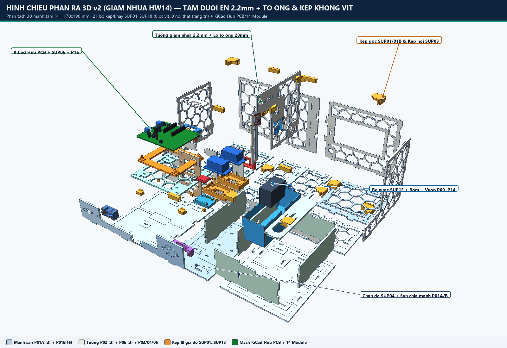
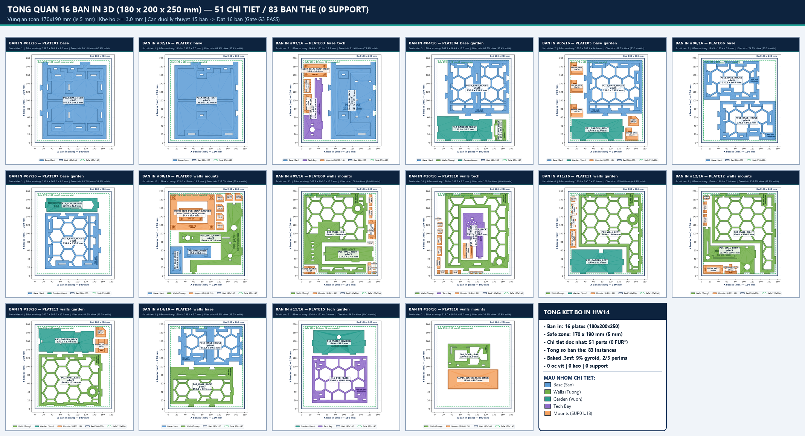
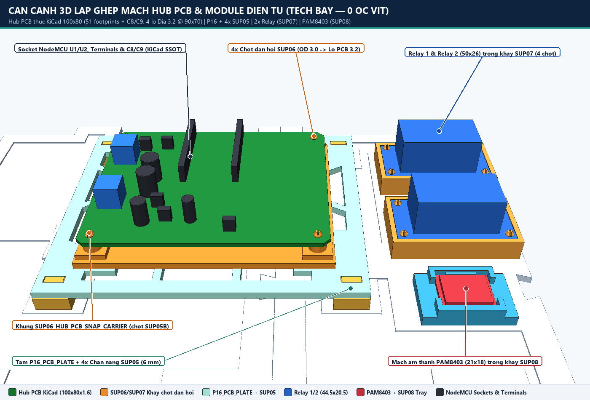
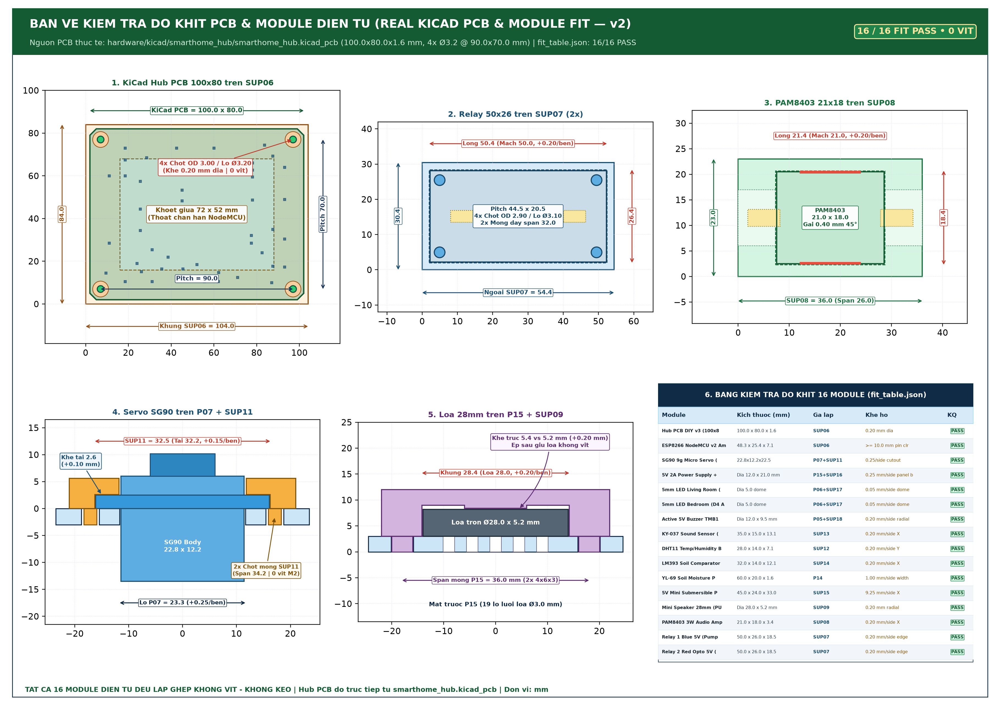

# Bộ Tệp In 3D Vỏ Nhà Thông Minh v2 (Tối Ưu Giảm Nhựa HW14) — 100% Lắp Mộng, Bàn In 180×200×250 mm (`hardware/in 3 d/`)

> **Nguyên tắc lắp ghép v2 (duy nhất):** Toàn bộ mô hình được thiết kế **100% bằng khớp mộng tự khóa (mộng đuôi én, mộng răng lược, kẹp chữ U, chốt mộng rời và chốt đàn hồi snap-fit) — không cần ốc vít, không cần keo dán** ở bất kỳ vị trí nào.
> **Nguồn sự thật duy nhất (SSOT):** Mọi kích thước vỏ nhà lấy từ [`hardware/mica/mica_design.py`](../mica/mica_design.py), chính sách giảm nhựa & thông số cắt lớp nhúng trong `.3mf` từ [`scripts/lightweight_policy.py`](scripts/lightweight_policy.py), biên dạng mạch Hub PCB thực đọc trực tiếp từ [`hardware/kicad/smarthome_hub/smarthome_hub.kicad_pcb`](../kicad/smarthome_hub/smarthome_hub.kicad_pcb), và toàn bộ tệp in đều sinh tự động từ [`scripts/`](scripts/).

---

## 1. Tổng Quan & Kết Quả Giảm Nhựa Không Giảm Độ Bền

- **Khổ máy in 3D mục tiêu:** **`180 × 200 × 250 mm`** (chừa lề an toàn `5 mm` mỗi cạnh → vùng in khả dụng **`170 × 190 × 245 mm`**).
- **Hiệu quả giảm nhựa PLA đo thực tế bằng `PrusaSlicer 2.9.7 CLI`:** Từ **`1044.86 g`** (`17` bàn) xuống còn **`660.64 g`** (**`16` bàn**), tiết kiệm **`384.22 g` (`36.77%`)** — vượt mục tiêu `>= 35%` (`<= 680 g`), giữ nguyên 100% ngàm lắp `14` module + Hub PCB + cụm cửa Servo SG90.
- **Quy mô bộ chi tiết (đã bỏ toàn bộ nội thất trang trí `FUR01`–`FUR09`):** **`51` chi tiết duy nhất / `83` bản thể vật lý**, gồm:
  - **`30` mảnh vỏ nhà** (`P01A`–`P17`, đã tự động chia mảnh cho 5 tấm vượt khổ `170 × 190 mm`; các tấm `P01A`, `P01B`, `P02`–`P06` làm mỏng vùng lòng xuống **`2.2 mm`** kèm gân tăng cứng `3.0 mm` và **`288` ô tổ ong lục giác `28 mm` bám biên** ở vùng không chịu lực, giữ kín 100% khoang Relay/PSU/bể nước).
  - **`21` phụ kiện kẹp góc, ngàm giữ mạch, bản lề đồng trục, ngàm chữ U tay đòn SG90 & lòng bể nước liền khối** (`SUP01`–`SUP18`).
- **Xếp bàn in tối ưu (`plates/`):** Toàn bộ `83` bản thể được đóng gói tự động bằng thuật toán 2D MaxRects (cho phép xoay `0°/90°`, khe hở `>= 3.0 mm`) vào đúng **`16` bàn in** (`PLATE01`–`PLATE16`), nhúng sẵn toàn bộ thông số cắt lớp (`Slic3r_PE.config` + `Slic3r_PE_model.config`) ngay bên trong từng tệp `.3mf`.
  - **Cận dưới lý thuyết vs thực đạt:** Tổng diện tích hình chiếu đặc = `269307 mm²` → cận dưới diện tích đặc **`9` bàn** (`8.34`); tổng diện tích khung bao = `467809 mm²` → cận dưới khung bao **`15` bàn** (`14.48`); **đạt `16` bàn**.
- **Kiểm chứng cắt lớp thực tế (`PrusaSlicer 2.9.7 CLI`, `--dont-arrange`, KHÔNG truyền cờ ghi đè CLI — đọc trực tiếp cấu hình nhúng trong `.3mf`):**
  - Toàn bộ **`51/51` chi tiết lẻ** và **`16/16` bàn in (`STL` + `3MF`)** đạt **`manifold = yes`** (`100%`).
  - **Cấu hình nhúng trong mọi `.3mf`:** PLA `1.24 g/cm³`, lớp `0.20 mm`, **`9% Gyroid`**, mặc định **`2` thành** (riêng `23` chi tiết khớp/ngàm/bản lề/servo giữ **`3` thành**), **`3` lớp đáy / `3` lớp đỉnh** (`0.6 mm` tối thiểu; ngoại lệ có lý do cho `SUP15_WATER_TANK_LINER`: `4` lớp đáy `0.8 mm` + `3` thành để chống thấm nước không cần chất trám), **`0% support`**.
  - **Tổng thời gian in ước tính:** **`73g 23p 49s`** (`73.40 giờ`).
  - **Tổng nhựa PLA tiêu thụ:** **`660.64 g`** (**`221.50 m`** sợi `1.75 mm`).
- **Kiểm định lắp ráp ảo 3D BRep & Độ bền FEA-lite:** Sai số tái ghép mảnh chia **`0.0000 mm`**, **`0` va chạm** trên toàn bộ `31` mảnh vỏ + `51` kẹp/giá đỡ + `17` mạch/linh kiện; quét thể tích cánh cửa dẫn động trực tiếp đồng trục **`0°–90°`** (`19` góc) đạt **`0.0000 mm³`** va chạm, hệ số dự trữ mô-men SG90 **`14.56×`**; độ võng đáy `2.2 mm` dưới tải `250 g` = **`0.0801 mm`** (`<= 0.50 mm`); bảng lắp khít linh kiện đạt **`16/16` PASS**.




---

## 2. Cấu Trúc Thư Mục `hardware/in 3 d/`

```text
hardware/in 3 d/
├── README.md                  # Tài liệu hướng dẫn tiếng Việt này
├── manifest.json              # Danh mục JSON đầy đủ từng tệp, chi tiết, bàn in, kích thước & SHA-256
├── verification_report.json   # Báo cáo kiểm định hợp nhất (lắp ráp, độ bền, lắp khít, PrusaSlicer, R9)
├── plates/                    # 16 bàn in hoàn chỉnh (PLATEnn_*.3mf nhúng sẵn cấu hình + PLATEnn_*.stl)
├── parts/                     # 51 chi tiết rời (STL kín khối phẳng Z=0 + STEP CAD BRep, 0 nội thất)
├── drawings/                  # 106 bản vẽ kỹ thuật PNG + PDF (51 chi tiết + cận cảnh mộng/tổ ong + lắp khít PCB)
├── previews/                  # Ảnh xem trước 3D, bố cục từng bàn in 180x200 và đường chạy G-code Gyroid
└── scripts/                   # Bộ mã nguồn tái tạo toàn bộ tự động (FreeCAD 1.1 + Python + PrusaSlicer)
```

---

## 3. Danh Mục 16 Bàn In Tối Ưu (`180 × 200 × 250 mm`, Đã Nhúng Sẵn Cấu Hình Trong `.3mf`)

Mở trực tiếp tệp `.3mf` trong [`plates/`](plates/) bằng **PrusaSlicer 2.9.7+** (hoặc OrcaSlicer/SuperSlicer). Toàn bộ thông số máy in (`180 × 200 × 250 mm`), mật độ ruột (`9% Gyroid`), số lớp đặc (`3/3`), số thành theo từng đối tượng (`2` thành cho tấm lớn, `3` thành cho khớp/ngàm/cửa servo, `4` lớp đáy cho `SUP15`) và `support = 0` đã được nhúng sẵn — chỉ cần bấm **Slice** ngay.



| Bàn in (`plates/`) | SL | Các chi tiết trên bàn | Khung sử dụng (mm) | Mật độ | Thời gian in | Nhựa (g / m) | Manifold / Slice | Bố cục |
| :--- | :---: | :--- | :---: | :---: | :---: | :---: | :---: | :---: |
| [`PLATE01_base`](plates/PLATE01_base.3mf) ([STL](plates/PLATE01_base.stl)) | `1` | `P01A_piece3of3` | `156.5×181.9×3.0` | `88.1%` | `5g 50p 30s` | `51.20 g` / `17.17 m` | `ĐẠT / ĐẠT` | [Xem](previews/_plate01_layout.png) |
| [`PLATE02_base`](plates/PLATE02_base.3mf) ([STL](plates/PLATE02_base.stl)) | `1` | `P01A_piece1of3` | `149.9×181.9×3.0` | `84.4%` | `5g 32p 23s` | `49.31 g` / `16.53 m` | `ĐẠT / ĐẠT` | [Xem](previews/_plate02_layout.png) |
| [`PLATE03_base_tech`](plates/PLATE03_base_tech.3mf) ([STL](plates/PLATE03_base_tech.stl)) | `5` | `P01A_piece2of3`, `P15_piece1of2`, `SUP07_RELAY_SNAP_CADDY`, `SUP14_LM393_SNAP_CRADLE`, `SUP16_DC022_STRAIN_RELIEF` | `169.4×181.9×16.5` | `91.9%` | `6g 42p 14s` | `58.47 g` / `19.60 m` | `ĐẠT / ĐẠT` | [Xem](previews/_plate03_layout.png) |
| [`PLATE04_base_garden`](plates/PLATE04_base_garden.3mf) ([STL](plates/PLATE04_base_garden.stl)) | `3` | `P01B_piece5of6`, `P12_GARDEN_FRONT`, `P07_SERVO_SHELF` | `169.4×189.4×13.0` | `88.6%` | `4g 09p 03s` | `37.71 g` / `12.64 m` | `ĐẠT / ĐẠT` | [Xem](previews/_plate04_layout.png) |
| [`PLATE05_base_garden`](plates/PLATE05_base_garden.3mf) ([STL](plates/PLATE05_base_garden.stl)) | `7` | `P01B_piece6of6`, `P11_GARDEN_RIGHT`, `SUP04_BASE_FOOT_CLIP`×4, `SUP01_CORNER_CLIP_WALL` | `169.5×189.4×14.0` | `88.3%` | `5g 00p 52s` | `49.76 g` / `16.68 m` | `ĐẠT / ĐẠT` | [Xem](previews/_plate05_layout.png) |
| [`PLATE06_base`](plates/PLATE06_base.3mf) ([STL](plates/PLATE06_base.stl)) | `2` | `P01B_piece3of6`, `P01B_piece1of6` | `169.5×185.4×3.0` | `74.9%` | `2g 56p 14s` | `26.67 g` / `8.94 m` | `ĐẠT / ĐẠT` | [Xem](previews/_plate06_layout.png) |
| [`PLATE07_base_garden`](plates/PLATE07_base_garden.3mf) ([STL](plates/PLATE07_base_garden.stl)) | `2` | `P01B_piece4of6`, `P14_SOIL_BRIDGE` | `131.4×167.0×3.0` | `65.7%` | `2g 45p 19s` | `25.18 g` / `8.44 m` | `ĐẠT / ĐẠT` | [Xem](previews/_plate07_layout.png) |
| [`PLATE08_walls_mounts`](plates/PLATE08_walls_mounts.3mf) ([STL](plates/PLATE08_walls_mounts.stl)) | `11` | `P05_piece2of3`, `SUP06_HUB_PCB_SNAP_CARRIER`, `P17_BASE_JOINER`×2, `SUP07_RELAY_SNAP_CADDY`, `SUP02_CORNER_CLIP_LOW`×6 | `170.0×190.0×13.6` | `127.0%` | `6g 32p 18s` | `57.48 g` / `19.27 m` | `ĐẠT / ĐẠT` | [Xem](previews/_plate08_layout.png) |
| [`PLATE09_walls_mounts`](plates/PLATE09_walls_mounts.3mf) ([STL](plates/PLATE09_walls_mounts.stl)) | `12` | `P06_WALL_MID`, `P05_piece3of3`, `SUP11_SG90_SNAP_SADDLE`, `SUP18_BUZZER_SNAP_COLLAR`, `SUP03_SEAM_U_CLIP`×3, `SUP10B_DOOR_HORN_COUPLER`, `SUP05B_CARRIER_TENON_PEG`×4 | `169.6×190.0×12.5` | `108.0%` | `5g 07p 03s` | `44.31 g` / `14.86 m` | `ĐẠT / ĐẠT` | [Xem](previews/_plate09_layout.png) |
| [`PLATE10_walls_tech`](plates/PLATE10_walls_tech.3mf) ([STL](plates/PLATE10_walls_tech.stl)) | `14` | `P02_piece3of3`, `P15_piece2of2`, `SUP08_PAM8403_SNAP_TRAY`, `SUP03_SEAM_U_CLIP`×3, `SUP17_LED5MM_RETAINING_COLLAR`×2, `SUP05_P16_TENON_RISER`×2, `SUP05B_CARRIER_TENON_PEG`×4 | `170.0×189.5×9.0` | `109.0%` | `4g 57p 29s` | `43.27 g` / `14.51 m` | `ĐẠT / ĐẠT` | [Xem](previews/_plate10_layout.png) |
| [`PLATE11_walls_garden`](plates/PLATE11_walls_garden.3mf) ([STL](plates/PLATE11_walls_garden.stl)) | `6` | `P03_WALL_LEFT`, `P09_GARDEN_LEFT`, `SUP09_SPEAKER_SNAP_RETAINER`, `SUP10_DOOR_MORTISE_HINGE`×2, `SUP05_P16_TENON_RISER` | `170.0×190.0×12.0` | `115.0%` | `4g 22p 45s` | `37.77 g` / `12.66 m` | `ĐẠT / ĐẠT` | [Xem](previews/_plate11_layout.png) |
| [`PLATE12_walls_mounts`](plates/PLATE12_walls_mounts.3mf) ([STL](plates/PLATE12_walls_mounts.stl)) | `9` | `P04_WALL_RIGHT`, `P05_piece1of3`, `SUP13_KY037_SNAP_CRADLE`, `SUP01B_T_CLIP_WALL`, `SUP03_SEAM_U_CLIP`×2, `SUP05_P16_TENON_RISER`, `SUP05B_CARRIER_TENON_PEG`×2 | `170.0×190.0×12.0` | `136.6%` | `4g 31p 53s` | `40.42 g` / `13.55 m` | `ĐẠT / ĐẠT` | [Xem](previews/_plate12_layout.png) |
| [`PLATE13_walls_garden`](plates/PLATE13_walls_garden.3mf) ([STL](plates/PLATE13_walls_garden.stl)) | `4` | `P02_piece1of3`, `P13_GARDEN_BACK`, `SUP12_DHT11_SNAP_CRADLE`, `SUP01_CORNER_CLIP_WALL` | `162.0×187.0×12.0` | `84.2%` | `3g 54p 18s` | `35.76 g` / `11.99 m` | `ĐẠT / ĐẠT` | [Xem](previews/_plate13_layout.png) |
| [`PLATE14_walls_base`](plates/PLATE14_walls_base.3mf) ([STL](plates/PLATE14_walls_base.stl)) | `2` | `P01B_piece2of6`, `P02_piece2of3` | `169.4×189.4×3.0` | `85.5%` | `3g 31p 50s` | `32.49 g` / `10.89 m` | `ĐẠT / ĐẠT` | [Xem](previews/_plate14_layout.png) |
| [`PLATE15_tech_garden`](plates/PLATE15_tech_garden.3mf) ([STL](plates/PLATE15_tech_garden.stl)) | `2` | `P16_PCB_PLATE`, `P10_WATER_DIVIDER` | `130.0×171.0×3.0` | `66.5%` | `3g 11p 21s` | `28.77 g` / `9.64 m` | `ĐẠT / ĐẠT` | [Xem](previews/_plate15_layout.png) |
| [`PLATE16_walls_mounts`](plates/PLATE16_walls_mounts.3mf) ([STL](plates/PLATE16_walls_mounts.stl)) | `2` | `SUP15_WATER_TANK_LINER`, `P08_DOOR_LEAF` | `119.0×107.0×45.0` | `34.5%` | `4g 18p 17s` | `42.07 g` / `14.11 m` | `ĐẠT / ĐẠT` | [Xem](previews/_plate16_layout.png) |
| **TỔNG CỘNG (16 bàn)** | **`83`** | **Đủ 51 chi tiết duy nhất (83 bản thể, 0 nội thất)** | **`<= 170×190×45`** | **Tối ưu** | **`73g 23p 49s`** | **`660.64 g` / `221.50 m`** | **`16/16` ĐẠT** | [Tổng quan](previews/_plates_overview.png) |

### Thông số cắt lớp nhúng trong `.3mf` & Ngoại lệ chống thấm `SUP15`
- **Đánh giá Support Slicer:** **`0/16` bàn in cần support** (`support_material = 0`). Mọi tấm giảm mỏng `2.2 mm` đều giữ mặt đáy `Z = 0` phẳng hoàn toàn (hạ mặt trên `0.8 mm`), ô lục giác đứng vách thẳng, không có phần nhô cần chống đỡ.
- **Thông số nhúng toàn cục (`Metadata/Slic3r_PE.config`):** PLA `1.75 mm` (`1.24 g/cm³`), đầu phun `0.4 mm`, lớp `0.20 mm`, **`9% Gyroid`**, **`2` thành**, **`3` lớp đỉnh / `3` lớp đáy** (`0.6 mm` tối thiểu), `Skirt = 1` (`2 mm`), `Elephant foot compensation = 0.15 mm`.
- **Ghi đè theo đối tượng (`Metadata/Slic3r_PE_model.config`):** Toàn bộ `23` chi tiết chịu lực cục bộ (`P07_SERVO_SHELF`, `SUP10`, `SUP10B`, `SUP11`, `P17_BASE_JOINER`, và toàn bộ kẹp/ngàm `SUP01`–`SUP18`) giữ **`3` thành** để đảm bảo độ cứng khớp mộng và đường truyền mô-men Servo SG90.
- **Ngoại lệ chống thấm có lý do (`SUP15_WATER_TANK_LINER`):** Giữ **`3` thành** và **`4` lớp đáy** (`0.8 mm` đáy đặc) để chứa trực tiếp nước cho bơm chìm 5V hoàn toàn kín nước mà không cần dùng chất trám.


---

## 4. Bảng Dung Sai Khớp Mộng (Joint & Clearance Table — FDM PLA Đầu Phun 0.4 mm)

Mọi liên kết kết cấu và lắp mạch đều dùng đúng 7 chuẩn khe hở định nghĩa tập trung trong [`scripts/print_domain.py`](scripts/print_domain.py):

| Loại khớp mộng | Khe hở thiết kế (mm) | Dải dung sai đạt | Ứng dụng trong mô hình |
| :--- | :---: | :---: | :--- |
| **Khop mong duoi en (tach manh tam lon)** (`dovetail_seam`) | **`0.20 mm`** | `0.18 - 0.22 mm` | Cac duong noi chia manh tren P01A, P01B, P02, P05, P15 |
| **Khop mong rang luoc (tab-and-slot) giua cac tam** (`panel_tab_slot`) | **`0.25 mm`** | `0.20 - 0.30 mm` | Toan bo canh noi tuong/day/vuon (ranh 3.25 mm cho tam 3.0 mm) |
| **Kep khoa goc 90 do & kep chu U khoa moi noi** (`corner_lock_clip`) | **`0.20 mm`** | `0.18 - 0.22 mm` | SUP01, SUP01B, SUP02, SUP03, SUP04 (ranh chu U 3.20 mm cho tam 3.0 mm) |
| **Mong chot vuong ep khit (mortise-and-tenon)** (`mortise_tenon_press`) | **`0.15 mm`** | `0.12 - 0.18 mm / canh (+0.30 mm tong)` | P17 thanh noi day, chan gia do SUP05..SUP18 |
| **Chot dan hoi tu khoa (split snap-fit peg)** (`snap_fit_peg`) | **`0.20 mm`** | `0.18 - 0.22 mm duong kinh + gai khoa 0.25 mm` | SUP06 (4 chot 3.0 mm vao lo 3.2 mm Hub PCB), SUP07 (4 chot 2.9 mm vao lo 3.1 mm Relay) |
| **Ranh truot & ngoam kep mep bo mach** (`edge_rail`) | **`0.20 mm`** | `0.20 mm / canh (+0.40 mm tong khoang trong)` | SUP08 (PAM8403), SUP09 (Loa 28mm), SUP10B (Tay don SG90), SUP11 (SG90), SUP12 (DHT11), SUP13 (KY-037), SUP14 (LM393), SUP16 (DC-022), SUP17 (LED 5mm), SUP18 (Coi TMB12A05) |
| **Truc xoay ban le mong cua chinh** (`hinge_pivot`) | **`0.30 mm`** | `0.25 - 0.35 mm duong kinh` | SUP10 ban le cua P08 <-> P05 (truc 2.7 mm trong ong 3.0 mm, xoay nhe theo Servo SG90) |

### Tài liệu hóa lỗ tròn chức năng giữ lại trên tấm vỏ (0 lỗ chốt kim loại)
Toàn bộ **44 lỗ tròn lắp ghép cũ** của bản mica đã bị loại bỏ hoàn toàn và thay bằng rãnh mộng chữ nhật. Chỉ giữ lại các lỗ tròn chức năng phục vụ dây dẫn, quang học, âm thanh và ống nước:
- **`led`:** Lo den LED bao hieu 5mm (5.5mm) va LED nguon 3mm (3.5mm) — lo chuc nang quang hoc, lo chuc nang.
- **`buzzer`:** Lo coi bao dong chu dong TMB12A05 (12.5mm) — lo phat am thanh, lo chuc nang.
- **`mic`:** Lo thu am micro electret 9.7mm cho cam bien KY-037 (10.5mm) — lo cam bien am thanh.
- **`dcjack`:** Lo giac nguon DC-022 5.5x2.1mm (12.5mm) — lo cap nguon 5V 2A.
- **`cable`:** Lo luon bo day tin hieu Dupont (14.0mm) — lo di day dien lien phong.
- **`tube`:** Lo luon ong silicon bom tuoi cay OD 8mm (10.0mm) — lo ong nuoc.
- **`grille`:** Cum 19 lo luoi thoat am thanh (3.0mm) cho loa mini 28mm — luoi loa, lo chuc nang.


---

## 5. Bảng Kiểm Tra Lắp Khít PCB & 14 Module Điện Tử (Fit Table — `16/16 PASS`)

Mọi giá đỡ mạch đều được đối chiếu kích thước trực tiếp với tệp KiCad PCB thực (`smarthome_hub.kicad_pcb`: `100.0 × 80.0 × 1.6 mm`, 4 lỗ định vị `Ø3.2 mm` bước `90.0 × 70.0 mm`, kiểm tra khoảng hở tới toàn bộ `47` footprint linh kiện bao gồm `C8`/`C9` trên tổng `51` footprint) và datasheet từng module:

| Linh kiện / Bo mạch | Nguồn kích thước | Kích thước bo / linh kiện (mm) | Kích thước lòng giá đỡ (mm) | Khe hở (mm) | Cơ chế giữ (lắp mộng) | Kết quả |
| :--- | :--- | :--- | :--- | :--- | :--- | :---: |
| **Hub PCB DIY v3 (100x80)** | hardware/kicad/smarthome_hub/smarthome_hub.kicad_pcb (Edge.Cuts + 4x 3.2mm holes, 51 footprints incl. C8/C9) | `100.0 x 80.0 x 1.6 (holes 90.0x70.0, Dia 3.2)` | `Frame 104.0x84.0, 4x split pegs OD 3.00 @ 90.0x70.0` | `0.20 mm dia (nearest 7.9 mm; C8 14.9 mm, C9 20.7 mm)` | 4x split snap-fit pegs (0.25mm barb) + 4x SUP05B floor mortise tenons into P16 | **`PASS`** |
| **ESP8266 NodeMCU v2 Amica** | hardware/kicad/smarthome_hub/smarthome_hub.kicad_pcb (PinSocket_1x15 22.86mm) + Components101 datasheet | `48.3 x 25.4 x 7.1 (22.86 mm pin row spacing)` | `Center pin cutout 72.0 x 52.0 mm below PCB; open top above Z=20.6 mm` | `>= 10.0 mm underside pin clearance, full open USB access` | Plugged into Hub PCB U1/U2 female headers (direct socket retention) | **`PASS`** |
| **SG90 9g Micro Servo (Main Door D1)** | component_dimensions_ssot.py + HandsOnTech SG90 datasheet | `Body 22.8x12.2x22.5, ears 32.2x2.5; horn 4.5x1.6; door 56x100` | `P07 cutout 23.3x12.7, SUP11 ear gap 2.6, SUP10B fork 4.9 mm, SUP10 bore 3.0/pin 2.7` | `0.25/side cutout, 0.10 ear Z, 0.20/side horn fork, 0.30 hinge dia` | Inverted coaxial top-jamb direct-drive on P07 clamped by SUP11 + SUP10B fork + SUP10 hinges | **`PASS`** |
| **5V 2A Power Supply + DC-022 Barrel Jack** | component_dimensions_ssot.py + Adafruit 610 DC-022 spec | `Dia 12.0 x 21.0 mm barrel (flange Dia 14.0 mm)` | `P15 hole Dia 12.5, SUP16 rear collar ID 12.4 + 4.2 mm wire guide` | `0.25 mm/side panel bore, 0.20 mm/side collar radial` | M12 barrel panel seat + SUP16 rear mortise snap-collar & wire strain-relief (2x 4x6x3 tenons into P15) | **`PASS`** |
| **5mm LED Living Room (D0)** | component_dimensions_ssot.py + Kingbright WP7113 datasheet | `Dia 5.0 dome, Dia 5.8 flange, H 8.6 mm` | `Dome bezel ID 5.1 mm + flange seat ID 6.0 mm` | `0.05 mm/side dome, 0.10 mm/side flange` | Press-fit retaining bezel locked via 2x integral 3x6x3 tenons into P06 mortises | **`PASS`** |
| **5mm LED Bedroom (D4 Active-LOW)** | component_dimensions_ssot.py + Kingbright WP7113 datasheet | `Dia 5.0 dome, Dia 5.8 flange, H 8.6 mm` | `Dome bezel ID 5.1 mm + flange seat ID 6.0 mm` | `0.05 mm/side dome, 0.10 mm/side flange` | Press-fit retaining bezel locked via 2x integral 3x6x3 tenons into P06 mortises | **`PASS`** |
| **Active 5V Buzzer TMB12A05 (D8)** | component_dimensions_ssot.py + TMB12A05 spec | `Dia 12.0 x 9.5 mm (7.6 mm pin pitch)` | `P05 aperture Dia 12.5, SUP18 cup ID 12.4, rear pin bore Dia 9.2` | `0.20 mm/side radial, 0.45 mm axial (inside P06 relief Z>112)` | Rear mortise snap cup locked via 2x integral 6x3x3 tenons into P05 CenterPillar mortises | **`PASS`** |
| **KY-037 Sound Sensor (D5)** | component_dimensions_ssot.py + Joy-IT KY-038/KY-037 datasheet | `35.0 x 15.0 x 13.1 (mic Dia 9.7)` | `Cavity 35.4 x 15.4, P05 mic hole Dia 10.5` | `0.20 mm/side X, 0.20 mm/side Z, 0.40 mm mic radial` | Edge-rail slide-in cradle locked via 2x integral 3x6x3 tenons into P05 mortises | **`PASS`** |
| **DHT11 Temp/Humidity Breakout (D2)** | component_dimensions_ssot.py + Aosong/DFRobot DHT11 datasheet | `28.0 x 14.0 x 7.1 (sensor 15.5 x 12.0)` | `Cavity 14.4 x 28.4, vent window 12.5x16.0` | `0.20 mm/side Y, 0.20 mm/side Z` | Edge-rail slide-in cradle locked via 2x integral 3x6x3 tenons into P06_WALL_MID mortises | **`PASS`** |
| **LM393 Soil Comparator (YL-38, A0)** | component_dimensions_ssot.py + HandsOnTech Soil Sensor datasheet | `32.0 x 14.0 x 12.1` | `Cavity 32.4 x 14.4` | `0.20 mm/side X, 0.20 mm/side Z` | Dry exterior rear edge-rail cradle locked via 2x integral 3x6x3 tenons into P13 mortises | **`PASS`** |
| **YL-69 Soil Moisture Probe** | component_dimensions_ssot.py + HandsOnTech Soil Sensor datasheet | `60.0 x 20.0 x 1.6 (2-prong PCB)` | `Slot 22.0 x 3.5 mm` | `1.00 mm/side width, 0.95 mm/side thickness` | Direct vertical drop-in bridge slot (mortise bridge) | **`PASS`** |
| **5V Mini Submersible Pump (J2)** | component_dimensions_ssot.py + Soldered/Mouser 101844 datasheet | `45.0 x 24.0 x 33.0 (tube OD 8.0)` | `Liner inner 43.7x116.2x43.4, notch 11.0` | `9.25 mm/side X, 35.0 mm/side Y, 1.50 mm/side tube notch` | Free-standing inside 1-piece watertight drop-in liner | **`PASS`** |
| **Mini Speaker 28mm (PUI AS02808MR-R)** | component_dimensions_ssot.py + PUI Audio AS02808MR-R datasheet | `Dia 28.0 x 5.2 mm` | `Bridge span 28.4 mm, depth 5.4 mm` | `0.20 mm radial, 0.20 mm axial` | Rear pressure bridge locked via 2x integral 4x6x3 tenons into P15 mortises | **`PASS`** |
| **PAM8403 3W Audio Amp (J11/J12)** | component_dimensions_ssot.py + Elecrow PAM8403 datasheet | `21.0 x 18.0 x 3.4 (bare stamp PCB)` | `Cavity 21.4 x 18.4 x 4.0 + 0.4 mm snap ribs` | `0.20 mm/side X, 0.20 mm/side Y` | Edge rails + 45-deg side snap ribs + 2x SUP05B mortise tenons into P01A | **`PASS`** |
| **Relay 1 Blue 5V (Pump D6)** | component_dimensions_ssot.py + Reichelt SRD-05VDC datasheet | `50.0 x 26.0 x 18.5 (holes 44.5x20.5, Dia 3.1)` | `Cavity 50.4x26.4, 4x split pegs OD 2.90 @ 44.5x20.5` | `0.20 mm/side edge, 0.20 mm peg dia` | 4x split snap-fit pegs + edge rim + 2x SUP05B mortise tenons into P01A | **`PASS`** |
| **Relay 2 Red Opto 5V (Speaker D7)** | component_dimensions_ssot.py + Electrokit SRD-05VDC Opto datasheet | `50.0 x 26.0 x 18.5 (holes 44.5x20.5, Dia 3.1)` | `Cavity 50.4x26.4, 4x split pegs OD 2.90 @ 44.5x20.5` | `0.20 mm/side edge, 0.20 mm peg dia` | 4x split snap-fit pegs + edge rim + 2x SUP05B mortise tenons into P01A | **`PASS`** |





---

## 6. Kiểm Chứng Độ Bền & An Toàn Sau Giảm Nhựa (FEA-Lite `strength_report.json`)

- **Bỏ nội thất trang trí (R6):** Đã loại bỏ hoàn toàn 9 mã `FUR01`–`FUR09` (`20` bản thể) và 10 lỗ mộng sàn `MORT_FUR_*`, giữ nguyên 100% khung nhà, khoang kỹ thuật, vườn/bể nước và đủ `14` module điện tử.
- **Khoét lỗ tổ ong lục giác an toàn (R4):** `288` ô lục giác `28.0 mm` bám biên (gân tối thiểu **`3.2 mm`** `>= 3.0 mm`, lề mép/mộng tối thiểu **`6.5 mm`** `>= 6.0 mm`). Toàn bộ khoang điện Relay/PSU (`P15_TECH_FASCIA`, `P01A_BASE_TECH`, vùng dưới `P05`) và đáy bể nước/chậu cây đều **kín 100% (`0` lỗ xuyên)**.
- **Làm mỏng tấm đáy & tường xuống `2.2 mm` (R5):** Giữ nguyên độ dày **`3.0 mm`** tại toàn bộ viền ngoài, răng lược, khớp đuôi én (`>= 12 mm` mỗi phía), rãnh mộng, lỗ chức năng, khung cửa và gân chống võng (nhịp không gân tối đa **`85.0 mm`** `<= 85 mm`). Độ võng lớn nhất dưới tải `250 g` = **`0.0801 mm`** (`<= 0.50 mm`).
- **Cụm cửa Servo SG90 (`1.8 kg·cm`):** Giữ `3` thành cho `P07`, `SUP10`, `SUP10B`, `SUP11`; hệ số dự trữ mô-men **`14.56×`** (`>= 5×`), quét cửa `0°–90°` đạt **`0.0000 mm³`** va chạm.

---

## 7. Thứ Tự Lắp Ráp (100% Lắp Mộng Tự Khóa)

Thực hiện theo đúng **8 bước** dưới đây (chỉ cần tay ép nhẹ hoặc gõ nhẹ bằng đệm phẳng; cạo nhẹ bavia cạnh đáy nếu máy in có elephant's foot):

1. **Bước 1 — Phân loại chi tiết từ 16 bàn in:** Đọc chữ khắc chìm trên mặt trên từng chi tiết để chia thành 2 nhóm: `30` mảnh vỏ (`P01A`–`P17`) và `21` bộ kẹp & giá đỡ (`SUP01`–`SUP18`).
2. **Bước 2 — Ghép các tấm chia mảnh bằng khớp đuôi én & kẹp `SUP03`:** Trượt khớp đuôi én khe hở `0.20 mm` theo đúng số thứ tự mảnh: `P01A` (`3` mảnh), `P01B` (`6` mảnh), `P02` (`3` mảnh), `P05` (`3` mảnh), `P15` (`2` mảnh).
3. **Bước 3 — Ghép sàn tổng `P01A` + `P01B`, khóa thanh `P17` và chân đế `SUP04`:** Lồng 4 mộng khóa giữa `P01A` và `P01B` trên mặt bàn phẳng, ép `2× P17_BASE_JOINER` từ mặt dưới và lồng `4× SUP04_BASE_FOOT_CLIP` vào 4 góc ngoài tấm sàn.
4. **Bước 4 — Lắp khoang kỹ thuật (Hub PCB, Relay 1/2, PAM8403):** Cắm `4× SUP05` + `P16`, đặt `4× SUP05B` + `SUP06` rồi ấn Hub PCB (đã cắm NodeMCU hướng USB ra mặt trước) vào 4 chốt đàn hồi; lắp `2× SUP07` cho Relay 1/2 và `SUP08` cho PAM8403.
5. **Bước 5 — Dựng khung tường nhà & khóa kẹp góc `SUP01` / `SUP01B` / `SUP02` / `SUP03`:** Cắm `P02`, `P06`, `P03`, `P04`, `P05` vào khe răng lược trên `P01B` và trượt các kẹp góc/kẹp nối từ trên xuống.
6. **Bước 6 — Lắp cảm biến tường, Servo SG90 đồng trục & cánh cửa `P08`:** Lắp `DHT11` (`SUP12`), `KY-037` (`SUP13`), `2× LED 5 mm` (`SUP17`), còi `TMB12A05` (`SUP18`); cài kệ `P07`, kẹp Servo `SG90` bằng `SUP11`, lắp `2× SUP10` bản lề + `SUP10B` ngàm chữ U lên cánh cửa `P08`.
7. **Bước 7 — Lắp cụm bể nước liền khối & chậu cây (`P09`–`P14`, `SUP14`, `SUP15`):** Dựng 5 vách `P09`–`P13`, khóa `4× SUP02`, thả lòng bể `SUP15` + bơm 5V + ống dẫn, gắn `LM393` vào `SUP14` và thả đầu dò `YL-69` qua cầu `P14`.
8. **Bước 8 — Lắp mặt nạ kỹ thuật `P15`, giắc `DC-022`, loa `Ø28 mm` & đi 40 dây Dupont:** Gắn `P15`, vòng giảm căng `SUP16`, thanh giữ loa `SUP09`, đi đủ 40 dây theo [`docs/phan_cung/WIRING_TABLE.md`](../../docs/phan_cung/WIRING_TABLE.md) và kiểm tra an toàn nguồn trước khi cấp `5 V 2 A`.

---

## 8. Lệnh Tái Tạo Toàn Bộ Bộ Tệp v2 Từ Mã Nguồn (Reproducible Build)

```powershell
# 1. Kiểm tra nguồn sự thật & sinh toàn bộ 51 chi tiết (STEP + STL trong parts/) bằng FreeCAD 1.1
python "hardware/in 3 d/scripts/print_domain.py"
python "hardware/in 3 d/scripts/build_all_v2.py"

# 2. Kiểm định lắp ráp ảo 3D BRep (0 va chạm), bảng lắp khít 16/16 & độ bền FEA-lite
& "C:\Users\LENOVO\AppData\Local\Programs\FreeCAD 1.1\bin\freecadcmd.exe" "hardware/in 3 d/scripts/verify_assembly_fit.py"
python "hardware/in 3 d/scripts/check_strength_hw14.py"

# 3. Xếp bàn in 2D MaxRects -> 16 bàn plates/PLATEnn_*.3mf (nhúng sẵn Slic3r_PE.config + Slic3r_PE_model.config)
python "hardware/in 3 d/scripts/nest_plates.py"

# 4. Kiểm chứng PrusaSlicer CLI toàn bộ 51 chi tiết + 16 bàn in (0 CLI override)
python "hardware/in 3 d/scripts/verify_plates_v2.py" --workers 2

# 5. Xuất bản vẽ kỹ thuật (PNG + PDF), ảnh xem trước 3D / bàn in / G-code, manifest & kiểm toán Gate G5
python "hardware/in 3 d/scripts/export_drawings_v2.py"
& "C:\Users\LENOVO\AppData\Local\Programs\FreeCAD 1.1\bin\freecadcmd.exe" "hardware/in 3 d/scripts/render_previews_v2.py" -- --clean --mode freecad
python "hardware/in 3 d/scripts/render_previews_v2.py" --mode python
python "hardware/in 3 d/scripts/generate_manifest_and_readme_v2.py"
```

---

## 9. Tài Liệu Liên Kết

- [Chỉ mục chế tạo & đấu nối phần cứng (`docs/HARDWARE_BUILD_GUIDE.md`)](../../docs/HARDWARE_BUILD_GUIDE.md)
- [Bảng đấu nối 40 dây & 10 chân ESP8266 (`docs/phan_cung/WIRING_TABLE.md`)](../../docs/phan_cung/WIRING_TABLE.md)
- [Tệp mạch in Hub PCB gốc KiCad (`hardware/kicad/smarthome_hub/smarthome_hub.kicad_pcb`)](../kicad/smarthome_hub/smarthome_hub.kicad_pcb)
- [Bản vẽ cận cảnh khớp mộng & tổ ong (`drawings/_joint_closeup_mong.pdf`)](drawings/_joint_closeup_mong.pdf)
- [Bản vẽ đối chiếu lắp khít PCB & module (`drawings/_pcb_module_fit.pdf`)](drawings/_pcb_module_fit.pdf)
