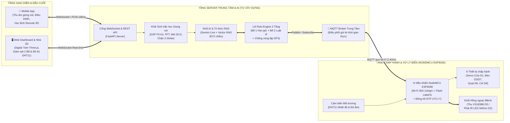
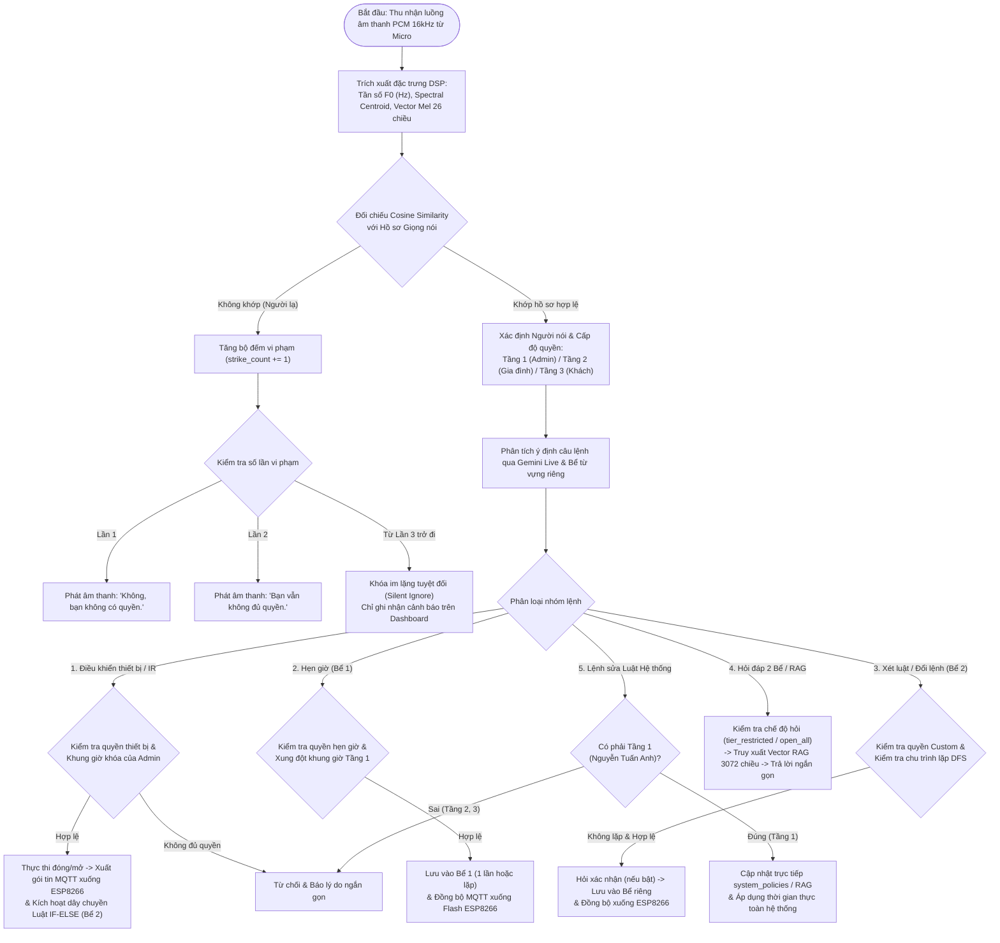
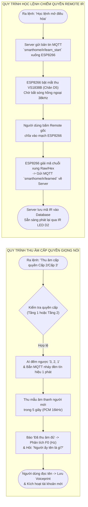
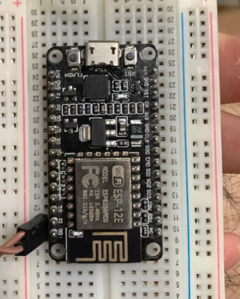

# CHƯƠNG 2. PHÂN TÍCH VÀ THIẾT KẾ HỆ THỐNG

## 2.1. Phân tích các chức năng của hệ thống

Để đáp ứng bài toán điều khiển nhà thông minh bằng giọng nói tự nhiên có phân quyền bảo mật nhiều lớp và khả năng mở rộng thiết bị không dây, hệ thống được thiết kế với **07 nhóm chức năng cốt lõi** dưới đây:

### 2.1.1. Chức năng Phân quyền Sinh trắc học Giọng nói 3 Tầng (3-Tier Voice RBAC)
Hệ thống chia người dùng trong gia đình thành 03 tầng quyền hạn chặt chẽ kèm cơ chế bảo vệ chống truy cập trái phép:

**Bảng 2.1. Ma trận phân quyền chức năng theo 3 tầng người dùng trong hệ thống**

| Nhóm chức năng | Tầng 1: Admin Tối Cao (Nguyễn Tuấn Anh) | Tầng 2: Thành Viên Gia Đình | Tầng 3: Cấp Khách | Người Lạ (Chưa cấp quyền) |
| :--- | :---: | :---: | :---: | :---: |
| **1. Đóng/mở, Bật/tắt 6 thiết bị cơ bản** | Toàn quyền 100% | Được phép (trừ thiết bị bị Cấp 1 khóa riêng) | Được phép gọi lệnh cố định (trừ thiết bị Cấp 1 cấm) | **Cấm tuyệt đối** (Chặn 2-Strike) |
| **2. Bể 1 — Đặt & Hủy lịch hẹn giờ** | Toàn quyền toàn nhà (Khung giờ ưu tiên tuyệt đối) | Được đặt/hủy lịch hẹn riêng (Không được đè/vướng khung giờ $\pm 30$ phút của Tầng 1) | Mặc định **Không được phép** *(Trừ khi Tầng 1 ra lệnh mở quyền)* | **Cấm tuyệt đối** |
| **3. Bể 2 — Đổi từ, Đổi khẩu lệnh & Đặt luật IF-ELSE** | Toàn quyền (Luật IF của Tầng 1 áp dụng ưu tiên toàn nhà) | Mỗi thành viên có **01 Bể lệnh riêng** độc lập (Không xung đột với luật Tầng 1) | Mặc định **Không được phép** *(Chỉ gọi lệnh cố định)* | **Cấm tuyệt đối** |
| **4. Thu âm cấp quyền & Hủy quyền giọng nói** | Được cấp/hủy quyền cho cả **Tầng 2** và **Tầng 3** | Chỉ được cấp/hủy quyền cho **Tầng 3** *(Không được hủy cùng cấp Tầng 2; Không được hủy người do Tầng 1 cấp)* | **Không được phép** cấp hoặc hủy quyền của bất kỳ ai | **Cấm tuyệt đối** |
| **5. Truy vấn thông tin 2 Bể & Kho tri thức RAG** | Được trả lời **100% mọi thông tin** trong hệ thống | Chỉ được trả lời thông tin thuộc phạm vi quyền và bể riêng của Cấp 2 *(hoặc mở toàn bộ nếu Cấp 1 cho phép)* | Chỉ được hỏi trạng thái đóng/mở thiết bị cơ bản *(hoặc mở toàn bộ nếu Cấp 1 cho phép)* | **Cấm tuyệt đối** |
| **6. Thực hiện 4 chế độ Reset hệ thống** | Reset toàn bộ hệ thống (`voice`, `timers`, `rules`, `all`) | Chỉ được Reset lịch hẹn và bể lệnh **của chính mình** *(Không chạm vào Tầng 1)* | **Không được phép** Reset | **Cấm tuyệt đối** |
| **7. Sửa quy tắc hệ thống & Dạy thêm RAG bằng giọng nói** | **Đặc quyền duy nhất của Tầng 1** (Sửa mọi luật phân quyền bằng giọng nói mà không cần sửa code) | **Không được phép** | **Không được phép** | **Cấm tuyệt đối** |

### 2.1.2. Chức năng Quản lý Bể 1 (Bể Hẹn Giờ Thông Minh)
- **Mặc định chạy 1 lần rồi tự dừng (`repeat = 'once'`):** Khi người dùng đặt hẹn giờ thông thường, hệ thống thực thi đúng 01 lần khi hết thời gian đếm ngược hoặc đến mốc giờ chỉ định, sau đó tự động xóa khỏi Bể 1.
- **Tự động nhận diện chu kỳ lặp:** Khi trong câu nói có các từ khóa *"hàng ngày" / "mỗi ngày"* (`daily`), *"hàng tuần"* (`weekly`), *"hàng giờ"* (`hourly`), *"hàng tháng"* (`monthly`), hệ thống tự động tái lập lịch sau mỗi chu kỳ.
- **Hỗ trợ 04 quy tắc thời gian tự nhiên:**
  1. Hẹn đếm ngược theo giây, phút, giờ (VD: *"10 giây nữa bật đèn phòng khách"*).
  2. Hẹn theo mốc giờ có chỉ rõ `AM` hoặc `PM` (VD: *"8:00 PM mở điều hòa"*).
  3. Hẹn theo mốc giờ chỉ nói con số mà không nói `AM/PM` (VD: *"8 giờ bật đèn"* $\rightarrow$ hệ thống tự động đặt cả hai mốc `8:00 AM` và `8:00 PM`).
  4. Hẹn kèm ngày/tháng cụ thể (VD: *"8:00 PM ngày 25/10 mở cửa chính"*).

### 2.1.3. Chức năng Quản lý Bể 2 (Bể Luật Động, Đổi Từ, Đổi Lệnh & Kiểm tra Đồ thị DFS)
- **Đổi từ vựng (`word_mappings`):** Cho phép gán từ đồng nghĩa cho thiết bị hoặc hành động (VD: gọi *"điều hòa"* là *"máy lạnh"*).
- **Đổi khẩu lệnh (`aliases`):** Cho phép gán một cụm từ bất kỳ để kích hoạt một hoặc nhiều thiết bị cùng lúc (VD: *"vừng ơi mở ra"* $\rightarrow$ mở cửa chính; *"chế độ đi ngủ"* $\rightarrow$ tắt đèn phòng khách và đóng cửa chính).
- **Luật liên động theo trạng thái `IF - THEN - ELSE` (`if_else_rules`):**
  - Hỗ trợ cả **luật 1 chiều** (VD: *"Nếu mở cửa chính thì mở điều hòa"* $\rightarrow$ khi đóng cửa chính, điều hòa vẫn giữ nguyên trạng thái đang bật) và **luật 2 chiều** (có nhánh *"ngược lại thì..."*).
  - Hỗ trợ **luật theo ngưỡng cảm biến môi trường** (VD: *"Nếu nhiệt độ phòng trên 30 độ thì mở điều hòa"*).
  - Tích hợp thuật toán **Duyệt đồ thị theo chiều sâu (Depth-First Search – DFS Cycle Detection)** để phát hiện và chặn ngay các luật gây vòng lặp vô hạn giữa các thiết bị (VD: Thiết bị A bật kéo theo Thiết bị B bật, Thiết bị B bật lại kéo theo Thiết bị A tắt).

### 2.1.4. Chức năng Thu âm Cấp quyền Giọng nói có Tín hiệu Phần cứng (`3-2-1` Nháy Đèn)
Khi Admin Cấp 1 (hoặc Thành viên Cấp 2) ra lệnh thu âm cấp quyền cho người mới:
1. Trợ lý ảo thông báo đếm ngược *"3, 2, 1"* và gửi lệnh xuống mạch **NodeMCU ESP8266** điều khiển **đèn tín hiệu nháy 01 lần** (bật rồi tắt) để báo hiệu bắt đầu thu âm.
2. Hệ thống mở luồng thu âm trong $5\text{ giây}$ (hoặc số giây do Admin Cấp 1 cấu hình).
3. Sau khi thu đủ mẫu âm thanh, hệ thống thông báo *"Đã thu âm đủ"*, tiến hành phân tích tần số cơ bản $F_0$ ($\text{Hz}$) và vector đặc trưng 26 chiều, thông báo kết quả phân tích và hỏi tên người được cấp quyền để lưu vào cơ sở dữ liệu.

### 2.1.5. Chức năng Học lệnh Hồng ngoại (IR Learning $38\text{ kHz}$) và Giám sát Cảm biến `DHT11`
- **Giám sát vi khí hậu:** Đọc liên tục Nhiệt độ ($^\circ\text{C}$) và Độ ẩm ($\%\text{RH}$) từ cảm biến `DHT11` gắn trên mạch ESP8266, cập nhật lên Web Dashboard, Mobile App và phục vụ truy vấn bằng giọng nói.
- **Chiếm quyền điều khiển Remote & Thêm thiết bị mới không cần dây:** Khi người dùng yêu cầu *"Học lệnh mở điều hòa"* hoặc *"Thêm thiết bị mới từ remote"*, mạch ESP8266 bật mắt thu `VS1838B` bắt chuỗi xung $38\text{ kHz}$ từ Remote thật, lưu mã xung vào bộ nhớ và cho phép điều khiển lại thiết bị đó bằng mắt phát `IR LED 940nm`.

---

## 2.2. Quy trình làm việc của hệ thống

### 2.2.1. Sơ đồ khối tổng thể và Quy trình vận hành chung

Hệ thống hoạt động theo kiến trúc 03 tầng kết nối chặt chẽ thông qua giao thức **MQTT** và **WebSocket** như thể hiện trên **Hình 2.1**:

*Hình 2.1. Sơ đồ khối kiến trúc tổng thể của hệ thống Nhà thông minh điều khiển bằng Giọng nói AI và MQTT.*

### 2.2.2. Lưu đồ quy trình xử lý lệnh giọng nói và Phân quyền 3 tầng

Khi có tín hiệu giọng nói từ người dùng, hệ thống xử lý tuần tự theo lưu đồ thuật toán trên **Hình 2.2**:

*Hình 2.2. Lưu đồ thuật toán xử lý tín hiệu giọng nói, xác thực sinh trắc học 3 tầng và thực thi mệnh lệnh.*

### 2.2.3. Lưu đồ quy trình Thu âm cấp quyền giọng nói (`3-2-1` Nháy đèn) và Học lệnh Hồng ngoại (IR Learning)

*Hình 2.3. Lưu đồ quy trình thu âm cấp quyền giọng nói có tín hiệu đèn phần cứng và quy trình học lệnh chiếm quyền Remote hồng ngoại.*

---

## 2.3. Xác định quy trình thiết kế hệ thống

Quy trình thiết kế tổng thể của đồ án được chia thành **02 nhánh thiết kế song song** (Thiết kế Phần cứng tại biên và Thiết kế Phần mềm 3 phân hệ) trước khi tích hợp thông qua giao thức MQTT:

### 2.3.1. Quy trình thiết kế Phần cứng trên Vi điều khiển NodeMCU ESP8266

*Hình 2.4. Bo mạch vi điều khiển trung tâm NodeMCU ESP8266 (module ESP-12E, giao tiếp CP2102) lắp đặt trên Breadboard thực nghiệm.*

Quy trình thiết kế phần cứng bao gồm **05 bước kỹ thuật**:
1. **Bước 1 – Khảo sát và lựa chọn vi điều khiển trung tâm:** Lựa chọn bo mạch **NodeMCU ESP8266 (ESP-12E)** có sẵn kết nối Wi-Fi $2.4\text{ GHz}$, bộ nhớ Flash $4\text{ MB}$ và mạch ổn áp nguồn $3.3\text{V}$ tích hợp.
2. **Bước 2 – Quy hoạch và phân bổ sơ đồ chân tín hiệu (Pinout Mapping):** Để tránh các chân nhạy cảm lúc khởi động (Boot Strapping Pins như `GPIO 0`, `GPIO 2`, `GPIO 15` cần đúng mức logic khi nạp/khởi động), các chân vào/ra được tính toán phân bổ tối ưu như trong **Bảng 2.2**.
3. **Bước 3 – Thiết kế khối thu thập cảm biến môi trường (`DHT11`):** Kết nối chân dữ liệu của cảm biến `DHT11` vào chân `D6` (`GPIO 12`) có điện trở kéo lên (Pull-up resistor $4.7\text{ k}\Omega\text{--}10\text{ k}\Omega$ lên nguồn $3.3\text{V}$).
4. **Bước 4 – Thiết kế khối Thu – Phát Hồng ngoại $38\text{ kHz}$:**
   - Mắt thu `VS1838B`: Chân `OUT` nối vào `D5` (`GPIO 14`), chân `VCC` nối $3.3\text{V}$, chân `GND` nối mass chung.
   - Mạch phát `IR LED 940nm`: Chân điều khiển từ `D2` (`GPIO 4`) qua điện trở hạn dòng kích cực gốc (Base) của Transistor NPN (`2N2222` hoặc `S8050`) để cấp dòng đỉnh lớn cho đèn LED hồng ngoại phát xa từ $3\text{--}5\text{ mét}$.
5. **Bước 5 – Thiết kế khối nguồn độc lập khi rút cáp khỏi máy tính:** Sử dụng nguồn một chiều ổn áp $5\text{V DC}$ (củ sạc hoặc pin dự phòng qua cổng Micro-USB hoặc cấp thẳng vào chân `Vin` và `GND`), kèm tụ lọc nguồn để tránh sụt áp (Brownout) khi module Wi-Fi phát công suất đỉnh ($\approx 170\text{--}250\text{ mA}$).

**Bảng 2.2. Bảng phân bổ chân tín hiệu (Pinout) trên vi điều khiển NodeMCU ESP8266**

| Ký hiệu trên Bo mạch | Chân Vi điều khiển | Chiều tín hiệu | Thiết bị / Khối chức năng kết nối | Chuẩn giao tiếp / Mức tín hiệu |
| :---: | :---: | :---: | :--- | :--- |
| **`D1`** | `GPIO 5` | Output | Động cơ `Servo SG90` điều khiển **Cửa chính (`main_door`)** | Xung điều rộng PWM ($50\text{ Hz}$, góc $0^\circ \leftrightarrow 90^\circ$) |
| **`D2`** | `GPIO 4` | Output | **Đèn phòng khách (`living_room_light`)** & Mạch phát **`IR LED 940nm`** | GPIO Digital Output / Sóng mang PWM $38\text{ kHz}$ |
| **`D5`** | `GPIO 14` | Input | Mắt thu hồng ngoại **`VS1838B`** (Học lệnh Remote điều hòa/quạt) | Giải mã chuỗi xung ngắt ngoài (External Interrupt) |
| **`D6`** | `GPIO 12` | In/Out | Cảm biến Nhiệt độ & Độ ẩm **`DHT11` / `DHT22`** + **Quạt (`fan`)** | Chuẩn giao tiếp số 1-Wire |
| **`D7`** | `GPIO 13` | Output | **Đèn phòng ngủ (`bedroom_light`)** / Relay Điều hòa | Mức logic Digital `HIGH (3.3V) / LOW (0V)` |
| **`D8` / `D0`** | `GPIO 15` / `16` | Output | **Còi báo động an ninh (`alarm_siren` - Buzzer 5V)** | Mức logic Digital Output |
| **`Vin` & `GND`** | `5V_IN` & `GND` | Power | Khối cấp nguồn độc lập $5\text{V DC}$ khi ngắt kết nối máy tính | Nguồn một chiều ổn áp $5\text{V} / 1\text{A}$ |

### 2.3.2. Quy trình thiết kế Phần mềm 3 phân hệ tự xây dựng (Không dùng Firebase/Supabase)

Quy trình thiết kế phần mềm được thực hiện theo phương pháp **Phân tách mô-đun (Modular Architecture)** gồm 05 giai đoạn:
1. **Giai đoạn 1 – Thiết kế Cơ sở dữ liệu nội bộ (Self-hosted Data Layer):** Thiết kế cấu trúc lưu trữ JSON/SQLite tại thư mục `simulator/data/` gồm 04 bảng dữ liệu: Cấu hình mặc định gốc (`factory_default_rules.json`), Cấu hình động 3 tầng & Bể lệnh riêng từng người (`custom_rules_overlay.json`), Hồ sơ sinh trắc học giọng nói (`voiceprints.json`), và Kho tri thức Vector RAG (`knowledge_base.json`).
2. **Giai đoạn 2 – Thiết kế Lõi xử lý Luật và Phân quyền (`SmartHomeEngine`):** Xây dựng máy trạng thái quản lý 6 thiết bị, bộ lập lịch bất đồng bộ (`asyncio` Timers) cho Bể 1, bộ kiểm tra chu trình đồ thị DFS cho Bể 2, và bộ kiểm tra phân quyền động (`system_policies`).
3. **Giai đoạn 3 – Thiết kế Tầng Truyền thông MQTT & WebSocket (`server.py`):** Xây dựng cầu nối hai chiều giữa luồng âm thanh `Gemini 3.8 Live`, các công cụ gọi hàm (Function Declarations) và bộ điều phối bản tin MQTT xuống vi điều khiển ESP8266.
4. **Giai đoạn 4 – Thiết kế Giao diện Web Dashboard & Mô hình Nhà 3D (`simulator/static/`):** Xây dựng bản sao số 3D của ngôi nhà bằng `Three.js` đồng bộ trực tiếp với bảng điều khiển 2 Bể, bảng phân quyền 3 tầng và đồ thị cảm biến.
5. **Giai đoạn 5 – Thiết kế Giao diện Mobile App (`mobile_app/`) & Firmware ESP8266 (`firmware_esp8266/`):** Tách biệt giao diện di động cầm tay và chương trình nhúng C++ nạp xuống vi điều khiển để đảm bảo hệ thống hoạt động trơn tru khi rút cáp khỏi máy tính.
