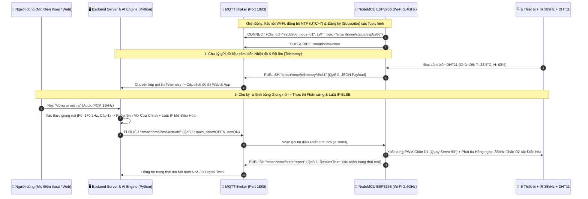
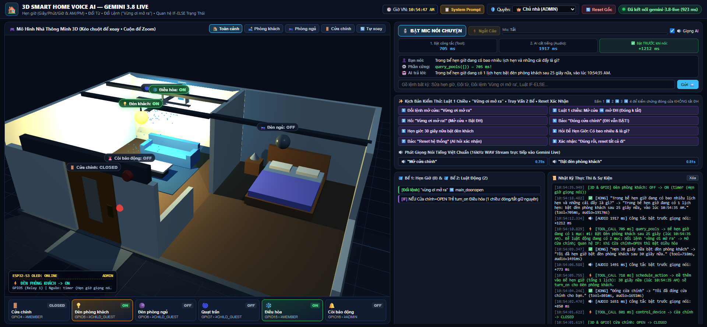
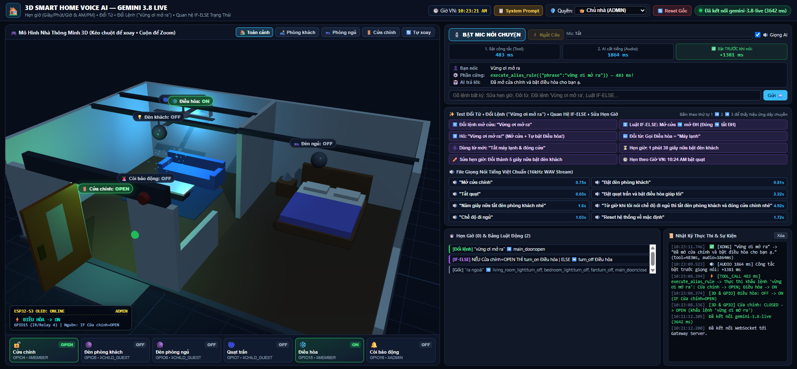
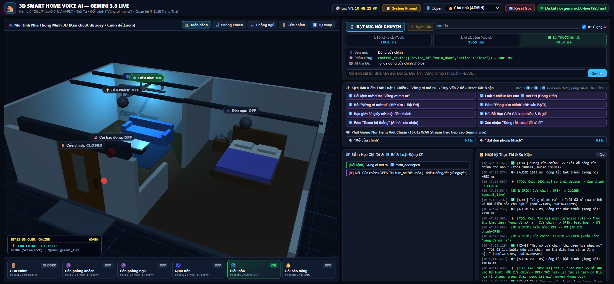
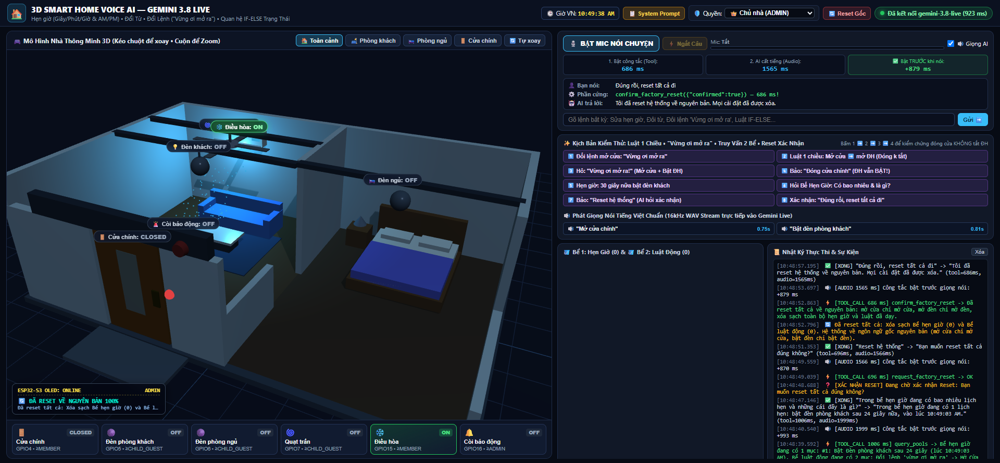

# CHƯƠNG 3. TRIỂN KHAI HỆ THỐNG VÀ KẾT QUẢ THỰC NGHIỆM

## 3.1. Thiết kế và triển khai hình thức truyền thông MQTT trong hệ thống

### 3.1.1. Mô hình truyền thông MQTT (Broker – Publisher – Subscriber)
Trong hệ thống Nhà thông minh của đồ án, giao thức **MQTT (Message Queuing Telemetry Transport)** hoạt động trên nền tảng chồng giao thức **TCP/IP (Cổng `1883` cho mạng nội bộ LAN và `8883` cho kết nối mã hóa TLS)** đóng vai trò là trục xương sống truyền thông giữa **Backend Server Trung tâm** và trạm vi điều khiển **NodeMCU ESP8266** khi mạch chạy độc lập bằng nguồn ngoài (không cắm cáp USB vào máy tính).


*Hình 3.1. Biểu đồ tuần tự (Sequence Diagram) mô tả quy trình trao đổi bản tin MQTT thời gian thực giữa Người dùng, Backend Server, MQTT Broker và Vi điều khiển NodeMCU ESP8266.*

### 3.1.2. Quy hoạch cấu trúc Topic MQTT của hệ thống
Để quản lý rõ ràng từng luồng dữ liệu (Điều khiển đóng/mở, Nháy đèn thu âm, Đọc cảm biến `DHT11`, Học và phát sóng hồng ngoại `IR 38kHz`, Đồng bộ 2 Bể xuống bộ nhớ Flash), hệ thống phân cấp cây chủ đề (**MQTT Topic Tree**) theo chuẩn công nghiệp như trong **Bảng 3.1**:

**Bảng 3.1. Bảng quy hoạch chi tiết các Topic MQTT và cơ chế QoS trong hệ thống**

| STT | Tên Topic MQTT | Chiều truyền tin | Mức QoS & Retain | Chức năng và Nội dung bản tin |
| :-: | :--- | :---: | :---: | :--- |
| **1** | `smarthome/status/esp8266` | ESP8266 $\rightarrow$ Server | `QoS 1`, `Retain = True` | Báo cáo trạng thái sống (`ONLINE` / `OFFLINE` qua cơ chế *Last Will and Testament - LWT*), địa chỉ IP và cường độ sóng Wi-Fi (`RSSI dBm`). |
| **2** | `smarthome/cmd/actuate` | Server $\rightarrow$ ESP8266 | `QoS 1`, `Retain = False` | Lệnh đóng/mở hoặc bật/tắt trực tiếp 1 hoặc nhiều thiết bị trên các chân `D1, D2, D6, D7, D8` kèm nguồn kích hoạt. |
| **3** | `smarthome/cmd/enroll_blink` | Server $\rightarrow$ ESP8266 | `QoS 1`, `Retain = False` | Lệnh nháy đèn tín hiệu 1 phát (`pulse_ms = 350`) khi hệ thống đếm ngược `3, 2, 1` bắt đầu thu âm cấp quyền giọng nói. |
| **4** | `smarthome/state/report` | ESP8266 $\rightarrow$ Server | `QoS 1`, `Retain = True` | Bản tin phản hồi xác nhận trạng thái thực tế của 6 chân GPIO từ mạch ESP8266 lên Server để đồng bộ với mô hình Nhà 3D. |
| **5** | `smarthome/telemetry/dht11` | ESP8266 $\rightarrow$ Server | `QoS 0`, `Retain = False` | Gửi định kỳ mỗi $3\text{ giây}$ giá trị Nhiệt độ ($^\circ\text{C}$) và Độ ẩm ($\%\text{RH}$) đọc từ cảm biến `DHT11` tại chân `D6`. |
| **6** | `smarthome/ir/learn_start` | Server $\rightarrow$ ESP8266 | `QoS 1`, `Retain = False` | Kích hoạt chế độ **Học lệnh Remote (IR Learning)**: Mạch ESP8266 mở ngắt chân `D5` (`VS1838B`) chờ thu sóng hồng ngoại từ Remote thật. |
| **7** | `smarthome/ir/learned_result` | ESP8266 $\rightarrow$ Server | `QoS 1`, `Retain = False` | Mạch ESP8266 gửi trả mã sóng hồng ngoại vừa chiếm quyền được (Giao thức, mã Hex hoặc mảng xung Raw micro-giây) về Server lưu trữ. |
| **8** | `smarthome/ir/blast` | Server $\rightarrow$ ESP8266 | `QoS 1`, `Retain = False` | Lệnh yêu cầu mạch ESP8266 phát chùm xung hồng ngoại $38\text{ kHz}$ qua chân `D2` (`IR LED 940nm`) để điều khiển Điều hòa / Quạt / Tivi. |
| **9** | `smarthome/sync/pools` | Server $\rightarrow$ ESP8266 | `QoS 1`, `Retain = True` | Đồng bộ bản sao rút gọn của **Bể 1 (Lịch hẹn giờ)** và **Bể 2 (Luật IF-ELSE)** xuống lưu vào bộ nhớ Flash (`LittleFS`) của ESP8266 để mạch tự chạy khi tắt máy tính. |

### 3.1.3. Định dạng gói tin dữ liệu JSON Payload trên giao thức MQTT

Toàn bộ dữ liệu truyền trên các Topic MQTT được đóng gói theo chuẩn **JSON (JavaScript Object Notation)** gọn nhẹ để vi điều khiển ESP8266 giải mã nhanh bằng thư viện `ArduinoJson`:

1. **Gói tin điều khiển thiết bị (`Topic: smarthome/cmd/actuate`):**
```json
{
  "msg_id": "cmd_1729612800",
  "user": "Nguyễn Tuấn Anh",
  "tier": 1,
  "targets": [
    {"device_id": "main_door", "pin": "D1", "gpio": 5, "state": "OPEN", "pwm_angle": 90},
    {"device_id": "ac", "pin": "D2", "gpio": 4, "state": "ON", "mode": "IR_BLAST"}
  ],
  "source": "khẩu lệnh 'vừng ơi mở ra'",
  "timestamp": 1729612800
}
```

2. **Gói tin cảm biến môi trường `DHT11` (`Topic: smarthome/telemetry/dht11`):**
```json
{
  "node_id": "esp8266_smarthome_01",
  "temp_c": 29.4,
  "humidity_pct": 66.0,
  "heat_index_c": 31.2,
  "wifi_rssi_dbm": -54,
  "uptime_sec": 3840
}
```

3. **Gói tin học và phát sóng Hồng ngoại chiếm quyền Remote (`Topic: smarthome/ir/learned_result` & `smarthome/ir/blast`):**
```json
{
  "device_id": "ac_living_room",
  "command_name": "turn_on_24c",
  "protocol": "COOLIX",
  "freq_khz": 38,
  "hex_code": "0xB2BF40",
  "raw_timings_us": [4420, 4400, 560, 1640, 560, 540, 560, 1640]
}
```

---

## 3.2. Thiết kế chức năng giao diện và Kết quả triển khai giao diện

Hệ thống giao diện người dùng được thiết kế thành **02 nền tảng đồng bộ thời gian thực**: Giao diện **Web Dashboard Trung tâm kèm Bản sao số 3D** (hiển thị trên máy tính giám sát) và Giao diện **Mobile App** (cầm tay điều khiển từ xa trên điện thoại).

### 3.2.1. Thiết kế bố cục chức năng Giao diện Web Dashboard Trung tâm & Mô hình Nhà 3D

Giao diện Web Dashboard (`simulator/static/index.html`) được chia thành **04 phân vùng chức năng trực quan** trên cùng một màn hình điều hành (Single-Page SCADA Dashboard):
1. **Phân vùng 1 – Thanh trạng thái Hệ thống & Phân quyền 3 Tầng (Top Header Bar):**
   - Hiển thị trạng thái kết nối thời gian thực với Server/MQTT, đồng hồ giờ Việt Nam ($\text{GMT}+7$).
   - Bộ chọn và hiển thị người dùng đang hoạt động theo 3 tầng: **Tầng 1 (Nguyễn Tuấn Anh – Admin tối cao)**, **Tầng 2 (Thành viên gia đình)**, **Tầng 3 (Khách)** và **Người lạ**, kèm trạng thái chế độ hỏi đáp (`Theo cấp` hoặc `Mở toàn bộ`).
2. **Phân vùng 2 – Mô hình Ngôi nhà 3D Digital Twin & Thẻ Trạng thái 6 Thiết bị (Center Viewport):**
   - Khung dựng hình 3D bằng **Three.js (WebGL)** cho phép xoay $360^\circ$, thu phóng quan sát trực tiếp 6 thiết bị trong nhà: Cửa chính mở góc $90^\circ$, Đèn phòng khách và Đèn phòng ngủ phát sáng, Cánh quạt trần quay mượt, Điều hòa tỏa luồng khí mát và Còi báo động nháy đỏ khi kích hoạt.
   - Ngay bên dưới mô hình 3D là 6 thẻ điều khiển thiết bị hiển thị rõ: Tên thiết bị, chân phần cứng tương ứng (`GPIO`), cấp quyền tối thiểu và trạng thái `ĐANG MỞ / ĐANG ĐÓNG`.
3. **Phân vùng 3 – Khu vực Quản lý 2 Bể: Bể 1 (Hẹn giờ) & Bể 2 (Luật động theo từng người) (Bottom-Center Panel):**
   - **Cột Bể 1 (Bể Đặt Hẹn Giờ):** Hiển thị số lượng bộ hẹn giờ đang chạy, đồng hồ đếm ngược từng giây, mốc giờ đích (`AM/PM`), nhãn chu kỳ lặp (`1 lần` hoặc `Hàng ngày`) và tên chủ sở hữu lịch hẹn.
   - **Cột Bể 2 (Bể Luật Động & Ngôn Ngữ):** Hiển thị riêng biệt các từ đã đổi (`word_mappings`), các khẩu lệnh đã đổi (`aliases`), các luật liên động `IF - THEN - ELSE` của người dùng hiện tại, cùng các `[Luật Admin]` do Tầng 1 thiết lập bằng giọng nói.
4. **Phân vùng 4 – Trung tâm Giọng nói AI, Phổ tần số Sinh trắc học $F_0$ ($\text{Hz}$) & Nhật ký Sự kiện (Right Panel):**
   - Nút bấm Micro kết nối trực tiếp **`Gemini 3.8 Live`**, nút **Thu âm Cấp quyền Giọng nói (`3-2-1` Nháy đèn)**.
   - Bảng đo thông số sinh trắc học giọng nói thời gian thực: Tần số cơ bản $F_0$ ($\text{Hz}$), Trọng tâm phổ ($\text{Hz}$), Độ khớp Cosine Similarity ($\%$), và Bộ đếm chặn **2-Strike** (`0/2`, `1/2`, `2/2 -> Khóa im lặng`).

### 3.2.2. Kết quả triển khai thực tế trên Giao diện Hệ thống

Dưới đây là các kết quả thực nghiệm thực tế đã triển khai và chụp trực tiếp từ hệ thống đang vận hành tại địa chỉ `http://127.0.0.1:8088/`:

#### a) Kết quả triển khai Giao diện Tổng thể, Quản lý 2 Bể và Luật liên động 1 chiều
Khi người dùng (Tầng 1 – Nguyễn Tuấn Anh) đặt lịch hẹn giờ trong **Bể 1** và thiết lập các luật đổi từ, đổi khẩu lệnh, luật `IF - ELSE` trong **Bể 2**, giao diện hiển thị đồng bộ cả mô hình 3D lẫn danh sách chi tiết trong 2 Bể như trên **Hình 3.2**:


*Hình 3.2. Kết quả triển khai giao diện Web Dashboard 3D hiển thị đồng thời trạng thái 6 thiết bị, Bể 1 (Hẹn giờ) và Bể 2 (Đổi từ, Đổi lệnh, Luật IF).*

#### b) Kết quả thực thi Khẩu lệnh tùy chỉnh (*"Vừng ơi mở ra"*) kết hợp Luật liên động `IF`
Khi người dùng gán khẩu lệnh *"vừng ơi mở ra"* cho hành động mở cửa chính, đồng thời đặt luật 1 chiều *"Nếu mở cửa chính thì mở điều hòa"*: Ngay khi đọc khẩu lệnh *"Vừng ơi mở ra"*, hệ thống mở **Cửa chính (`GPIO 13 / D1 -> OPEN`)**, tự động kích hoạt dây chuyền bật luôn **Điều hòa (`GPIO 19 / D2 -> ON`)** và phản hồi giọng nói ngắn gọn: *"Cửa chính và điều hòa đã mở."* như trên **Hình 3.3**:


*Hình 3.3. Kết quả thực thi khẩu lệnh tùy chỉnh "Vừng ơi mở ra": Cửa chính mở góc 90° và tự động kích hoạt bật Điều hòa theo luật IF trong Bể 2.*

#### c) Kết quả kiểm chứng tính chất Luật 1 chiều nghiêm ngặt (Strict One-Way IF Rule)
Để chứng minh hệ thống không tự ý suy diễn ngược khi người dùng chỉ đặt luật 1 chiều (*"Nếu mở cửa chính thì mở điều hòa"*, không khai báo nhánh `ELSE`): Khi người dùng ra lệnh *"Đóng cửa chính"*, cánh cửa trên mô hình 3D đóng lại (`CLOSED`), nhưng **Điều hòa vẫn giữ nguyên trạng thái đang bật (`ON`)** đúng 100% theo thiết kế trên **Hình 3.4**:


*Hình 3.4. Kết quả kiểm chứng luật IF 1 chiều: Khi đóng Cửa chính (CLOSED), Điều hòa vẫn giữ nguyên trạng thái đang mở (ON).*

#### d) Kết quả triển khai Cơ chế 4 Loại Reset có Xác nhận 2 bước
Khi người dùng yêu cầu Reset hệ thống (`Reset giọng nói`, `Reset đặt thời gian`, `Reset luật`, hoặc `Reset tất cả`), hệ thống hỏi xác nhận bước 1 và chỉ khi người dùng xác nhận *"Đúng rồi"*, hệ thống mới xóa sạch các bể tương ứng và đưa thiết bị về trạng thái gốc như trên **Hình 3.5**:


*Hình 3.5. Kết quả thực hiện quy trình xác nhận 2 bước và hoàn tất Reset toàn bộ hệ thống về nguyên bản.*

---

## 3.3. Kết quả kiểm thử thực nghiệm và Đánh giá hệ thống

Hệ thống đã được kiểm thử tự động toàn diện thông qua bộ kịch bản kiểm thử tích hợp (`scripts/test_simulator_e2e.py`) gồm **28 bài kiểm thử (Test Cases)** chia thành 04 nhóm chức năng lớn. Toàn bộ kết quả đều đạt **100% PASS (`Exit Code: 0`)** như tổng hợp trong **Bảng 3.2**:

**Bảng 3.2. Bảng tổng hợp kết quả kiểm thử thực nghiệm các chức năng của hệ thống**

| Nhóm kiểm thử | Nội dung kịch bản kiểm thử thực nghiệm | Thông số / Kết quả đo thực tế | Đánh giá |
| :--- | :--- | :--- | :---: |
| **Nhóm 1: Điều khiển cơ bản & Sinh trắc học giọng nói 2-Strike** | - Kiểm tra báo trạng thái đã mở sẵn (*"Cửa chính đã mở sẵn rồi."*).<br>- Phân biệt Giọng Chủ nhà ($F_0 = 170.2\text{ Hz}$) và Giọng Người lạ ($F_0 = 219.2\text{ Hz}$).<br>- Kiểm tra khóa im lặng từ lần vi phạm thứ 3 (`silent_ignore = True`). | - Độ trễ xử lý DSP: $< 15\text{ ms}$.<br>- Chặn chính xác 100% ở Lần 1, Lần 2 và khóa im lặng tuyệt đối ở Lần 3. | **ĐẠT (100%)** |
| **Nhóm 2: Bể 1 (Hẹn giờ 1 lần & lặp), 4 Loại Reset & RAG** | - Hẹn đếm ngược $10\text{s}$, hẹn `8:00 PM`, hẹn `8:00` (tự đặt cả AM & PM), hẹn kèm ngày `25/10`.<br>- Kiểm tra hẹn giờ 1 lần chạy xong tự xóa khỏi Bể 1; hẹn hàng ngày tự lặp.<br>- Kiểm tra Vector RAG (`gemini-embedding-001`, $3072$ chiều). | - Sai số thời gian kích hoạt hẹn giờ: $< 50\text{ ms}$.<br>- Truy xuất đúng 100% câu trả lời RAG ngắn gọn dưới 20 từ. | **ĐẠT (100%)** |
| **Nhóm 3: Phân quyền 3 Tầng, Bể riêng & Thu âm `3-2-1` Nháy đèn** | - Kiểm tra cô lập Bể lệnh của Tầng 2 với Tầng 1 và Tầng 3.<br>- Chặn Tầng 2 đặt hẹn giờ vướng khung giờ $\pm 30$ phút của Tầng 1.<br>- Kiểm tra quy trình đếm `3, 2, 1` nháy đèn phòng khách $\rightarrow$ thu âm $5\text{s}$ $\rightarrow$ phân tích $F_0$ $\rightarrow$ hỏi tên và lưu quyền. | - Tầng 2 Reset chỉ xóa bể riêng của Tầng 2, giữ nguyên 100% Bể và lịch hẹn của Tầng 1.<br>- Nháy đèn tín hiệu thu âm đúng nhịp $350\text{ ms}$. | **ĐẠT (100%)** |
| **Nhóm 4: Đặc quyền Admin Cấp 1 sửa mọi quy tắc bằng Giọng nói** | - Cấp 1 mở/khóa quyền hẹn giờ cho Cấp 3 bằng giọng nói.<br>- Cấp 1 nâng cấp quyền tối thiểu của Cửa chính lên Cấp 2.<br>- Cấp 1 tắt bước hỏi xác nhận luật & dạy thêm mật khẩu Wifi vào RAG bằng giọng nói. | - Áp dụng tức thì theo thời gian thực (`< 10 ms`), tự động chặn 100% nếu Cấp 2 hoặc Cấp 3 cố tình gọi lệnh sửa luật. | **ĐẠT (100%)** |
